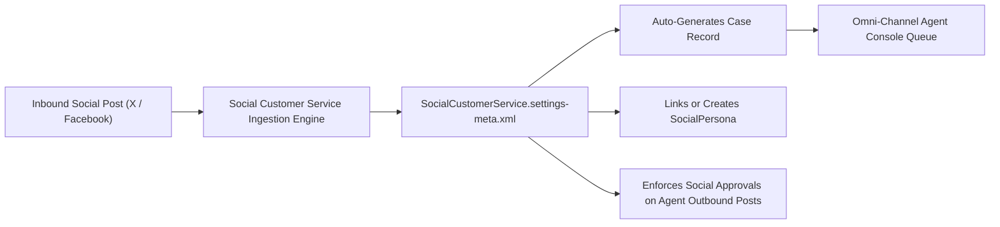

## Architectural Overview

`SocialCustomerServiceSettings` manages the platform-level configuration for **Social Customer Service**, Salesforce's capability for turning customer social media interactions (such as messages, mentions, and posts on X/Twitter, Facebook, YouTube, and Instagram) into actionable CRM `Case` and `SocialPost` records.

In modern omnichannel contact centers, social care operations must balance rapid SLA responses with strict brand protection. Architecturally, `SocialCustomerServiceSettings` controls inbound case generation rules, case subject line formats, social persona association, and whether outgoing social responses from support agents must pass through an automated `ApprovalProcess` before being published to external networks.



## Directory and File Conventions

In SFDX source format, `SocialCustomerServiceSettings` is stored in the `settings` directory under the filename `SocialCustomerService.settings-meta.xml`.

| Property | Value |
| :--- | :--- |
| **Metadata Type Name** | `Settings` (member: `SocialCustomerService`) or `SocialCustomerServiceSettings` |
| **SFDX Storage Folder** | `force-app/main/default/settings/` |
| **File Name** | `SocialCustomerService.settings-meta.xml` |
| **Scratch Org Setting Key** | `socialCustomerServiceSettings` |

## Key Metadata Fields

The `SocialCustomerServiceSettings` schema defines the operational rules governing social case generation:

| Field Name | Field Type | Required | Architectural Description |
| :--- | :--- | :--- | :--- |
| `enableSocialCustomerService` | `boolean` | No | Master toggle enabling Social Customer Service across the Salesforce instance. |
| `caseSubjectOption` | `string` | No | Formatting style for generated case subjects (e.g. `SocialPostContent`, `BuildSubject`). |
| `enableSocialApprovals` | `boolean` | No | Enforces an approval workflow before an agent's social reply is published externally. |
| `enableSocialPersonaHistoryTracking` | `boolean` | No | Enables field history tracking on the `SocialPersona` standard entity. |
| `enableSocialPostHistoryTracking` | `boolean` | No | Enables field history tracking on the `SocialPost` standard entity. |

> [!NOTE]
> Connecting live social accounts (e.g., corporate X handles or Facebook pages) requires an authenticated administrator OAuth handshake in the Setup UI, but all underlying routing and policy infrastructure is governed by this metadata.

## Declarative XML and Package Manifest Examples

Below is an enterprise XML configuration enforcing social post approvals and history tracking:

```xml title="force-app/main/default/settings/SocialCustomerService.settings-meta.xml"
<?xml version="1.0" encoding="UTF-8"?>
<SocialCustomerServiceSettings xmlns="http://soap.sforce.com/2006/04/metadata">
    <caseSubjectOption>SocialPostContent</caseSubjectOption>
    <enableSocialApprovals>true</enableSocialApprovals>
    <enableSocialCustomerService>true</enableSocialCustomerService>
    <enableSocialPersonaHistoryTracking>true</enableSocialPersonaHistoryTracking>
    <enableSocialPostHistoryTracking>true</enableSocialPostHistoryTracking>
</SocialCustomerServiceSettings>
```

### Manifest Definition (`package.xml`)

```xml title="manifest/package.xml"
<?xml version="1.0" encoding="UTF-8"?>
<Package xmlns="http://soap.sforce.com/2006/04/metadata">
    <types>
        <members>SocialCustomerService</members>
        <name>Settings</name>
    </types>
    <version>68.0</version>
</Package>
```

## Retrieval and Deployment

To retrieve or deploy `SocialCustomerServiceSettings` using the Salesforce CLI:

```bash
# Retrieve Social Customer Service settings
sf project retrieve start --metadata "Settings:SocialCustomerService"

# Deploy Social Customer Service settings
sf project deploy start --metadata "Settings:SocialCustomerService"
```

## Senior Architect Deployment Best Practices and Gotchas

1. **Licensing and Feature Enablement**: Target orgs must have Service Cloud entitlements and social customer service features enabled. Verify scratch org feature definitions include `ServiceCloud` before deployment.
2. **Custom Apex Social Handler**: If implementing a custom Apex social intake class (`Social.InboundSocialPostHandler`), ensure the Apex class is deployed alongside this setting to prevent case generation failures.
3. **Approval Process Coupling**: When setting `enableSocialApprovals` to `true`, ensure that an active `ApprovalProcess` on `SocialPost` is deployed; otherwise, agents will encounter runtime errors when submitting responses.
4. **Data Volume and Retention**: High-frequency social campaigns can generate millions of `SocialPost` records rapidly. Architect an automated archival or purge strategy using Big Objects or Scheduled Apex to manage storage consumption.

> [!TIP]
> Use `caseSubjectOption` set to `SocialPostContent` so service agents can quickly assess customer inquiry sentiment from case list views and notifications without opening individual records.
