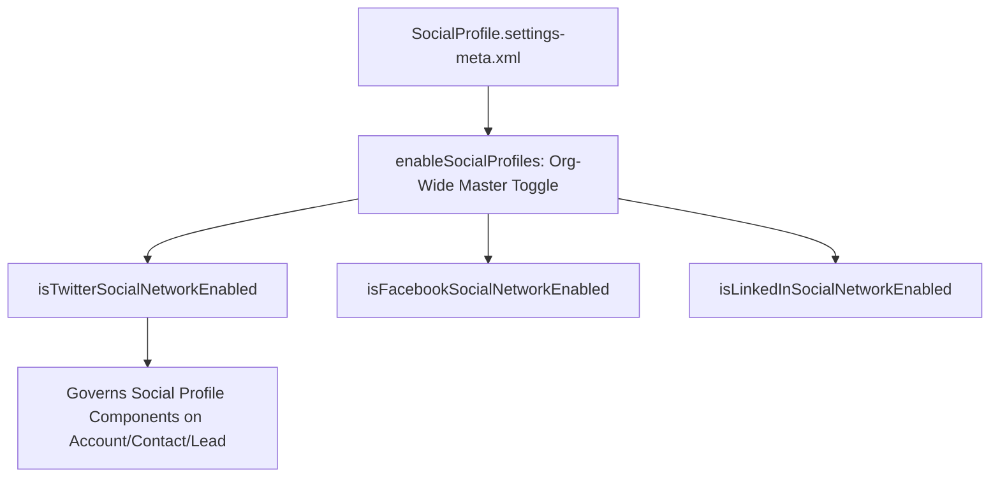

## Architectural Overview

`SocialProfileSettings` manages the platform-wide configuration for the legacy **Social Accounts, Contacts, and Leads** feature in Salesforce. This capability allows sales representatives and customer-facing teams to link Twitter (X), LinkedIn, Facebook, and YouTube social profiles directly to standard CRM records, enabling reps to view public updates, recent posts, and shared corporate networks inside record pages.

From an enterprise governance and data privacy perspective, `SocialProfileSettings` controls which external social networks can be accessed from Salesforce and whether the feature is enabled across the organization. In highly regulated industries (such as financial advisory, defense, or healthcare), compliance officers frequently require disabling external social network integrations across all sandboxes and production orgs to adhere to strict communication governance standards.



## Directory and File Conventions

In SFDX source format, `SocialProfileSettings` is stored in the `settings` directory under the filename `SocialProfile.settings-meta.xml`.

| Property | Value |
| :--- | :--- |
| **Metadata Type Name** | `Settings` (member: `SocialProfile`) or `SocialProfileSettings` |
| **SFDX Storage Folder** | `force-app/main/default/settings/` |
| **File Name** | `SocialProfile.settings-meta.xml` |
| **Scratch Org Setting Key** | `socialProfileSettings` |

## Key Metadata Fields

The `SocialProfileSettings` XML schema exposes toggles for individual social networks:

| Field Name | Field Type | Required | Architectural Description |
| :--- | :--- | :--- | :--- |
| `enableSocialProfiles` | `boolean` | No | Master toggle enabling Social Accounts, Contacts, and Leads in the organization. |
| `isFacebookSocialNetworkEnabled` | `boolean` | No | Enables Facebook profile search and association on CRM records. |
| `isLinkedInSocialNetworkEnabled` | `boolean` | No | Enables LinkedIn company and profile views on CRM records. |
| `isTwitterSocialNetworkEnabled` | `boolean` | No | Enables Twitter (X) handle and tweet feed views on CRM records. |
| `isYouTubeSocialNetworkEnabled` | `boolean` | No | Enables YouTube channel views on Account records. |

> [!NOTE]
> Viewing social profiles requires individual Salesforce users to log in with their own personal or corporate social network accounts; credentials are not shared across org users.

## Declarative XML and Package Manifest Examples

Below is a declarative XML configuration enabling Social Profiles selectively for professional networks:

```xml title="force-app/main/default/settings/SocialProfile.settings-meta.xml"
<?xml version="1.0" encoding="UTF-8"?>
<SocialProfileSettings xmlns="http://soap.sforce.com/2006/04/metadata">
    <enableSocialProfiles>true</enableSocialProfiles>
    <isFacebookSocialNetworkEnabled>false</isFacebookSocialNetworkEnabled>
    <isLinkedInSocialNetworkEnabled>true</isLinkedInSocialNetworkEnabled>
    <isTwitterSocialNetworkEnabled>true</isTwitterSocialNetworkEnabled>
    <isYouTubeSocialNetworkEnabled>false</isYouTubeSocialNetworkEnabled>
</SocialProfileSettings>
```

### Manifest Definition (`package.xml`)

```xml title="manifest/package.xml"
<?xml version="1.0" encoding="UTF-8"?>
<Package xmlns="http://soap.sforce.com/2006/04/metadata">
    <types>
        <members>SocialProfile</members>
        <name>Settings</name>
    </types>
    <version>68.0</version>
</Package>
```

## Retrieval and Deployment

Use the Salesforce CLI to retrieve and deploy `SocialProfileSettings`:

```bash
# Retrieve Social Profile settings
sf project retrieve start --metadata "Settings:SocialProfile"

# Deploy Social Profile settings
sf project deploy start --metadata "Settings:SocialProfile"
```

## Senior Architect Deployment Best Practices and Gotchas

1. **Compliance Hardening**: In enterprise environments with FINRA or SEC oversight, set `enableSocialProfiles` to `false` in version control to ensure social widgets cannot be activated in any environment.
2. **Third-Party API Deprecations**: External social network APIs change frequently. Features like Facebook or LinkedIn direct feed integration may have diminished capabilities depending on current platform partnerships.
3. **Record Layout Placement**: Toggling settings on does not automatically place social viewer components onto Lightning Record Pages. FlexiPages must be updated to include the Social Profile Lightning Component.
4. **Data Isolation**: Viewing a social profile does not save social posts into Salesforce data storage; only public profile metadata and verified handles are linked to the record.

> [!TIP]
> Audit user permissions under `Profile` or `PermissionSet` to ensure only certified sales reps have the "Social Accounts, Contacts, and Leads" user permission enabled.
