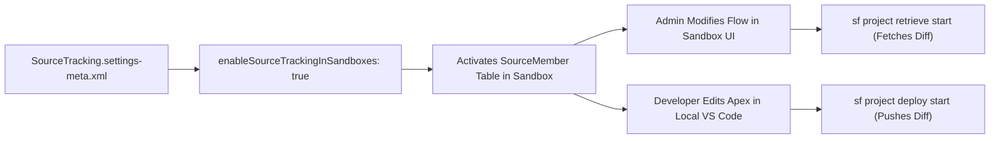

## Architectural Overview

`SourceTrackingSettings` is a game-changing DevOps metadata configuration that enables **Source Tracking in Developer and Developer Pro Sandboxes**. Historically, automated bidirectional change detection (tracking local edits against remote org changes) was exclusive to temporary scratch orgs. With source tracking enabled in persistent sandboxes, developers and administrators can build declaratively in the Setup UI while using the Salesforce CLI to retrieve only modified components automatically.

Architecturally, `SourceTrackingSettings` activates shadow change-tracking tables (`SourceMember`) inside the sandbox database. Every declarative change—such as creating a custom field, tweaking a flow, or adjusting a page layout—generates a timestamped `SourceMember` entry. When developers execute `sf project retrieve start`, the CLI compares local timestamps against remote `SourceMember` records, synchronizing only changed files without requiring manual `package.xml` authoring.



## Directory and File Conventions

In SFDX source format, `SourceTrackingSettings` is stored in the `settings` directory under the filename `SourceTracking.settings-meta.xml`.

| Property | Value |
| :--- | :--- |
| **Metadata Type Name** | `Settings` (member: `SourceTracking`) or `SourceTrackingSettings` |
| **SFDX Storage Folder** | `force-app/main/default/settings/` |
| **File Name** | `SourceTracking.settings-meta.xml` |
| **Scratch Org Setting Key** | `sourceTrackingSettings` |

## Key Metadata Fields

The `SourceTrackingSettings` schema exposes the primary sandbox tracking flag:

| Field Name | Field Type | Required | Architectural Description |
| :--- | :--- | :--- | :--- |
| `enableSourceTrackingInSandboxes` | `boolean` | No | Enables the `SourceMember` tracking subsystem in Developer and Developer Pro sandboxes. |

> [!NOTE]
> Scratch orgs always have source tracking enabled natively. This setting specifically controls source tracking behavior in persistent Developer and Developer Pro sandboxes created from Production.

## Declarative XML and Package Manifest Examples

Below is a declarative XML configuration enabling sandbox source tracking for enterprise DevOps pipelines:

```xml title="force-app/main/default/settings/SourceTracking.settings-meta.xml"
<?xml version="1.0" encoding="UTF-8"?>
<SourceTrackingSettings xmlns="http://soap.sforce.com/2006/04/metadata">
    <enableSourceTrackingInSandboxes>true</enableSourceTrackingInSandboxes>
</SourceTrackingSettings>
```

### Manifest Definition (`package.xml`)

```xml title="manifest/package.xml"
<?xml version="1.0" encoding="UTF-8"?>
<Package xmlns="http://soap.sforce.com/2006/04/metadata">
    <types>
        <members>SourceTracking</members>
        <name>Settings</name>
    </types>
    <version>68.0</version>
</Package>
```

## Retrieval and Deployment

Use the Salesforce CLI to deploy and manage `SourceTrackingSettings`:

```bash
# Retrieve Source Tracking settings
sf project retrieve start --metadata "Settings:SourceTracking"

# Deploy Source Tracking settings to sandbox or production
sf project deploy start --metadata "Settings:SourceTracking"
```

## Senior Architect Deployment Best Practices and Gotchas

1. **Deploy to Production for Inherited Sandboxes**: Deploy `SourceTracking.settings-meta.xml` into your Production environment so all newly refreshed Developer and Developer Pro sandboxes inherit source tracking automatically.
2. **Handling Tracking Desynchronization**: If multiple developers work concurrently in the same sandbox or if large bulk package deployments occur, local tracking can become desynchronized. Run `sf project reset tracking` to clear local tracking state and realign with the remote org.
3. **Partial Copy and Full Sandboxes**: Source tracking is designed for lightweight development in Developer and Developer Pro sandboxes. It is not supported in Partial Copy or Full Sandboxes due to high metadata and data indexing volumes.
4. **Performance with Large Metadata Repositories**: In monolithic orgs with tens of thousands of custom fields and apex classes, initial tracking queries against `SourceMember` can take several seconds. Structure projects using multiple package directories (`sfdx-project.json`) to scope tracking efficiently.

> [!TIP]
> Combine source tracking in developer sandboxes with Git feature branch workflows. Developers can experiment declaratively in the sandbox UI, run `sf project retrieve start`, review git diffs locally, and submit clean pull requests.
