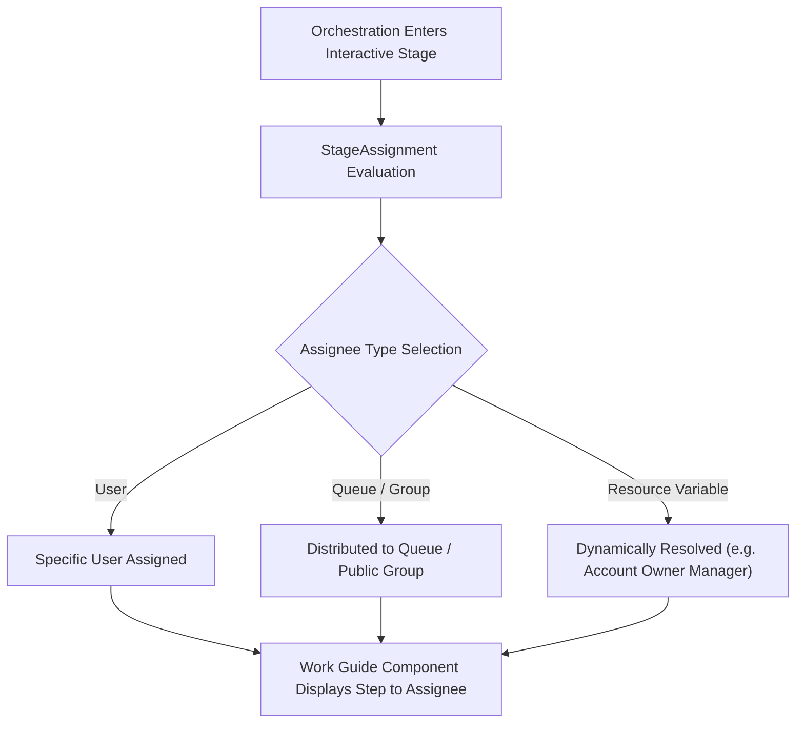

## Architectural Overview

`StageAssignment` is an essential sub-type and orchestration routing component within **Flow Orchestrator**, Salesforce's enterprise workflow engine designed for complex, multi-user, multi-stage business processes. While standard Salesforce Flows execute sequentially within an immediate user context or automated transaction, Flow Orchestrator coordinates long-running journeys spanning days or weeks across distinct departments.

In an orchestrated workflow, each interactive step within a stage requires human intervention—such as an approval, legal review, or manual data entry. `StageAssignment` defines the assignee binding rules: designating whether an interactive step is assigned to a specific user, a public group, a support queue, or a dynamic resource evaluated at runtime (such as the record owner's manager).



## Directory and File Conventions

`StageAssignment` is not a standalone top-level metadata file; it is declared within parent `Flow` metadata XML files (specifically flows with `processType` set to `Orchestrator` or `OrchestratedFlow`).

| Property | Value |
| :--- | :--- |
| **Metadata Subtype Name** | `StageAssignment` (Child of `Flow`) |
| **Parent Metadata Type** | `Flow` |
| **SFDX Storage Folder** | `force-app/main/default/flows/` |
| **Parent File Suffix** | `.flow-meta.xml` |
| **XML Element Name** | `<stageAssignments>` |

## Key Metadata Fields

The `StageAssignment` XML block contains properties that resolve the target assignee entity:

| Field Name | Field Type | Required | Architectural Description |
| :--- | :--- | :--- | :--- |
| `assignee` | `FlowElementReferenceOrValue` | Yes | The user ID, queue name, public group, or dynamic flow variable receiving the assignment. |
| `assigneeType` | `string` | Yes | Type of assignee: `User`, `Group`, `Queue`, or `Resource`. |
| `recordId` | `FlowElementReferenceOrValue` | No | ID of the context record associated with the interactive step. |

### Assignee Types in Flow Orchestrator

- **User**: Static user reference (avoid hardcoding in metadata; prefer dynamic user resolution).
- **Group**: Developer name of a Public Group whose members are eligible to complete the step.
- **Queue**: Developer name of a standard or custom Queue.
- **Resource**: A flow formula, variable, or record field resolved at runtime (e.g., `{!$Record.Owner:User.ManagerId}`).

> [!NOTE]
> When an interactive step assigned via `StageAssignment` completes, Flow Orchestrator automatically progresses to the next step or advances the orchestration stage based on exit conditions.

## Declarative XML and Package Manifest Examples

Below is an excerpt of an Orchestration Flow definition assigning an interactive step to a Finance Queue:

```xml title="force-app/main/default/flows/Invoice_Approval_Orchestration.flow-meta.xml"
<?xml version="1.0" encoding="UTF-8"?>
<Flow xmlns="http://soap.sforce.com/2006/04/metadata">
    <apiVersion>68.0</apiVersion>
    <processType>Orchestrator</processType>
    <status>Active</status>
    <orchestratedStages>
        <name>Finance_Review_Stage</name>
        <label>Finance Review Stage</label>
        <stageSteps>
            <name>Review_Discounts_Step</name>
            <actionName>Review_Discounts_Screen_Flow</actionName>
            <actionType>stepInteractive</actionType>
            <entryConditionLogic>and</entryConditionLogic>
            <label>Review Discounts Step</label>
            <stageAssignments>
                <assignee>
                    <stringValue>Finance_Approvers_Queue</stringValue>
                </assignee>
                <assigneeType>Queue</assigneeType>
            </stageAssignments>
        </stageSteps>
    </orchestratedStages>
</Flow>
```

### Manifest Definition (`package.xml`)

Because `StageAssignment` is encapsulated within `Flow`, the deployment manifest specifies the parent Flow:

```xml title="manifest/package.xml"
<?xml version="1.0" encoding="UTF-8"?>
<Package xmlns="http://soap.sforce.com/2006/04/metadata">
    <types>
        <members>Invoice_Approval_Orchestration</members>
        <members>Review_Discounts_Screen_Flow</members>
        <name>Flow</name>
    </types>
    <types>
        <members>Finance_Approvers_Queue</members>
        <name>Queue</name>
    </types>
    <version>68.0</version>
</Package>
```

## Retrieval and Deployment

Use the Salesforce CLI to retrieve and deploy Orchestration flows containing stage assignments:

```bash
# Retrieve Orchestration Flow and child Screen Flows
sf project retrieve start --metadata "Flow:Invoice_Approval_Orchestration,Flow:Review_Discounts_Screen_Flow"

# Deploy Orchestration Flow
sf project deploy start --metadata "Flow:Invoice_Approval_Orchestration"
```

## Senior Architect Deployment Best Practices and Gotchas

1. **Avoid Hardcoded User Assignees**: Never assign interactive steps to static User IDs or usernames. User IDs differ across environments, causing deployment failures. Always assign to Queues, Groups, or runtime `Resource` variables.
2. **Child Screen Flow Dependencies**: An interactive orchestration step references a child Screen Flow (`actionName`). The child Screen Flow must be deployed and active before or during deployment of the Orchestrator.
3. **Queue and Group Pre-requisites**: When assigning steps to a `Queue` or `Group`, ensure the queue object associations and memberships are deployed in the same package.
4. **Work Guide Component Placement**: Assignees must have access to the Flow Orchestrator Work Guide component on their Lightning Record Pages or Experience Cloud site to view and complete assigned interactive steps.

> [!TIP]
> Use dynamic `Resource` assignment targeting user manager lookups (e.g. `{!$Record.Owner.ManagerId}`) to build flexible escalation paths that adapt automatically to organizational changes.
