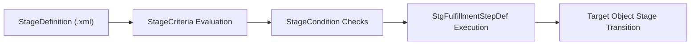

## Architectural Overview

The `StageDefinition` metadata type represents the declarative configuration of discrete business phases, transition gates, and step fulfillments within Salesforce **Stage Management**. As enterprise processes expand across multi-user, multi-departmental lifecycles—such as loan approvals, patient intake workflows, complex order deliveries, and claims assessments—architects need a resilient mechanism to decouple stage progression logic from hardcoded Apex triggers or monolithic validation rules.

`StageDefinition` models a finite state machine directly within the platform metadata layer. Each stage definition contains entry criteria, exit conditions, automated validation evaluations (`StageCriteria`), and required fulfillment steps (`StgFulfillmentStepDef`). This metadata abstraction enables continuous delivery teams to deploy versioned lifecycle state changes across environments without risking manual discrepancies or runtime data inconsistencies.



## Directory and File Conventions

In SFDX source format, `StageDefinition` metadata components are organized within the `stageDefinitions` directory.

| Property | Value |
| :--- | :--- |
| **Metadata Type Name** | `StageDefinition` |
| **SFDX Folder** | `force-app/main/default/stageDefinitions/` |
| **File Suffix** | `.stageDefinition-meta.xml` |
| **Wildcard Support (`*`)** | Not supported (explicit members required in `package.xml`) |

## Key Metadata Fields

A `StageDefinition` file encapsulates the configuration parameters, conditions, and transition steps governing a process phase:

| Field Name | Field Type | Required | Architectural Description |
| :--- | :--- | :--- | :--- |
| `fullName` | `string` | Yes | Unique API name of the stage definition component. |
| `masterLabel` | `string` | Yes | Human-readable label displayed in Setup and monitoring consoles. |
| `description` | `string` | No | Operational narrative detailing the scope and prerequisites of this stage. |
| `stageConditions` | `StageCondition[]` | No | Conditions that must evaluate to true before entry or exit can occur. |
| `stageCriteria` | `StageCriteria[]` | No | Granular rule expressions validating record fields and related records. |
| `stageTransitions` | `StageTransition[]` | No | Allowable forward or backward destination stages permissible from this state. |
| `stageValues` | `StageValue[]` | No | Field mutations and status picklist values stamped upon entry or completion. |
| `stgFulfillmentStepDefs` | `StgFulfillmentStepDef[]` | No | Child fulfillment action definitions required before progressing beyond the stage. |

> [!NOTE]
> `StageDefinition` components extend standard platform metadata and require API version 62.0 or higher. Always verify that Stage Management features are provisioned in your target scratch org or sandbox.

## Declarative XML and Package Manifest Examples

Below is an enterprise `StageDefinition` configuring an Underwriting Review stage with fulfillment requirements and allowed next transitions:

```xml title="force-app/main/default/stageDefinitions/Underwriting_Review.stageDefinition-meta.xml"
<?xml version="1.0" encoding="UTF-8"?>
<StageDefinition xmlns="http://soap.sforce.com/2006/04/metadata">
    <fullName>Underwriting_Review</fullName>
    <masterLabel>Underwriting Review</masterLabel>
    <description>Mandatory financial risk analysis stage before loan commitment generation.</description>
    <stageConditions>
        <conditionName>CreditReportGenerated</conditionName>
        <isMetOnCompletion>true</isMetOnCompletion>
    </stageConditions>
    <stageCriteria>
        <criteriaExpression>LoanAmount__c &gt; 50000 &amp;&amp; CreditScore__c &gt;= 680</criteriaExpression>
        <name>RiskProfileValidation</name>
    </stageCriteria>
    <stageTransitions>
        <destinationStage>Commitment_Issued</destinationStage>
        <isAutomatic>false</isAutomatic>
    </stageTransitions>
    <stageTransitions>
        <destinationStage>Application_Rejected</destinationStage>
        <isAutomatic>false</isAutomatic>
    </stageTransitions>
</StageDefinition>
```

To package and deploy this component, specify each member explicitly in your manifest:

```xml title="manifest/package.xml"
<?xml version="1.0" encoding="UTF-8"?>
<Package xmlns="http://soap.sforce.com/2006/04/metadata">
    <types>
        <members>Underwriting_Review</members>
        <name>StageDefinition</name>
    </types>
    <version>68.0</version>
</Package>
```

## Retrieval and Deployment

Use the Salesforce CLI to retrieve and deploy `StageDefinition` records:

```bash
# Retrieve specific StageDefinition component by API name
sf project retrieve start --metadata "StageDefinition:Underwriting_Review"

# Deploy StageDefinition components to target environment
sf project deploy start --metadata "StageDefinition:Underwriting_Review" --target-org staging-sandbox

# Inspect available stage definitions via SOQL
sf data query --query "SELECT Id, DeveloperName, MasterLabel FROM StageDefinition" --use-tooling-api
```

## Senior Architect Considerations

> [!TIP]
> Treat `StageDefinition` components as version-controlled state machines. Maintain strict boundary contracts between stage definitions, and avoid circular transition paths unless explicit fallback mechanisms are defined and tested.

1. **Dependency Sequencing:** Because `stageTransitions` reference other `StageDefinition` API names (`destinationStage`), multi-stage lifecycle pipelines must be deployed simultaneously or sequenced carefully to prevent unresolvable metadata reference errors.
2. **Orchestration Integration:** Combine `StageDefinition` with [Flow](/docs/metadata/flow-metadata-type/) orchestrators to coordinate asynchronous tasks across distributed workers while preserving state persistence.
3. **Data Model Alignment:** Ensure referenced custom fields in `stageCriteria` exist in target environments prior to deployment to avoid packaging validation failures.
