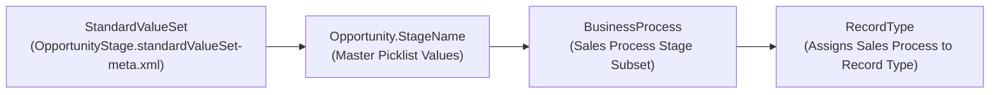

The `StandardValueSet` metadata type represents the set of values for a **standard Salesforce picklist field** (such as `Account.Type`, `Opportunity.StageName`, `Case.Status`, or `Lead.Status`). Introduced in API version 38.0, `StandardValueSet` separates standard picklist values from the `CustomField` metadata file so teams can version-control stage probabilities, closed statuses, and lead conversion states cleanly.

In Salesforce DX projects, standard value sets are stored in `force-app/main/default/standardValueSets/` with the `.standardValueSet-meta.xml` suffix.



## Common `StandardValueSet` Member Names

Because `StandardValueSet` **does not support the `*` wildcard** in `package.xml`, you must reference the exact `StandardValueSet` name rather than the `Object.Field` API name:

| Standard Object.Field | `StandardValueSet` Member Name | Special `standardValue` Attributes |
|---|---|---|
| `Account.Type` | `AccountType` | Standard `fullName`, `default`, `label` |
| `Account.Industry` | `Industry` | Shared by `Account.Industry` and `Lead.Industry` |
| `Lead.LeadSource` | `LeadSource` | Shared across `Lead`, `Contact`, and `Opportunity.LeadSource` |
| `Lead.Status` | `LeadStatus` | Requires `<converted>true|false</converted>` |
| `Case.Status` | `CaseStatus` | Requires `<closed>true|false</closed>` |
| `Case.Origin` | `CaseOrigin` | Standard `fullName`, `default`, `label` |
| `Opportunity.StageName` | `OpportunityStage` | Requires `<closed>`, `<won>`, `<probability>`, and `<forecastCategory>` |
| `Task.Status` | `TaskStatus` | Requires `<closed>true|false</closed>` |
| `CampaignMember.Status` | `CampaignMemberStatus` | Standard `fullName`, `default`, `label` |

## Key Fields on `StandardValueSet` and `StandardValue`

| Field | Location | Required | Description |
|---|---|---|---|
| `sorted` | Root | Yes | Whether values are sorted alphabetically (`true`) or in declaration order (`false`) |
| `groupingStringEnum` | Root | No | Grouping enum used by `StatusGroup` standard value sets |
| `fullName` | `standardValue` | Yes | API name of the picklist option |
| `label` | `standardValue` | No | Display label of the picklist option |
| `default` | `standardValue` | Yes | Marks the default value when no RecordType override applies |
| `closed` | `standardValue` | Conditional | Required for `CaseStatus`, `TaskStatus`, and `OpportunityStage` |
| `won` | `standardValue` | Conditional | Required for `OpportunityStage` |
| `probability` | `standardValue` | Conditional | Win percentage (`0` to `100`) required for `OpportunityStage` |
| `forecastCategory` | `standardValue` | Conditional | `Omitted`, `Pipeline`, `BestCase`, `Forecast` (Commit), or `Closed` |
| `converted` | `standardValue` | Conditional | Marks Lead statuses used during Lead Conversion (`LeadStatus`) |

## Production-Grade XML Example (`OpportunityStage`)

Below is an `OpportunityStage.standardValueSet-meta.xml` file configuring custom enterprise sales stages:

```xml
<?xml version="1.0" encoding="UTF-8"?>
<StandardValueSet xmlns="http://soap.sforce.com/2006/04/metadata">
    <sorted>false</sorted>
    <standardValue>
        <fullName>Discovery</fullName>
        <default>false</default>
        <description>Initial qualification and discovery call completed.</description>
        <label>1 - Discovery</label>
        <closed>false</closed>
        <forecastCategory>Pipeline</forecastCategory>
        <probability>10</probability>
        <won>false</won>
    </standardValue>
    <standardValue>
        <fullName>Technical Validation</fullName>
        <default>false</default>
        <description>Solution architecture review and proof of concept.</description>
        <label>2 - Technical Validation</label>
        <closed>false</closed>
        <forecastCategory>BestCase</forecastCategory>
        <probability>50</probability>
        <won>false</won>
    </standardValue>
    <standardValue>
        <fullName>Contract Negotiation</fullName>
        <default>false</default>
        <description>Redlining MSA and order form with procurement.</description>
        <label>3 - Contract Negotiation</label>
        <closed>false</closed>
        <forecastCategory>Forecast</forecastCategory>
        <probability>80</probability>
        <won>false</won>
    </standardValue>
    <standardValue>
        <fullName>Closed Won</fullName>
        <default>false</default>
        <label>Closed Won</label>
        <closed>true</closed>
        <forecastCategory>Closed</forecastCategory>
        <probability>100</probability>
        <won>true</won>
    </standardValue>
    <standardValue>
        <fullName>Closed Lost</fullName>
        <default>false</default>
        <label>Closed Lost</label>
        <closed>true</closed>
        <forecastCategory>Omitted</forecastCategory>
        <probability>0</probability>
        <won>false</won>
    </standardValue>
</StandardValueSet>
```

> [!WARNING]
> **Omitted Values Are Automatically Deactivated**: Unlike `CustomField` deployments where omitted items may throw errors, deploying a `StandardValueSet` treats the XML file as the complete list of **active** values. Any existing value in the target org that is missing from your `.standardValueSet-meta.xml` file is immediately deactivated upon deployment.

## Sample `package.xml` Manifest

```xml
<?xml version="1.0" encoding="UTF-8"?>
<Package xmlns="http://soap.sforce.com/2006/04/metadata">
    <types>
        <members>AccountType</members>
        <members>CaseOrigin</members>
        <members>CaseStatus</members>
        <members>Industry</members>
        <members>LeadSource</members>
        <members>LeadStatus</members>
        <members>OpportunityStage</members>
        <name>StandardValueSet</name>
    </types>
    <version>68.0</version>
</Package>
```

