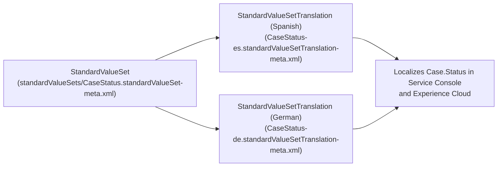

## Why the `StandardValueSetTranslation` Metadata Type Matters

Salesforce automatically translates out-of-the-box standard picklist values (`New`, `Working`, `Closed` on `Case.Status`). However, as soon as you add custom business values to a [StandardValueSet](/docs/metadata/standard-value-set-metadata-type/)—such as `Awaiting Vendor RMA` on `CaseStatus` or `Partner Referral - Tier 1` on `LeadSource`—those custom values appear in English to international users unless you deploy a **`StandardValueSetTranslation`**.



---

## SFDX Source Format & File Naming

Files reside in `force-app/main/default/standardValueSetTranslations/` and combine the official [StandardValueSet](/docs/metadata/standard-value-set-metadata-type/) name with a hyphen and the language code:

- `CaseStatus-es.standardValueSetTranslation-meta.xml`
- `OpportunityStage-fr.standardValueSetTranslation-meta.xml`
- `LeadSource-ja.standardValueSetTranslation-meta.xml`
- `AccountRating-de.standardValueSetTranslation-meta.xml`

---

## Key Metadata Fields

| Field | Type | Required | Description |
|---|---|---|---|
| `valueTranslation` | `ValueTranslation[]` | No | List of translated standard picklist values. |
| `valueTranslation.masterLabel` | `string` | Yes | The exact **Master Label** of the value in the `StandardValueSet`. |
| `valueTranslation.translation` | `string` | Yes | The localized text for the target language. Leave empty string if untranslated. |

---

## Real-World XML Example (`standardValueSetTranslations/CaseStatus-es.standardValueSetTranslation-meta.xml`)

```xml
<?xml version="1.0" encoding="UTF-8"?>
<StandardValueSetTranslation xmlns="http://soap.sforce.com/2006/04/metadata">
    <valueTranslation>
        <masterLabel>Awaiting Customer Logs</masterLabel>
        <translation>Esperando registros del cliente</translation>
    </valueTranslation>
    <valueTranslation>
        <masterLabel>Escalated to Tier 3 Engineering</masterLabel>
        <translation>Escalado a Ingeniería Nivel 3</translation>
    </valueTranslation>
    <valueTranslation>
        <masterLabel>Resolved - Pending Verification</masterLabel>
        <translation>Resuelto - Pendiente de verificación</translation>
    </valueTranslation>
</StandardValueSetTranslation>
```

---

## Senior Architect Best Practices

> [!TIP]
> **Always Pair `StandardValueSet` and `StandardValueSetTranslation` in PRs:** Whenever a developer adds a new stage or status to `OpportunityStage.standardValueSet-meta.xml` or `CaseStatus.standardValueSet-meta.xml`, enforce a pull-request check ensuring the corresponding `StandardValueSetTranslation` files are updated in the same commit.

- **Deploy the `StandardValueSet` First (or Together):** If a `StandardValueSetTranslation` file contains a `<masterLabel>` that does not yet exist in the target org's `StandardValueSet`, the translation entry will fail or be dropped during deployment.
