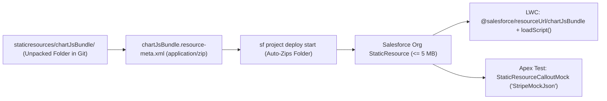

## Overview

The `StaticResource` metadata type (`staticresources/<Name>.resource-meta.xml`) stores static files—third-party JavaScript libraries (Chart.js, D3.js), custom CSS stylesheets, SVG/PNG graphics, custom web fonts, and JSON test payload fixtures—directly inside your Salesforce org so they can be served from Salesforce's Content Delivery Network (CDN) without violating Content Security Policy (CSP) or Lightning Web Security (LWS).

One of the best productivity features of Salesforce DX source format is **unpacked ZIP Static Resources**. Instead of committing opaque binary `.zip` files into Git, you can place a regular folder (`staticresources/chartJsBundle/`) next to `chartJsBundle.resource-meta.xml` (with `<contentType>application/zip</contentType>`). When you run `sf project deploy start`, the CLI zips the folder on the fly; when you run `sf project retrieve start`, the CLI extracts the archive back into clean, diffable source files.



As shown in the workflow above, unpacked folders in `staticresources/` compress automatically during CLI deployment and serve both LWC frontend components (`@salesforce/resourceUrl`) and Apex unit tests (`StaticResourceCalloutMock`).

## Prerequisites

- **Permissions:** "Customize Application" and "Modify Metadata Through Metadata API Functions" permissions.
- **LWS Compatibility:** Any third-party JavaScript library uploaded as a `StaticResource` and loaded via `loadScript()` in LWC must comply with **Lightning Web Security (LWS)** and strict mode JavaScript.
- **API Version:** Verified against API version `68.0` (Winter '27).

## StaticResource XML Metadata Fields

Each `StaticResource` in `force-app/main/default/staticresources/` consists of the asset file (or unpacked folder) and a `<ResourceName>.resource-meta.xml` file:

| XML Element | Type | Required | Valid Values & Best Practice |
| :--- | :--- | :--- | :--- |
| `cacheControl` | `StaticResourceCacheControl` | ✅ Yes | `Private` (cached per user session; default for internal assets and JSON test mocks) or `Public` (cached on CDN; best for Experience Cloud fonts/logos). |
| `contentType` | `string` | ✅ Yes | Standard MIME type: `application/zip`, `application/json`, `text/javascript`, `text/css`, `image/svg+xml`, `image/png`. |
| `description` | `string` | No | Documents the library version (e.g., `Chart.js v4.4.1 minified`) and license for security audits. |

> [!TIP]
> Always record the exact library version number in `<description>` (for example, `Chart.js v4.4.6 SHA-256: ...`) so security teams can audit third-party frontend dependencies using a simple SOQL query on `StaticResource`.

## Querying StaticResource via SOQL

`StaticResource` is a standard Salesforce object queryable via **standard SOQL** and **Tooling API**.

### 1. Audit Org StaticResource Storage Usage Against the 250 MB Limit
Find the largest static resources and calculate total bytes consumed across your org:

```soql
SELECT Id, Name, NamespacePrefix, ContentType, CacheControl,
       BodyLength, Description, LastModifiedDate, LastModifiedBy.Name
FROM StaticResource
WHERE NamespacePrefix = null
ORDER BY BodyLength DESC
```

### 2. Aggregate Total Unmanaged StaticResource Megabytes Used
```soql
SELECT SUM(BodyLength) totalBytesUsed, COUNT(Id) resourceCount
FROM StaticResource
WHERE NamespacePrefix = null
```

## Example

### 1. Metadata Descriptor (`StripeChargeMock.resource-meta.xml`) and JSON Fixture
Store mock HTTP callout payloads as `.json` static resources so your Apex unit tests stay clean and free of giant escaped JSON strings:

```xml title="force-app/main/default/staticresources/StripeChargeMock.resource-meta.xml"
<?xml version="1.0" encoding="UTF-8"?>
<StaticResource xmlns="http://soap.sforce.com/2006/04/metadata">
    <cacheControl>Private</cacheControl>
    <contentType>application/json</contentType>
    <description>Mock 200 OK Stripe v1/charges response payload for PaymentGatewayServiceTest.</description>
</StaticResource>
```

```json title="force-app/main/default/staticresources/StripeChargeMock.json"
{
  "id": "ch_3Q9xYz2eZvKYlo2C01234567",
  "object": "charge",
  "amount": 25000,
  "currency": "usd",
  "paid": true,
  "status": "succeeded"
}
```

### 2. Using `StaticResourceCalloutMock` in an Apex Unit Test
Reference `StripeChargeMock` in an `@IsTest` method without writing a custom `HttpCalloutMock` class:

```apex title="PaymentGatewayServiceMockTest.cls"
@IsTest
private class PaymentGatewayServiceMockTest {

    @IsTest
    static void parsesSuccessfulStripeChargeUsingStaticResourceMock() {
        StaticResourceCalloutMock mock = new StaticResourceCalloutMock();
        mock.setStaticResource('StripeChargeMock');
        mock.setStatusCode(200);
        mock.setHeader('Content-Type', 'application/json');

        Test.setMock(HttpCalloutMock.class, mock);

        Test.startTest();
        HttpResponse res = PaymentGatewayService.createCharge(25000, 'USD', 'tok_visa');
        Test.stopTest();

        Assert.areEqual(200, res.getStatusCode());
        Assert.isTrue(res.getBody().contains('ch_3Q9xYz2eZvKYlo2C01234567'));
    }
}
```

### 3. Loading a ZIP StaticResource in a Lightning Web Component
```javascript title="force-app/main/default/lwc/revenueChart/revenueChart.js"
import { LightningElement } from 'lwc';
import { loadScript, loadStyle } from 'lightning/platformResourceLoader';
import CHARTJS_ZIP from '@salesforce/resourceUrl/chartJsBundle';

export default class RevenueChart extends LightningElement {
    chartInitialized = false;

    async renderedCallback() {
        if (this.chartInitialized) {
            return;
        }
        this.chartInitialized = true;
        await Promise.all([
            loadScript(this, `${CHARTJS_ZIP}/chart.umd.min.js`),
            loadStyle(this, `${CHARTJS_ZIP}/chart-custom.css`)
        ]);
        this.initializeChart();
    }

    initializeChart() {
        // Initialize Chart.js on this.template.querySelector('canvas')
    }
}
```

## Limits and Gotchas

- **5 MB Single File Ceiling:** Any single `StaticResource` exceeding **5 MB** (5,242,880 bytes) fails deployment immediately. Minify JS/CSS bundles and compress SVG/WebP assets before committing.
- **250 MB Total Org Ceiling:** An org can store at most **250 MB** of total `StaticResource` binary data across all unmanaged resources.
- **Avoid Querying `StaticResource.Body` in Loops:** Selecting the `Body` (`Blob`) field in SOQL loads the entire binary payload onto the **6 MB synchronous Apex heap** (12 MB asynchronous). Only select `Body` for one small resource at a time.

## Related Official Documentation

- [StaticResource Metadata API Reference](https://developer.salesforce.com/docs/atlas.en-us.api_meta.meta/api_meta/meta_staticresource.htm): XML elements and manifest configuration.
- [StaticResource Object Reference](https://developer.salesforce.com/docs/atlas.en-us.object_reference.meta/object_reference/sforce_api_objects_staticresource.htm): Standard SOQL fields for auditing static resources.
- [Use Third-Party JavaScript Libraries in LWC](https://developer.salesforce.com/docs/platform/lwc/guide/js-third-party-library.html): Loading static resources with `platformResourceLoader`.
