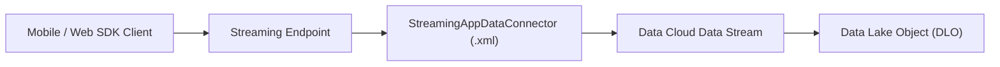

## Architectural Overview

The `StreamingAppDataConnector` metadata type defines ingestion conduits for real-time mobile and web telemetry entering **Salesforce Data Cloud**. In event-driven enterprise architectures, organizations capture micro-interactions—such as page clicks, cart updates, mobile screen views, and telemetry events—and stream them directly into Data Cloud data streams for identity resolution, real-time segmentation, and automated triggering.

Architecturally, `StreamingAppDataConnector` serves as the declarative configuration binding the client application identifier (`appIdentifier`) to Data Cloud ingestion pipelines. Managing this connector as code enables continuous delivery pipelines to promote streaming integrations across sandbox, staging, and production orgs without relying on manual setup clicks in Data Cloud Ingestion Settings.



## Directory and File Conventions

In SFDX source projects, `StreamingAppDataConnector` source files are stored in the `streamingAppDataConnectors` directory:

| Property | Value |
| :--- | :--- |
| **Metadata Type Name** | `StreamingAppDataConnector` |
| **SFDX Folder** | `force-app/main/default/streamingAppDataConnectors/` |
| **File Suffix** | `.streamingAppDataConnector-meta.xml` |
| **Wildcard Support (`*`)** | Supported in `package.xml` |

## Key Metadata Fields

The `StreamingAppDataConnector` schema consists of connection identifiers, routing classifications, and parameter collections:

| Field Name | Field Type | Required | Architectural Description |
| :--- | :--- | :--- | :--- |
| `fullName` | `string` | Yes | Unique API name representing the streaming connector instance. |
| `masterLabel` | `string` | Yes | Business-friendly name displayed in Data Cloud Ingestion interfaces. |
| `appIdentifier` | `string` | Yes | Unique application identifier (UUID) assigned to the mobile app or website. |
| `dataConnectorType` | `DataConnectorType` | Yes | Broad data connector category; defaults to `StreamingApp`. |
| `streamingAppDataConnectorType` | `StreamingAppDataConnectorType` | Yes | Concrete ingestion source type; valid options are `MobileApp` and `WebApp`. |
| `alias` | `string` | No | Optional secondary label or routing nickname for the connector. |
| `connectorParameters` | `StreamingAppDataCnctrParm[]` | No | Extensible key-value parameter collection configuring token security or payload routing. |
| `isProtected` | `boolean` | No | Indicates whether the component is protected within managed package distributions. |

> [!NOTE]
> `StreamingAppDataConnector` requires an active Salesforce Data Cloud license and appropriate provisioning in the target environment before deployment can succeed.

## Declarative XML and Package Manifest Examples

The following definition establishes a streaming connector for an iOS and Android enterprise mobile application:

```xml title="force-app/main/default/streamingAppDataConnectors/Mobile_Retail_App.streamingAppDataConnector-meta.xml"
<?xml version="1.0" encoding="UTF-8"?>
<StreamingAppDataConnector xmlns="http://soap.sforce.com/2006/04/metadata">
    <fullName>Mobile_Retail_App</fullName>
    <masterLabel>Mobile Retail App</masterLabel>
    <alias>RetailAppMobileTelemetry</alias>
    <appIdentifier>d3b07384-d113-4660-9c30-4e3a9687e38f</appIdentifier>
    <dataConnectorType>StreamingApp</dataConnectorType>
    <streamingAppDataConnectorType>MobileApp</streamingAppDataConnectorType>
</StreamingAppDataConnector>
```

Add the component to the package manifest:

```xml title="manifest/package.xml"
<?xml version="1.0" encoding="UTF-8"?>
<Package xmlns="http://soap.sforce.com/2006/04/metadata">
    <types>
        <members>Mobile_Retail_App</members>
        <name>StreamingAppDataConnector</name>
    </types>
    <version>68.0</version>
</Package>
```

## Retrieval and Deployment

Use modern Salesforce CLI commands to manage streaming data connectors across org tiers:

```bash
# Retrieve all StreamingAppDataConnector components
sf project retrieve start --metadata "StreamingAppDataConnector:*"

# Deploy a specific connector to your target Data Cloud org
sf project deploy start --metadata "StreamingAppDataConnector:Mobile_Retail_App" --target-org cdp-prod

# Query deployed connectors using Tooling API
sf data query --query "SELECT Id, DeveloperName, MasterLabel, DataConnectorType FROM StreamingAppDataConnector" --use-tooling-api
```

## Senior Architect Considerations

> [!TIP]
> Ensure the `appIdentifier` UUID matches the client SDK configuration bundled inside your iOS, Android, or JavaScript web application code to guarantee frictionless event ingestion.

1. **Environment Separation:** Maintain distinct `appIdentifier` values across development, QA, and production environments to isolate testing telemetry from production data lakes.
2. **Downstream Dependencies:** Streaming connectors ingest events that feed Data Streams and Data Model Objects (DMOs). Deploy connectors prior to activating downstream ingestion flows.
3. **Security Architecture:** Pair your streaming connectors with appropriate [ConnectedApp](/docs/metadata/connected-app-metadata-type/) configurations and [PermissionSet](/docs/metadata/permission-set-metadata-type/) definitions to enforce end-to-end transport encryption and authorized API ingress.
