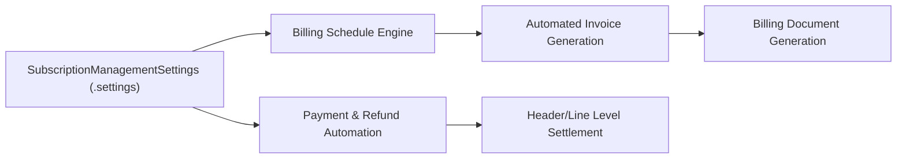

## Architectural Overview

The `SubscriptionManagementSettings` metadata type encapsulates organization-level toggles and financial automation rules for **Salesforce Subscription Management** (part of Salesforce Revenue Cloud). Modern recurring revenue businesses require automated billing engines that can calculate recurring prorations, generate billing schedules, create payment schedules, and settle invoices without manual intervention.

Architecturally, `SubscriptionManagementSettings` acts as the single source of truth for financial accounting policies within the subscription lifecycle engine. It controls whether negative invoice lines automatically convert to credit memos, whether payments settle against entire invoice headers or discrete line items, and whether PDF billing document generation triggers upon invoice finalization. Managing these settings as version-controlled metadata ensures consistent financial configurations across scratch orgs, sandboxes, and production environments.



## Directory and File Conventions

In SFDX source projects, `SubscriptionManagementSettings` is categorized as an org setting component:

| Property | Value |
| :--- | :--- |
| **Metadata Type Name** | `SubscriptionManagementSettings` (or member of `Settings`) |
| **SFDX Folder** | `force-app/main/default/settings/` |
| **File Name** | `subscriptionmanagement.settings-meta.xml` (or `subscriptionmanagement.settings`) |
| **Wildcard Support (`*`)** | Not supported under generic `Settings`; member must be explicitly listed |

## Key Metadata Fields

The XML schema for `SubscriptionManagementSettings` contains financial orchestration flags:

| Field Name | Field Type | Default | Architectural Description |
| :--- | :--- | :--- | :--- |
| `enableSubscriptionManagement` | `boolean` | `false` | Master toggle activating core Subscription Management capabilities in the org. |
| `enableBillingDocGen` | `boolean` | `false` | Enables automated document generation services for finalized customer invoices. |
| `enableConvertNegativeInvoiceLinesToCreditMemoAndApply` | `boolean` | `false` | Automatically converts negative line items into positive-balance credit memos applied to balances. |
| `enableInvHeaderLvlSettlement` | `boolean` | `false` | When true, payments settle at the invoice header level; when false, payments apply directly to line items. |
| `enablePaymentScheduleAutomation` | `boolean` | `false` | Automatically creates payment schedules and payment schedule items when invoices post. |
| `enableRefundAutomation` | `boolean` | `false` | Automates the issuance and posting of customer refunds for overpayments and credits. |
| `enableRevSubMgmtBlngOptOut` | `boolean` | `false` | Allows administrators to disable standard Subscription Management billing schedules when using external ERPs. |

> [!NOTE]
> Deploying `SubscriptionManagementSettings` requires that the target Salesforce organization has the Subscription Management permission set license and active feature entitlements enabled.

## Declarative XML and Package Manifest Examples

Below is an enterprise settings definition activating automated billing document generation, payment scheduling, and negative line item conversion:

```xml title="force-app/main/default/settings/subscriptionmanagement.settings-meta.xml"
<?xml version="1.0" encoding="UTF-8"?>
<SubscriptionManagementSettings xmlns="http://soap.sforce.com/2006/04/metadata">
    <enableSubscriptionManagement>true</enableSubscriptionManagement>
    <enableBillingDocGen>true</enableBillingDocGen>
    <enableConvertNegativeInvoiceLinesToCreditMemoAndApply>true</enableConvertNegativeInvoiceLinesToCreditMemoAndApply>
    <enableInvHeaderLvlSettlement>false</enableInvHeaderLvlSettlement>
    <enablePaymentScheduleAutomation>true</enablePaymentScheduleAutomation>
    <enableRefundAutomation>true</enableRefundAutomation>
    <enableRevSubMgmtBlngOptOut>false</enableRevSubMgmtBlngOptOut>
</SubscriptionManagementSettings>
```

In `package.xml`, settings are referenced under the generic `Settings` metadata type:

```xml title="manifest/package.xml"
<?xml version="1.0" encoding="UTF-8"?>
<Package xmlns="http://soap.sforce.com/2006/04/metadata">
    <types>
        <members>SubscriptionManagement</members>
        <name>Settings</name>
    </types>
    <version>68.0</version>
</Package>
```

## Retrieval and Deployment

Use Salesforce CLI commands to retrieve and deploy org settings:

```bash
# Retrieve SubscriptionManagement settings
sf project retrieve start --metadata "Settings:SubscriptionManagement"

# Deploy settings to target staging sandbox
sf project deploy start --metadata "Settings:SubscriptionManagement" --target-org staging-sandbox

# Validate active feature settings via Salesforce CLI
sf org display --target-org staging-sandbox
```

## Senior Architect Considerations

> [!TIP]
> Coordinate the `enableInvHeaderLvlSettlement` setting with your enterprise ERP integrations (SAP, Oracle NetSuite, or Workday). Switching between header-level and line-level settlement impacts how financial ledger journal entries synchronize across systems.

1. **Scratch Org Definitions:** To enable Subscription Management in CI/CD pipelines, configure `"subscriptionManagement": true` inside your `project-scratch-def.json` under `features`.
2. **Sequential Activation:** Some automation features require prerequisite payment gateways and tax calculation engines to be configured prior to enabling automated refunds or payment schedules.
3. **Audit and Compliance:** Automated credit memo generation (`enableConvertNegativeInvoiceLinesToCreditMemoAndApply`) directly impacts revenue recognition rules under ASC 606 and IFRS 15. Ensure accounting stakeholders review and approve these flags.
