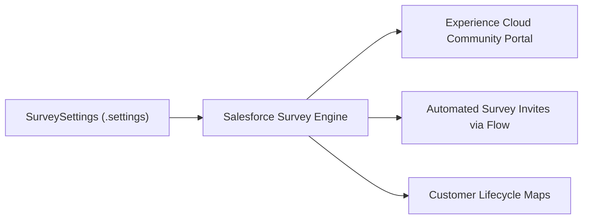

## Architectural Overview

The `SurveySettings` metadata type represents the administrative configuration governing **Salesforce Surveys** and customer feedback orchestration across an enterprise organization. Gathering customer sentiment, Net Promoter Scores (NPS), and Customer Satisfaction (CSAT) scores requires native survey tooling embedded directly into CRM workflows—such as post-case resolution, opportunity closure, or contract renewal milestones.

Architecturally, `SurveySettings` serves as the global enablement switchboard. It enables the core survey engine, permits survey owners to manage respondent answers, and integrates with Salesforce Customer Lifecycle Maps to visualize end-to-end customer journey satisfaction. Codifying these settings ensures that ephemeral scratch orgs and multi-tier deployment pipelines have surveys properly activated before deploying dependent survey definitions, flows, and community portals.



## Directory and File Conventions

In SFDX source projects, `SurveySettings` components reside within the `settings` directory:

| Property | Value |
| :--- | :--- |
| **Metadata Type Name** | `SurveySettings` (or member of `Settings`) |
| **SFDX Folder** | `force-app/main/default/settings/` |
| **File Name** | `Survey.settings-meta.xml` (or `Survey.settings`) |
| **Wildcard Support (`*`)** | Not supported under generic `Settings`; member must be explicitly listed |

## Key Metadata Fields

The XML schema for `SurveySettings` provides the following global switches:

| Field Name | Field Type | Default | Architectural Description |
| :--- | :--- | :--- | :--- |
| `enableSurvey` | `boolean` | `false` | Master toggle activating Salesforce Surveys within the organization. |
| `enableCustomerLifecycleMap` | `boolean` | `false` | Activates Customer Lifecycle Maps to track satisfaction across customer stages. |
| `enableSurveyOwnerCanManageResponse` | `boolean` | `false` | Grants survey owners permission to view, edit, or delete submitted survey responses. |

> [!NOTE]
> Enabling `enableSurvey` exposes native Survey standard objects (such as `Survey`, `SurveyVersion`, `SurveyInvitation`, and `SurveyResponse`) in the database schema.

## Declarative XML and Package Manifest Examples

Below is a declarative `SurveySettings` configuration activating surveys, lifecycle mapping, and response owner management:

```xml title="force-app/main/default/settings/Survey.settings-meta.xml"
<?xml version="1.0" encoding="UTF-8"?>
<SurveySettings xmlns="http://soap.sforce.com/2006/04/metadata">
    <enableCustomerLifecycleMap>true</enableCustomerLifecycleMap>
    <enableSurvey>true</enableSurvey>
    <enableSurveyOwnerCanManageResponse>true</enableSurveyOwnerCanManageResponse>
</SurveySettings>
```

To package and retrieve this component via `package.xml`:

```xml title="manifest/package.xml"
<?xml version="1.0" encoding="UTF-8"?>
<Package xmlns="http://soap.sforce.com/2006/04/metadata">
    <types>
        <members>Survey</members>
        <name>Settings</name>
    </types>
    <version>68.0</version>
</Package>
```

## Retrieval and Deployment

Manage `SurveySettings` using standard Salesforce CLI commands:

```bash
# Retrieve Survey settings from the default org
sf project retrieve start --metadata "Settings:Survey"

# Deploy Survey settings to target sandbox or production org
sf project deploy start --metadata "Settings:Survey" --target-org uat-sandbox

# Confirm survey enablement by querying Survey records
sf data query --query "SELECT Id, Name, TotalVersionsCount FROM Survey"
```

## Senior Architect Considerations

> [!TIP]
> In enterprise environments, external respondents submit survey answers unauthenticated via Experience Cloud. Always pair `enableSurvey` with a designated default Community Site to generate public survey invitation URLs.

1. **Scratch Org Automation:** Add `"survey": true` to the `features` array in your `project-scratch-def.json` file so test scratch orgs automatically provision the Survey data model.
2. **Data Privacy and GDPR:** When enabling `enableSurveyOwnerCanManageResponse`, ensure your enterprise data governance policies comply with privacy regulations regarding response deletion and personal data masking.
3. **Flow Dependencies:** Automated survey invitation triggers built in [Flow](/docs/metadata/flow-metadata-type/) require `SurveySettings` to be deployed and active in the target org before flow deployment or compilation will succeed.
