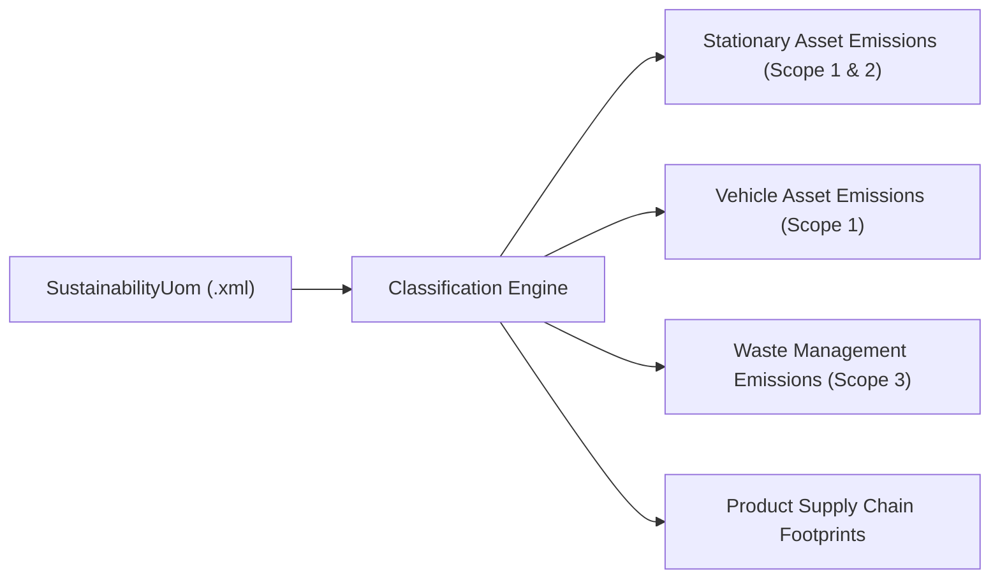

## Architectural Overview

The `SustainabilityUom` metadata type represents the declarative configuration of units of measure (UOM) within **Salesforce Net Zero Cloud**. Enterprise ESG (Environmental, Social, and Governance) compliance demands rigorous tracking and auditing of greenhouse gas (GHG) Scope 1, Scope 2, and Scope 3 emissions. Global organizations frequently operate across international boundaries with differing measurement metrics—such as metric tonnes, kilowatt-hours, British thermal units (MMBtu), cubic meters, and gallons.

Architecturally, `SustainabilityUom` registers recognized measurement units into the Net Zero Cloud calculation engine. It classifies whether a unit applies to stationary assets (e.g., factories, commercial real estate), vehicle assets (e.g., corporate vehicle fleets, logistics trucks), supply chain products, or waste management operations. Codifying units of measure as metadata allows sustainability architects to promote standardized ESG configurations cleanly across enterprise orgs without manual setup in production.



## Directory and File Conventions

In SFDX source projects, `SustainabilityUom` files reside in the `sustainabilityUoms` directory:

| Property | Value |
| :--- | :--- |
| **Metadata Type Name** | `SustainabilityUom` |
| **SFDX Folder** | `force-app/main/default/sustainabilityUoms/` |
| **File Suffix** | `.sustainabilityUom-meta.xml` |
| **Wildcard Support (`*`)** | Supported in `package.xml` |

## Key Metadata Fields

The `SustainabilityUom` metadata type schema contains classification toggles and descriptive labels:

| Field Name | Field Type | Required | Architectural Description |
| :--- | :--- | :--- | :--- |
| `fullName` | `string` | Yes | Unique API identifier representing the sustainability unit of measure. |
| `label` | `string` | Yes | User-interface label displayed in Net Zero Cloud calculation forms and reports. |
| `description` | `string` | No | Operational details describing the standard and regional context of the unit. |
| `isStationaryAssetUom` | `boolean` | No | Indicates whether this unit is eligible for stationary asset fuel and energy calculations. |
| `isVehicleAssetUom` | `boolean` | No | Indicates whether this unit applies to mobile vehicle fuel consumption calculations. |
| `isProductUom` | `boolean` | No | Indicates whether this unit applies to supply chain product procurement accounting. |
| `isWasteUom` | `boolean` | No | Indicates whether this unit is used in solid and wastewater management emissions records. |
| `isProtected` | `boolean` | No | Managed package protection indicator; default is `false`. |

> [!NOTE]
> `SustainabilityUom` was introduced in API version 56.0, with waste management calculation support (`isWasteUom`) added in API version 65.0.

## Declarative XML and Package Manifest Examples

Below is a declarative `SustainabilityUom` configuration establishing a custom Megawatt-hour unit for stationary facilities:

```xml title="force-app/main/default/sustainabilityUoms/MWh_Custom.sustainabilityUom-meta.xml"
<?xml version="1.0" encoding="UTF-8"?>
<SustainabilityUom xmlns="http://soap.sforce.com/2006/04/metadata">
    <fullName>MWh_Custom</fullName>
    <label>Megawatt-Hour Custom</label>
    <description>Stationary facility electrical consumption unit of measure for enterprise datacenters.</description>
    <isStationaryAssetUom>true</isStationaryAssetUom>
    <isVehicleAssetUom>false</isVehicleAssetUom>
    <isProductUom>false</isProductUom>
    <isWasteUom>false</isWasteUom>
    <isProtected>false</isProtected>
</SustainabilityUom>
```

Include the component in `package.xml`:

```xml title="manifest/package.xml"
<?xml version="1.0" encoding="UTF-8"?>
<Package xmlns="http://soap.sforce.com/2006/04/metadata">
    <types>
        <members>MWh_Custom</members>
        <name>SustainabilityUom</name>
    </types>
    <version>68.0</version>
</Package>
```

## Retrieval and Deployment

Use the Salesforce CLI to deploy and retrieve `SustainabilityUom` components:

```bash
# Retrieve all sustainability units of measure
sf project retrieve start --metadata "SustainabilityUom:*"

# Deploy a specific unit of measure to Net Zero Cloud environment
sf project deploy start --metadata "SustainabilityUom:MWh_Custom" --target-org nzc-staging

# Query deployed units of measure via Tooling API
sf data query --query "SELECT Id, DeveloperName, MasterLabel FROM SustainabilityUom" --use-tooling-api
```

## Senior Architect Considerations

> [!TIP]
> Whenever introducing a new `SustainabilityUom`, simultaneously deploy its corresponding [SustnUomConversion](/docs/metadata/sustn-uom-conversion-metadata-type/) metadata rules so Net Zero Cloud calculation engines can normalize raw data into standard carbon equivalent outputs (e.g., metric tonnes CO2e).

1. **Licensing Prerequisites:** Net Zero Cloud requires specific permission set licenses. Ensure CI scratch org definitions include the `"netZeroCloud"` feature before deploying UOM definitions.
2. **Audit Trailing:** Avoid altering boolean asset eligibility flags on existing `SustainabilityUom` components in production if historical carbon footprint records already reference them.
3. **Data Integrity:** Verify that integration pipelines feeding IoT or utility smart meter data map cleanly to the registered UOM labels to prevent ingestion calculation exceptions.
