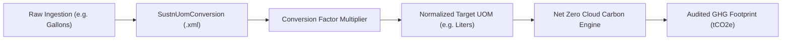

## Architectural Overview

The `SustnUomConversion` metadata type represents declarative unit of measure conversion rules within **Salesforce Net Zero Cloud**. Enterprise carbon accounting mandates standardized reporting in carbon dioxide equivalent (tCO2e), yet operational consumption data arrives in disparate regional units—such as liters, US gallons, Imperial gallons, therms, cubic meters, and kilowatt-hours across distinct fuel categories like diesel, natural gas, jet fuel, and biomass.

Architecturally, `SustnUomConversion` defines the multiplier (`conversionFactor`) that normalizes a source unit (`sourceUom`) into a target calculation unit (`targetUom`) for a designated `fuelType`. Packaging these conversion rules as metadata guarantees that environmental engineers and DevOps teams can deploy auditable conversion matrices across scratch orgs, sandboxes, and production environments, maintaining complete consistency for external ESG financial audits.



## Directory and File Conventions

In SFDX source projects, `SustnUomConversion` components are stored in the `sustnUomConversions` directory:

| Property | Value |
| :--- | :--- |
| **Metadata Type Name** | `SustnUomConversion` |
| **SFDX Folder** | `force-app/main/default/sustnUomConversions/` |
| **File Suffix** | `.sustnUomConversion-meta.xml` |
| **Wildcard Support (`*`)** | Supported in `package.xml` |

## Key Metadata Fields

The `SustnUomConversion` metadata type schema contains mathematical conversion rules and fuel classifications:

| Field Name | Field Type | Required | Architectural Description |
| :--- | :--- | :--- | :--- |
| `fullName` | `string` | Yes | Unique API name representing the conversion record. |
| `masterLabel` | `string` | Yes | Human-readable label displayed in Net Zero Cloud Setup. |
| `conversionFactor` | `double` | Yes | Decimal multiplier applied to convert values from source to target UOM. |
| `sourceUom` | `string` | Yes | Originating unit of measure (e.g., `UsGallons`, `Therms`, `kG`, `kWh`). |
| `targetUom` | `string` | Yes | Destination unit of measure for energy and emissions calculation. |
| `fuelType` | `string` | No | Fuel category binding (e.g., `Diesel`, `NaturalGas`, `Electricity`, `JetFuel`). |
| `uomsKey` | `string` | No | System indexing key associated with the fuel and UOM mapping. |
| `isProtected` | `boolean` | No | Managed package distribution flag; default is `false`. |

> [!NOTE]
> `SustnUomConversion` was introduced in API version 57.0 and requires Net Zero Cloud permissions to be enabled in the target organization.

## Declarative XML and Package Manifest Examples

Below is a declarative `SustnUomConversion` defining the mathematical factor converting kilograms to liters for mobile diesel fuel:

```xml title="force-app/main/default/sustnUomConversions/Diesel_KG_to_Liters.sustnUomConversion-meta.xml"
<?xml version="1.0" encoding="UTF-8"?>
<SustnUomConversion xmlns="http://soap.sforce.com/2006/04/metadata">
    <fullName>Diesel_KG_to_Liters</fullName>
    <masterLabel>Diesel KG to Liters</masterLabel>
    <conversionFactor>1.19</conversionFactor>
    <fuelType>Diesel</fuelType>
    <sourceUom>kG</sourceUom>
    <targetUom>Liters</targetUom>
    <uomsKey>Diesel_kG_Liters</uomsKey>
    <isProtected>false</isProtected>
</SustnUomConversion>
```

Add the component to the package manifest:

```xml title="manifest/package.xml"
<?xml version="1.0" encoding="UTF-8"?>
<Package xmlns="http://soap.sforce.com/2006/04/metadata">
    <types>
        <members>Diesel_KG_to_Liters</members>
        <name>SustnUomConversion</name>
    </types>
    <version>68.0</version>
</Package>
```

## Retrieval and Deployment

Use Salesforce CLI commands to manage sustainability conversions:

```bash
# Retrieve all conversion components
sf project retrieve start --metadata "SustnUomConversion:*"

# Deploy specific conversion factor to Net Zero Cloud target org
sf project deploy start --metadata "SustnUomConversion:Diesel_KG_to_Liters" --target-org nzc-prod

# Query deployed conversion factors using Tooling API
sf data query --query "SELECT Id, DeveloperName, FuelType, ConversionFactor FROM SustnUomConversion" --use-tooling-api
```

## Senior Architect Considerations

> [!TIP]
> Ensure both `sourceUom` and `targetUom` refer to standard units or custom units deployed via [SustainabilityUom](/docs/metadata/sustainability-uom-metadata-type/) before deploying the conversion factor metadata.

1. **Precision and Rounding:** When defining `conversionFactor` values, maintain maximum decimal precision (up to 8 decimal places) to eliminate compounding rounding errors in high-volume utility bill calculations.
2. **Bidirectional Rules:** Conversion factors are directional (`sourceUom` to `targetUom`). If your business process records consumption in both directions, configure reciprocal conversion records explicitly.
3. **Regulatory Auditing:** Conversion coefficients are often mandated by regulatory bodies like the EPA or DEFRA. Document the official regulatory citations in your team's Git commit messages when updating `conversionFactor` metadata.
