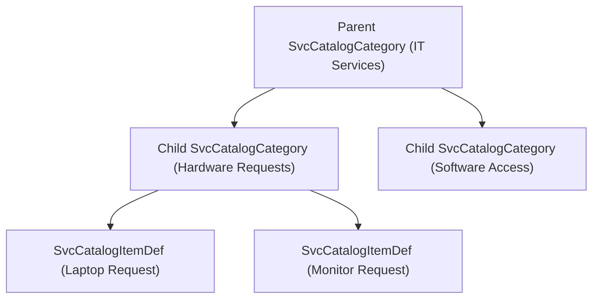

## Architectural Overview

The `SvcCatalogCategory` metadata type represents the hierarchical classification structure used within **Salesforce Service Catalog** (part of Employee Service and IT Service Management). When organizations provide internal employee service portals or customer-facing service catalogs, users navigate through structured service categories—such as Workplace Services, Hardware Provisioning, Software Access, and HR Inquiries—to submit catalog requests.

Architecturally, `SvcCatalogCategory` defines both top-level service groupings and child subcategories. It encapsulates visual branding assets (`image`), display sorting order (`sortOrder`), and parent-child taxonomy (`parentCategory`). Managing catalog categories as version-controlled metadata enables platform architects to maintain synchronized request taxonomies across sandbox testing and production portals.



## Directory and File Conventions

In SFDX source projects, `SvcCatalogCategory` components reside within the `svcCatalogCategories` directory:

| Property | Value |
| :--- | :--- |
| **Metadata Type Name** | `SvcCatalogCategory` |
| **SFDX Folder** | `force-app/main/default/svcCatalogCategories/` |
| **File Suffix** | `.category-meta.xml` (or `.category`) |
| **Wildcard Support (`*`)** | Supported in `package.xml` |

## Key Metadata Fields

The `SvcCatalogCategory` schema encapsulates the taxonomy structure, labels, and display ordering:

| Field Name | Field Type | Required | Architectural Description |
| :--- | :--- | :--- | :--- |
| `fullName` | `string` | Yes | DeveloperName / API identifier of the catalog category. |
| `masterLabel` | `string` | Yes | Human-readable label displayed on the Service Catalog user interface. |
| `image` | `string` | No | Developer name of a `ContentDocument` or static resource representing category iconography. |
| `parentCategory` | `string` | No | API name of the parent `SvcCatalogCategory` under which this category appears. |
| `sortOrder` | `int` | No | Numerical sort sequence determining card placement in portal views. |
| `isActive` | `boolean` | No | Controls whether this category is active and visible to portal end users. |
| `isProtected` | `boolean` | No | Indicates packaging protection status for managed solutions. |

> [!NOTE]
> Service Catalog enforces a strict maximum of **one level of nesting**. A parent category cannot possess its own parent category.

## Declarative XML and Package Manifest Examples

Below is a declarative `SvcCatalogCategory` representing a child category under the IT Services catalog:

```xml title="force-app/main/default/svcCatalogCategories/Hardware_Requests.category-meta.xml"
<?xml version="1.0" encoding="UTF-8"?>
<SvcCatalogCategory xmlns="http://soap.sforce.com/2006/04/metadata">
    <fullName>Hardware_Requests</fullName>
    <masterLabel>Hardware Requests</masterLabel>
    <image>Laptop_Icon_Asset</image>
    <parentCategory>IT_Services</parentCategory>
    <sortOrder>2</sortOrder>
    <isActive>true</isActive>
    <isProtected>false</isProtected>
</SvcCatalogCategory>
```

To include all service catalog categories in `package.xml`:

```xml title="manifest/package.xml"
<?xml version="1.0" encoding="UTF-8"?>
<Package xmlns="http://soap.sforce.com/2006/04/metadata">
    <types>
        <members>*</members>
        <name>SvcCatalogCategory</name>
    </types>
    <version>68.0</version>
</Package>
```

## Retrieval and Deployment

Use modern Salesforce CLI commands to manage catalog categories:

```bash
# Retrieve all Service Catalog categories
sf project retrieve start --metadata "SvcCatalogCategory:*"

# Deploy specific category to staging org
sf project deploy start --metadata "SvcCatalogCategory:Hardware_Requests" --target-org staging-sandbox

# Inspect deployed categories using Tooling API
sf data query --query "SELECT Id, DeveloperName, MasterLabel, ParentCategoryId FROM SvcCatalogCategory" --use-tooling-api
```

## Senior Architect Considerations

> [!TIP]
> Deploy parent categories before child categories if deploying incrementally; otherwise, deploy all `SvcCatalogCategory` components in a single deployment package to satisfy parent lookup dependencies.

1. **Asset Deployment Order:** If referencing an `image`, ensure the corresponding `ContentDocument` or asset library file exists in the target org prior to deploying the category metadata.
2. **Category Pruning:** Deactivating a category (`isActive = false`) immediately hides all child catalog items from end users without deleting historical request records.
3. **Item Associations:** Catalog items link to categories via [SvcCatalogItemDef](/docs/metadata/svc-catalog-item-def-metadata-type/). Keep item definitions and categories coupled within the same feature branch.
