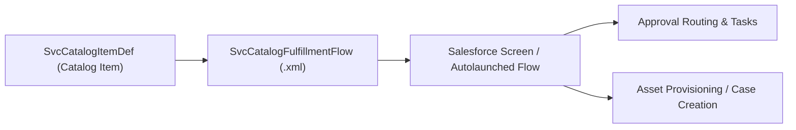

## Architectural Overview

The `SvcCatalogFulfillmentFlow` metadata type establishes the binding contract between user-facing service requests and backend orchestration logic in **Salesforce Service Catalog**. When employees or customers submit requests through a self-service catalog portal, the platform must execute tailored fulfillment workflows—such as creating IT assets, orchestrating multi-tier approval chains, provisioning software licenses, or updating HR systems.

Architecturally, `SvcCatalogFulfillmentFlow` decouples catalog item presentations from automation logic. By declaring which [Flow](/docs/metadata/flow-metadata-type/) handles fulfillment, architects can independently iterate on catalog user experiences and business logic. Packaging this metadata type ensures that CI/CD release pipelines can promote service automation updates across development and production orgs deterministically.



## Directory and File Conventions

In SFDX source projects, `SvcCatalogFulfillmentFlow` files reside in the `svcCatalogFulfillmentFlows` directory:

| Property | Value |
| :--- | :--- |
| **Metadata Type Name** | `SvcCatalogFulfillmentFlow` |
| **SFDX Folder** | `force-app/main/default/svcCatalogFulfillmentFlows/` |
| **File Suffix** | `.fulfillmentFlow-meta.xml` (or `.fulfillmentFlow`) |
| **Wildcard Support (`*`)** | Supported in `package.xml` |

## Key Metadata Fields

The `SvcCatalogFulfillmentFlow` metadata schema contains the essential reference attributes linking items to automation engines:

| Field Name | Field Type | Required | Architectural Description |
| :--- | :--- | :--- | :--- |
| `fullName` | `string` | Yes | DeveloperName / API identifier of the fulfillment flow component. |
| `description` | `string` | Yes | Comprehensive explanation of the fulfillment logic, approval stages, and outcomes. |
| `flow` | `string` | Yes | API name of the referenced active `Flow` metadata component. |

> [!NOTE]
> `SvcCatalogFulfillmentFlow` components were introduced in API version 53.0. The referenced flow can be an Autolaunched Flow or Screen Flow designed for catalog fulfillment.

## Declarative XML and Package Manifest Examples

Below is a declarative `SvcCatalogFulfillmentFlow` routing new employee laptop requests to an IT hardware fulfillment flow:

```xml title="force-app/main/default/svcCatalogFulfillmentFlows/Laptop_Provisioning_Flow.fulfillmentFlow-meta.xml"
<?xml version="1.0" encoding="UTF-8"?>
<SvcCatalogFulfillmentFlow xmlns="http://soap.sforce.com/2006/04/metadata">
    <fullName>Laptop_Provisioning_Flow</fullName>
    <description>Fulfillment orchestration flow for corporate developer laptop procurement and provisioning.</description>
    <flow>Hardware_Laptop_Fulfillment_Process</flow>
</SvcCatalogFulfillmentFlow>
```

Add the component to the package manifest:

```xml title="manifest/package.xml"
<?xml version="1.0" encoding="UTF-8"?>
<Package xmlns="http://soap.sforce.com/2006/04/metadata">
    <types>
        <members>Laptop_Provisioning_Flow</members>
        <name>SvcCatalogFulfillmentFlow</name>
    </types>
    <version>68.0</version>
</Package>
```

## Retrieval and Deployment

Use Salesforce CLI commands to manage fulfillment flows across development cycles:

```bash
# Retrieve all fulfillment flows
sf project retrieve start --metadata "SvcCatalogFulfillmentFlow:*"

# Deploy fulfillment flow together with its dependent Flow
sf project deploy start --metadata "Flow:Hardware_Laptop_Fulfillment_Process" "SvcCatalogFulfillmentFlow:Laptop_Provisioning_Flow" --target-org uat

# Query deployed fulfillment flows via Tooling API
sf data query --query "SELECT Id, DeveloperName, FlowDefinitionId FROM SvcCatalogFulfillmentFlow" --use-tooling-api
```

## Senior Architect Considerations

> [!TIP]
> Always bundle the target [Flow](/docs/metadata/flow-metadata-type/) in the same deployment commit as `SvcCatalogFulfillmentFlow`. If the referenced flow is missing or in draft status without an active version, the metadata deployment will fail with a reference resolution error.

1. **Input Contract Alignment:** Ensure your target flow declares the appropriate input variables (such as `recordId`, `userId`, or catalog submission payload variables) expected by the Service Catalog runtime.
2. **Error Handling Architecture:** Design the referenced flow with robust fault-handling paths that notify system administrators and update catalog request statuses if external API calls or record insertions fail.
3. **Decoupled Architecture:** Using `SvcCatalogFulfillmentFlow` allows teams to swap out the underlying flow implementation without modifying the customer-facing [SvcCatalogItemDef](/docs/metadata/svc-catalog-item-def-metadata-type/).
