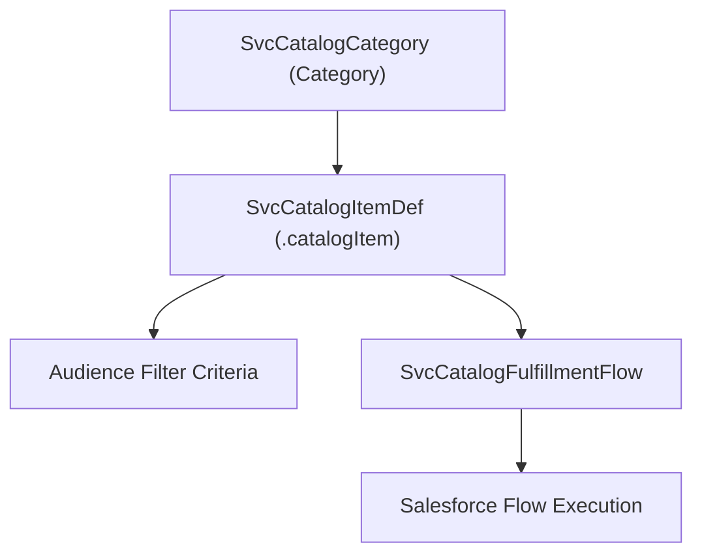

## Architectural Overview

The `SvcCatalogItemDef` metadata type defines individual requestable catalog items within **Salesforce Service Catalog**. Modern IT and HR shared service centers provide structured self-service portals where employees and customers request specific goods or services—such as developer workstations, VPN access tokens, ergonomic office equipment, or corporate credit cards.

Architecturally, `SvcCatalogItemDef` serves as the central hub of Service Catalog configurations. It connects three critical pillars:
1. **Taxonomy & Discovery:** Linking items into browsable categories via [SvcCatalogCategory](/docs/metadata/svc-catalog-category-metadata-type/).
2. **Access Governance:** Restricting visibility via eligibility filter rules (`catalogFilterCriteria`) and external customer toggles (`isAvailableToAllCustomers`).
3. **Execution:** Routing requests to the appropriate automation engine through [SvcCatalogFulfillmentFlow](/docs/metadata/svc-catalog-fulfillment-flow-metadata-type/).

Managing catalog item definitions as code ensures that product portfolios, descriptions, and operational workflows remain version-controlled and reproducible across enterprise pipelines.



## Directory and File Conventions

In SFDX source projects, `SvcCatalogItemDef` metadata is stored in the `svcCatalogItems` directory:

| Property | Value |
| :--- | :--- |
| **Metadata Type Name** | `SvcCatalogItemDef` |
| **SFDX Folder** | `force-app/main/default/svcCatalogItems/` |
| **File Suffix** | `.catalogItem-meta.xml` (or `.catalogItem`) |
| **Wildcard Support (`*`)** | Supported in `package.xml` |

## Key Metadata Fields

The `SvcCatalogItemDef` schema combines user-facing content, taxonomy mappings, and automation references:

| Field Name | Field Type | Required | Architectural Description |
| :--- | :--- | :--- | :--- |
| `fullName` | `string` | Yes | DeveloperName / API identifier of the catalog item. |
| `masterLabel` | `string` | Yes | Display title shown in catalog galleries and search result cards. |
| `description` | `string` | No | Customer-facing summary describing the item, delivery SLAs, and instructions. |
| `fulfillmentFlow` | `string` | No | DeveloperName of the related `SvcCatalogFulfillmentFlow` processing the submission. |
| `categories` | `SvcCatalogCategoryItem[]` | No | Collection of parent categories containing this item, with primary category designations. |
| `catalogFilterCriteria` | `SvcCatalogItemDefFiltrCrit[]` | No | Demographic and profile criteria restricting who can view or request this item. |
| `isAvailableToAllCustomers`| `boolean` | No | Determines whether authenticated external Experience Cloud users can access the item. |
| `image` | `string` | No | DeveloperName of a `ContentDocument` or image asset representing the item icon. |
| `internalNotes` | `string` | No | Private administrator notes used within Service Catalog Builder. |

> [!NOTE]
> `SvcCatalogItemDef` was introduced in API version 53.0. Audience eligibility criteria (`catalogFilterCriteria`) and external customer availability were introduced in versions 59.0 and 61.0 respectively.

## Declarative XML and Package Manifest Examples

Below is a declarative `SvcCatalogItemDef` defining a high-performance developer laptop catalog item:

```xml title="force-app/main/default/svcCatalogItems/Developer_MacBook_Pro.catalogItem-meta.xml"
<?xml version="1.0" encoding="UTF-8"?>
<SvcCatalogItemDef xmlns="http://soap.sforce.com/2006/04/metadata">
    <fullName>Developer_MacBook_Pro</fullName>
    <masterLabel>MacBook Pro 16-Inch M4 Max</masterLabel>
    <description>Standard engineering laptop provisioned with 64GB RAM and security toolchains for developers.</description>
    <fulfillmentFlow>Laptop_Provisioning_Flow</fulfillmentFlow>
    <image>MacBook_Asset_Icon</image>
    <isAvailableToAllCustomers>false</isAvailableToAllCustomers>
    <categories>
        <SvcCatalogCategory>Hardware_Requests</SvcCatalogCategory>
        <IsPrimaryCategory>true</IsPrimaryCategory>
    </categories>
</SvcCatalogItemDef>
```

Add the component to the package manifest:

```xml title="manifest/package.xml"
<?xml version="1.0" encoding="UTF-8"?>
<Package xmlns="http://soap.sforce.com/2006/04/metadata">
    <types>
        <members>Developer_MacBook_Pro</members>
        <name>SvcCatalogItemDef</name>
    </types>
    <version>68.0</version>
</Package>
```

## Retrieval and Deployment

Use Salesforce CLI commands to retrieve and deploy catalog items:

```bash
# Retrieve all catalog items
sf project retrieve start --metadata "SvcCatalogItemDef:*"

# Deploy catalog item with category and fulfillment flow dependencies
sf project deploy start --metadata "SvcCatalogCategory:Hardware_Requests" "SvcCatalogFulfillmentFlow:Laptop_Provisioning_Flow" "SvcCatalogItemDef:Developer_MacBook_Pro" --target-org staging

# Query active catalog items via Tooling API
sf data query --query "SELECT Id, DeveloperName, MasterLabel, FulfillmentFlowId FROM SvcCatalogItemDef" --use-tooling-api
```

## Senior Architect Considerations

> [!TIP]
> Ensure all referenced `categories` and `fulfillmentFlow` metadata components are deployed beforehand or co-packaged in the same release bundle to prevent dangling pointer deployment errors.

1. **Deployment Bundling:** A complete catalog capability requires deploying `SvcCatalogCategory`, `SvcCatalogFulfillmentFlow`, the target `Flow`, and `SvcCatalogItemDef` together.
2. **Access Governance:** Use `catalogFilterCriteria` to prevent unauthorized employees from requesting high-cost hardware or sensitive software privileges without appropriate department codes.
3. **Multi-Language Support:** When delivering global employee portals, pair catalog item metadata with Translation Workbench entries to localize item titles and descriptions across international locales.
