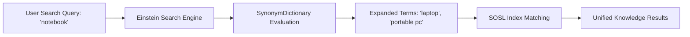

## Architectural Overview

The `SynonymDictionary` metadata type represents the declarative configuration of search synonym groups in **Salesforce Knowledge and Einstein Search**. When contact center agents, service technicians, or self-service community members search knowledge bases and CRM records, they frequently use colloquial terminology, internal jargon, or acronyms that do not literally match the authored text—such as searching for "laptop" when the article references "notebook computer", or "USB-C" when the product is cataloged as "Type-C cable".

Architecturally, `SynonymDictionary` injects semantic expansion into the Salesforce SOSL (Salesforce Object Search Language) index. A synonym group contains a set of symmetrical terms and target language codes. Searching for any term within the group automatically yields search results indexed against any other term in that group. Managing synonym dictionaries in version control empowers enterprise knowledge management teams to maintain high search recall across global service operations.



## Directory and File Conventions

In SFDX source format, `SynonymDictionary` components reside in the `synonymDictionaries` directory:

| Property | Value |
| :--- | :--- |
| **Metadata Type Name** | `SynonymDictionary` |
| **SFDX Folder** | `force-app/main/default/synonymDictionaries/` |
| **File Suffix** | `.synonymDictionary-meta.xml` (or `.synonymDictionary`) |
| **Wildcard Support (`*`)** | Supported in `package.xml` |

## Key Metadata Fields

The `SynonymDictionary` XML schema structures synonym groups, languages, and terms:

| Field Name | Field Type | Required | Architectural Description |
| :--- | :--- | :--- | :--- |
| `fullName` | `string` | Yes | DeveloperName / API identifier of the synonym dictionary. |
| `label` | `string` | Yes | Administrative title identifying the dictionary in Search Setup. |
| `groups` | `SynonymGroup[]` | Yes | Array of synonym groups containing interchangeable terms and target languages. |
| `groups.languages` | `Language[]` | Yes | Language codes (e.g., `en_US`, `fr`, `de`, `ja`) where the synonym group applies. |
| `groups.terms` | `string[]` | Yes | Collection of interchangeable words or phrases (minimum 2 terms, maximum 50 characters per term). |
| `isProtected` | `boolean` | No | Managed package protection indicator; default is `false`. |

> [!NOTE]
> Synonym groups are **strictly symmetrical**. Defining "monitor" and "display" in a group means searching for "monitor" returns "display" matches, and searching for "display" returns "monitor" matches.

## Declarative XML and Package Manifest Examples

Below is a declarative `SynonymDictionary` defining hardware and device terminology across English and Spanish locales:

```xml title="force-app/main/default/synonymDictionaries/IT_Hardware_Synonyms.synonymDictionary-meta.xml"
<?xml version="1.0" encoding="UTF-8"?>
<SynonymDictionary xmlns="http://soap.sforce.com/2006/04/metadata">
    <fullName>IT_Hardware_Synonyms</fullName>
    <label>IT Hardware Synonyms</label>
    <groups>
        <languages>en_US</languages>
        <terms>laptop</terms>
        <terms>notebook</terms>
        <terms>portable computer</terms>
    </groups>
    <groups>
        <languages>en_US</languages>
        <terms>headset</terms>
        <terms>headphones</terms>
        <terms>earphones</terms>
    </groups>
    <groups>
        <languages>es</languages>
        <terms>ordenador portatil</terms>
        <terms>computadora portatil</terms>
    </groups>
    <isProtected>false</isProtected>
</SynonymDictionary>
```

Add the component to the package manifest:

```xml title="manifest/package.xml"
<?xml version="1.0" encoding="UTF-8"?>
<Package xmlns="http://soap.sforce.com/2006/04/metadata">
    <types>
        <members>IT_Hardware_Synonyms</members>
        <name>SynonymDictionary</name>
    </types>
    <version>68.0</version>
</Package>
```

## Retrieval and Deployment

Use Salesforce CLI commands to manage search dictionaries:

```bash
# Retrieve all synonym dictionaries
sf project retrieve start --metadata "SynonymDictionary:*"

# Deploy specific dictionary to production org
sf project deploy start --metadata "SynonymDictionary:IT_Hardware_Synonyms" --target-org prod

# Query synonym dictionaries via Tooling API
sf data query --query "SELECT Id, DeveloperName, MasterLabel FROM SynonymDictionary" --use-tooling-api
```

## Senior Architect Considerations

> [!TIP]
> Each synonym group requires a minimum of **two terms**. Deployments containing single-term synonym groups will fail schema validation.

1. **Pre-requisite Permissions:** Ensure the deploying user profile or permission set has **Manage Synonyms** enabled and that Knowledge search is enabled in target org settings.
2. **Search Index Latency:** Deploying updates to `SynonymDictionary` metadata triggers background index recompilation. Allow several minutes post-deployment for index propagation to complete before conducting search testing.
3. **Avoid Over-Expansion:** Creating excessively broad synonym groups (e.g., grouping generic terms like "system", "app", and "software") degrades search precision by introducing excessive noise into agent search results.
