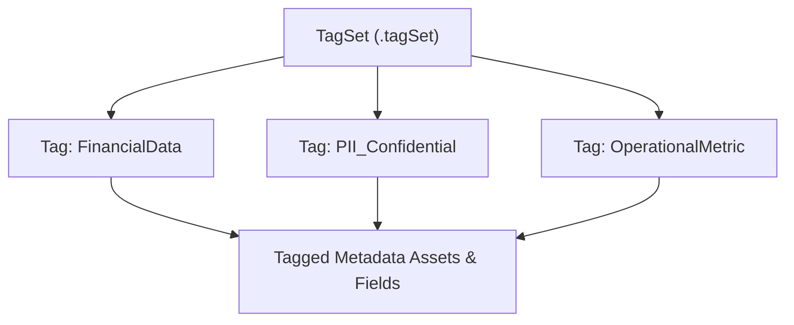

## Architectural Overview

The `Tag` metadata type represents discrete classification values defined within modern **Salesforce Metadata Governance and Tagging** frameworks. As enterprise organizations scale across thousands of custom objects, integration endpoints, flows, and Data Cloud data streams, managing data governance, compliance classifications (such as PII, HIPAA, or GDPR), and architectural domain ownership requires standardized tagging mechanisms.

Architecturally, `Tag` functions as a strongly typed, controlled vocabulary value nested within a parent [TagSet](/docs/metadata/tag-set-metadata-type/). While legacy platform tags were unmanaged text strings created ad-hoc by end users, modern `Tag` metadata provides programmatic governance: each tag has a unique developer name, localized labels, administrative descriptions, and extensible properties. DevOps teams can promote compliance taxonomies deterministically across multi-org architectures.



## Directory and File Conventions

In SFDX source projects, `Tag` definitions are encapsulated within their parent `TagSet` containers stored in the `tagSets` folder:

| Property | Value |
| :--- | :--- |
| **Metadata Type Name** | `Tag` (child of `TagSet`) |
| **SFDX Folder** | `force-app/main/default/tagSets/` |
| **File Suffix** | Bundled within `.tagSet-meta.xml` |
| **Wildcard Support (`*`)** | Not supported (explicit manifest declaration required) |

## Key Metadata Fields

The `Tag` metadata schema provides attribute controls for governance classification:

| Field Name | Field Type | Required | Architectural Description |
| :--- | :--- | :--- | :--- |
| `name` | `string` | Yes | Programmatic API name of the tag (alphanumeric, no spaces, org-unique). |
| `label` | `string` | Yes | Human-readable label displayed in administrative consoles and data catalogs. |
| `description` | `string` | No | Operational definition clarifying the exact governance or compliance scope. |
| `options` | `TagOption[]` | No | Configurable option parameters associated with the tag. |
| `properties` | `TagProperty[]` | No | Extensible key-value metadata properties assigned to this tag value. |

> [!RELEASE] Winter '27
> Introduced in API version 67.0 and expanded in API version 68.0, `Tag` provides unified taxonomy capabilities for Salesforce Platform and Data Cloud governance.

## Declarative XML and Package Manifest Examples

Below is a declarative snippet illustrating `Tag` records declared within a parent `TagSet` definition:

```xml title="force-app/main/default/tagSets/ComplianceClassification.tagSet-meta.xml"
<?xml version="1.0" encoding="UTF-8"?>
<TagSet xmlns="http://soap.sforce.com/2006/04/metadata">
    <fullName>ComplianceClassification</fullName>
    <label>Compliance Classification</label>
    <description>Enterprise regulatory compliance and privacy classifications.</description>
    <tags>
        <name>PII_Restricted</name>
        <label>PII Restricted</label>
        <description>Direct personally identifiable information requiring encryption at rest and masked display.</description>
    </tags>
    <tags>
        <name>PCI_Cardholder</name>
        <label>PCI Cardholder Data</label>
        <description>Payment card industry regulated PAN and authentication data.</description>
    </tags>
</TagSet>
```

In `package.xml`, retrieve the parent `TagSet` explicitly:

```xml title="manifest/package.xml"
<?xml version="1.0" encoding="UTF-8"?>
<Package xmlns="http://soap.sforce.com/2006/04/metadata">
    <types>
        <members>ComplianceClassification</members>
        <name>TagSet</name>
    </types>
    <version>68.0</version>
</Package>
```

## Retrieval and Deployment

Manage `Tag` and `TagSet` components using modern Salesforce CLI syntax:

```bash
# Retrieve specific TagSet containing child tags
sf project retrieve start --metadata "TagSet:ComplianceClassification"

# Deploy TagSet taxonomy to staging sandbox
sf project deploy start --metadata "TagSet:ComplianceClassification" --target-org staging-sandbox

# List existing tags in the org using metadata list command
sf project list metadata --metadata-type TagSet
```

## Senior Architect Considerations

> [!TIP]
> Do not use wildcard (`*`) operators when retrieving `Tag` or `TagSet` metadata. Salesforce Metadata API requires explicit member declarations for these governance types.

1. **Taxonomy Governance:** Treat `Tag` definitions as immutable reference metadata. Renaming or deleting tags in production can break automated compliance reporting and data masking policies.
2. **Data Cloud Integration:** Modern Data Cloud policies leverage tags for automated object tagging and semantic search indexing. Ensure tags are deployed prior to configuring data governance policies.
3. **Hierarchy Strategy:** Group related tags under focused `TagSet` containers (e.g., Data Privacy, Business Domain, Lifecycle State) rather than creating a single monolithic tag set.
