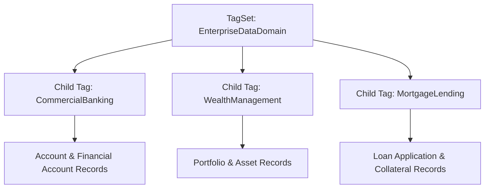

## Architectural Overview

The `TagSet` metadata type represents top-level taxonomy categories within **Salesforce Metadata Governance**. In large-scale enterprise deployments, architects must enforce data cataloging and compliance policies across disparate CRM entities, Custom Metadata Types, Flow automations, and Data Cloud objects. Rather than applying unstructured labels, organizations require formal taxonomy definitions that classify assets into structured domains.

Architecturally, `TagSet` acts as the root taxonomy container that groups individual [Tag](/docs/metadata/tag-metadata-type/) entries. Furthermore, `TagSet` supports multi-tier hierarchical categorization, where high-level categories (e.g., Data Privacy) branch into specialized subcategories (e.g., Regional Jurisdiction, Retention Schedules). Codifying tag sets as metadata allows DevOps teams to version-control the taxonomy schema alongside the platform components it categorizes.



## Directory and File Conventions

In SFDX source projects, `TagSet` components are stored in the `tagSets` directory:

| Property | Value |
| :--- | :--- |
| **Metadata Type Name** | `TagSet` |
| **SFDX Folder** | `force-app/main/default/tagSets/` |
| **File Suffix** | `.tagSet-meta.xml` (or `.tagSet`) |
| **Wildcard Support (`*`)** | Not supported (explicit members required in `package.xml`) |

## Key Metadata Fields

The `TagSet` metadata schema defines container taxonomy properties and encapsulates child tags:

| Field Name | Field Type | Required | Architectural Description |
| :--- | :--- | :--- | :--- |
| `name` | `string` | Yes | DeveloperName / API identifier of the tag set container. |
| `label` | `string` | Yes | Human-readable category title displayed in administrative Setup. |
| `description` | `string` | No | Operational narrative defining the governance boundaries of this taxonomy. |
| `tags` | `Tag[]` | No | Collection of individual `Tag` child items belonging to this category. |
| `options` | `TagOption[]` | No | Configuration options controlling tag assignment behavior. |
| `properties` | `TagProperty[]` | No | Custom key-value properties describing category parameters. |

> [!RELEASE] Winter '27
> Introduced in API version 67.0 and refined in API version 68.0, `TagSet` is the standard metadata construct for enterprise data cataloging across Salesforce Core and Data Cloud.

## Declarative XML and Package Manifest Examples

Below is a declarative `TagSet` defining an enterprise business domain classification schema:

```xml title="force-app/main/default/tagSets/BusinessDomain.tagSet-meta.xml"
<?xml version="1.0" encoding="UTF-8"?>
<TagSet xmlns="http://soap.sforce.com/2006/04/metadata">
    <name>BusinessDomain</name>
    <label>Business Domain Classification</label>
    <description>Enterprise taxonomy grouping Salesforce assets by line of business.</description>
    <tags>
        <name>Consumer_Lending</name>
        <label>Consumer Lending</label>
        <description>Retail mortgage and consumer credit assets.</description>
    </tags>
    <tags>
        <name>Commercial_Banking</name>
        <label>Commercial Banking</label>
        <description>Corporate credit facilities and treasury management assets.</description>
    </tags>
</TagSet>
```

In `package.xml`, specify each tag set explicitly:

```xml title="manifest/package.xml"
<?xml version="1.0" encoding="UTF-8"?>
<Package xmlns="http://soap.sforce.com/2006/04/metadata">
    <types>
        <members>BusinessDomain</members>
        <name>TagSet</name>
    </types>
    <version>68.0</version>
</Package>
```

## Retrieval and Deployment

Use modern Salesforce CLI commands to manage tag set metadata:

```bash
# Retrieve specific TagSet component by name
sf project retrieve start --metadata "TagSet:BusinessDomain"

# Deploy TagSet to target production org
sf project deploy start --metadata "TagSet:BusinessDomain" --target-org prod

# List available TagSet metadata in the connected org
sf project list metadata --metadata-type TagSet
```

## Senior Architect Considerations

> [!TIP]
> Because `TagSet` contains its nested `tags`, deploying the `TagSet` file updates both the container taxonomy and all associated tag options atomically.

1. **Explicit Manifest Declarations:** Never configure `<members>*</members>` for `TagSet` in `package.xml`. The Metadata API will reject the manifest with a member expansion error.
2. **Domain-Driven Design:** Align `TagSet` definitions with your enterprise Data Mesh architecture. Creating dedicated tag sets for Business Unit, Data Sensitivity, and Operational Lifecycle provides multi-dimensional tagging capabilities.
3. **Automated Compliance:** Use CI/CD validation scripts to verify that every new custom object or data stream includes approved domain tags defined in your deployed `TagSet` metadata.
