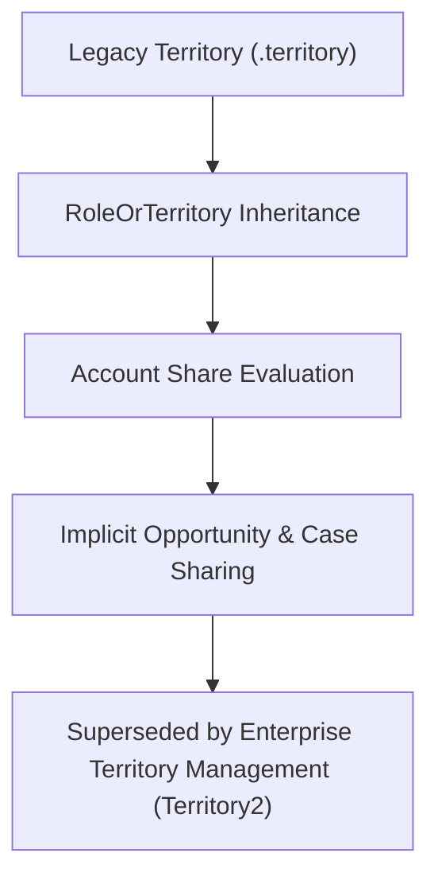

## Architectural Overview

The `Territory` metadata type represents the original, legacy **Sales Territory Management** framework in Salesforce. In earlier platform architectures, organizations configured territory nodes to overlay standard role hierarchies, granting sales representatives record access to Accounts, Contacts, Opportunities, and Cases based on geographic or industry groupings rather than standard ownership.

Architecturally, legacy `Territory` extends `RoleOrTerritory` and operates in tandem with the account sharing engine. However, original territory management lacked multi-model planning, effective date ranges, and modular rule abstractions. Consequently, Salesforce replaced legacy territory management with **Enterprise Territory Management (Territory2)**. Today, enterprise architects primarily encounter `Territory` metadata during technical debt assessments, legacy org decompilations, or enterprise migration initiatives moving to [Territory2](/docs/metadata/territory2-metadata-type/).



## Directory and File Conventions

In SFDX source projects representing legacy orgs, `Territory` components reside in the `territories` directory:

| Property | Value |
| :--- | :--- |
| **Metadata Type Name** | `Territory` |
| **SFDX Folder** | `force-app/main/default/territories/` |
| **File Suffix** | `.territory-meta.xml` (or `.territory`) |
| **Wildcard Support (`*`)** | Supported in `package.xml` (in legacy orgs) |

## Key Metadata Fields

The `Territory` schema inherits from the platform role and territory base structure:

| Field Name | Field Type | Required | Architectural Description |
| :--- | :--- | :--- | :--- |
| `fullName` | `string` | Yes | DeveloperName / API identifier of the legacy territory node. |
| `name` | `string` | Yes | Display name of the territory shown in sales reports and user assignments. |
| `description` | `string` | No | Operational details clarifying geographical coverage or target market segments. |
| `parentTerritory` | `string` | No | Full name of the parent territory node within the single active hierarchy tree. |
| `accountAccessLevel` | `string` | No | Access granted to Accounts assigned to this territory (`Read`, `Edit`). |
| `opportunityAccessLevel` | `string` | No | Access level granted to associated Opportunities (`None`, `Read`, `Edit`). |
| `caseAccessLevel` | `string` | No | Access level granted to associated Cases (`None`, `Read`, `Edit`). |
| `contactAccessLevel` | `string` | No | Access level for Contacts when org-wide defaults are private. |

> [!WARNING]
> Original Territory Management is legacy functionality and is not available in newly provisioned Salesforce organizations. All net-new territory implementations must utilize [Territory2](/docs/metadata/territory2-metadata-type/).

## Declarative XML and Package Manifest Examples

Below is a declarative XML definition of a legacy Western Sales territory:

```xml title="force-app/main/default/territories/Western_Enterprise_Sales.territory-meta.xml"
<?xml version="1.0" encoding="UTF-8"?>
<Territory xmlns="http://soap.sforce.com/2006/04/metadata">
    <fullName>Western_Enterprise_Sales</fullName>
    <name>Western Enterprise Sales</name>
    <description>Enterprise sales accounts located in California, Oregon, and Washington.</description>
    <parentTerritory>North_America_Sales</parentTerritory>
    <accountAccessLevel>Edit</accountAccessLevel>
    <opportunityAccessLevel>Edit</opportunityAccessLevel>
    <caseAccessLevel>Read</caseAccessLevel>
    <contactAccessLevel>Edit</contactAccessLevel>
</Territory>
```

In `package.xml`:

```xml title="manifest/package.xml"
<?xml version="1.0" encoding="UTF-8"?>
<Package xmlns="http://soap.sforce.com/2006/04/metadata">
    <types>
        <members>Western_Enterprise_Sales</members>
        <name>Territory</name>
    </types>
    <version>68.0</version>
</Package>
```

## Retrieval and Deployment

To retrieve legacy territory metadata from an existing legacy org:

```bash
# Retrieve legacy territory definitions
sf project retrieve start --metadata "Territory:Western_Enterprise_Sales"

# Query legacy territories via Tooling API
sf data query --query "SELECT Id, DeveloperName, MasterLabel, ParentTerritoryId FROM Territory" --use-tooling-api
```

## Senior Architect Considerations

> [!TIP]
> If maintaining a legacy org that still uses `Territory`, prioritize a technical migration roadmap to **Enterprise Territory Management (Territory2)**. Territory2 unlocks multiple concurrent models, automated territory assignment rules, and territory type hierarchies.

1. **Hierarchy Locking:** Deploying updates to parent-child territory relationships initiates asynchronous group membership recalculations on AccountShare tables, which can cause row lock timeouts during business hours.
2. **Migration Path:** Export existing territory structures, map legacy territories to [Territory2](/docs/metadata/territory2-metadata-type/), define [Territory2Model](/docs/metadata/territory2-model-metadata-type/) components, and migrate manual account assignments to [Territory2Rule](/docs/metadata/territory2-rule-metadata-type/).
3. **Sharing Rule Impact:** Always audit existing [SharingRules](/docs/metadata/sharing-rules-metadata-type/) that grant access to `Territory` groups before initiating decommissioning.
