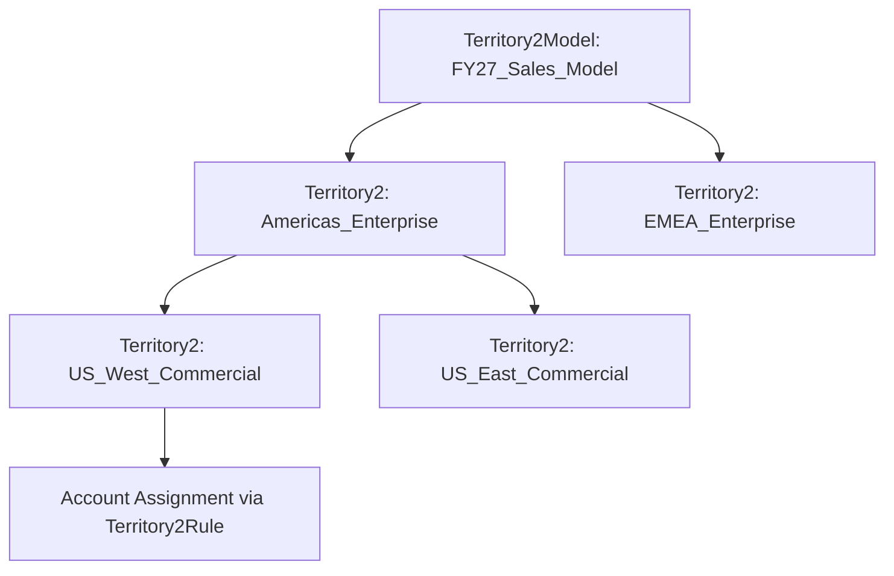

## Architectural Overview

The `Territory2` metadata type represents an individual territory node within **Enterprise Territory Management (ETM / Territory2)**. In enterprise sales organizations, account ownership alone cannot satisfy complex go-to-market motions where global account managers, regional sales executives, solution engineers, and customer success managers collaborate on the same client accounts.

Architecturally, `Territory2` components are structured within a parent [Territory2Model](/docs/metadata/territory2-model-metadata-type/) container and classified by a [Territory2Type](/docs/metadata/territory2-type-metadata-type/). Each territory node determines:
1. **Access Permissions:** Defining explicit read or edit access to assigned Accounts, Opportunities, and Cases.
2. **Structural Placement:** Forming a parent-child hierarchy under a parent territory.
3. **Custom Metadata Attributes:** Supporting custom fields on the `Territory2` standard object (e.g., Quota targets, Regional Director references, or Cost Center codes).

Deploying `Territory2` metadata enables DevOps teams to automate the rollout of restructured sales territories across fiscal years without manual data entry.



## Directory and File Conventions

In SFDX source format, `Territory2` components are nested inside their parent model directory:

| Property | Value |
| :--- | :--- |
| **Metadata Type Name** | `Territory2` |
| **SFDX Folder** | `force-app/main/default/territory2Models/ModelName/territories/` |
| **File Suffix** | `.territory2-meta.xml` (or `.territory2`) |
| **Wildcard Support (`*`)** | Supported in `package.xml` |

## Key Metadata Fields

The `Territory2` metadata schema defines access levels, parent relationships, and classification links:

| Field Name | Field Type | Required | Architectural Description |
| :--- | :--- | :--- | :--- |
| `name` | `string` | Yes | Human-readable territory label displayed across CRM interfaces. |
| `territory2Type` | `string` | Yes | DeveloperName of the associated `Territory2Type` classifying this node. |
| `parentTerritory` | `string` | No | API name of the parent `Territory2` node within the same model hierarchy. |
| `accountAccessLevel` | `string` | Yes | Access granted on assigned Accounts (`Read`, `Edit`). |
| `opportunityAccessLevel` | `string` | Yes | Access granted on associated Opportunities (`None`, `Read`, `Edit`). |
| `caseAccessLevel` | `string` | Yes | Access granted on associated Cases (`None`, `Read`, `Edit`). |
| `description` | `string` | No | Detailed explanation of account eligibility and sales coverage rules. |
| `customFields` | `CustomField[]`| No | Custom field values stamped on this territory metadata record. |

> [!NOTE]
> Custom fields on `Territory2` support most standard field types, but exclude long text areas, rich text areas, and encrypted fields.

## Declarative XML and Package Manifest Examples

Below is a declarative `Territory2` component for the US West commercial sales division under the `FY27_Global_Sales` model:

```xml title="force-app/main/default/territory2Models/FY27_Global_Sales/territories/US_West_Commercial.territory2-meta.xml"
<?xml version="1.0" encoding="UTF-8"?>
<Territory2 xmlns="http://soap.sforce.com/2006/04/metadata">
    <name>US West Commercial</name>
    <description>Commercial accounts with revenue under $500M in Pacific and Mountain timezones.</description>
    <territory2Type>Commercial_Accounts</territory2Type>
    <parentTerritory>Americas_Sales</parentTerritory>
    <accountAccessLevel>Edit</accountAccessLevel>
    <opportunityAccessLevel>Edit</opportunityAccessLevel>
    <caseAccessLevel>Read</caseAccessLevel>
</Territory2>
```

Add the component to the package manifest:

```xml title="manifest/package.xml"
<?xml version="1.0" encoding="UTF-8"?>
<Package xmlns="http://soap.sforce.com/2006/04/metadata">
    <types>
        <members>FY27_Global_Sales.US_West_Commercial</members>
        <name>Territory2</name>
    </types>
    <version>68.0</version>
</Package>
```

## Retrieval and Deployment

Use modern Salesforce CLI commands to manage territory nodes:

```bash
# Retrieve all territories within a model
sf project retrieve start --metadata "Territory2:FY27_Global_Sales.*"

# Deploy territory node to target environment
sf project deploy start --metadata "Territory2:FY27_Global_Sales.US_West_Commercial" --target-org prod-sandbox

# Inspect territory nodes via SOQL Tooling API
sf data query --query "SELECT Id, DeveloperName, Territory2ModelId, Territory2TypeId FROM Territory2" --use-tooling-api
```

## Senior Architect Considerations

> [!TIP]
> Always deploy [Territory2Type](/docs/metadata/territory2-type-metadata-type/) components before deploying `Territory2` nodes. Every territory record strictly requires a valid territory type reference.

1. **Model Hierarchy Traversal:** When deploying multiple territories, deploy top-level root territories before child territories to satisfy `parentTerritory` dependencies.
2. **Access Level Inconsistencies:** The platform validates that child territory access levels do not contradict parent territory permissions. Align account, opportunity, and case access levels across the hierarchy.
3. **Sharing Recalculation Overhead:** Activating a model containing thousands of `Territory2` records initiates massive asynchronous batch recalculations on `AccountShare` and `OpportunityShare` tables. Schedule activations during maintenance windows.
