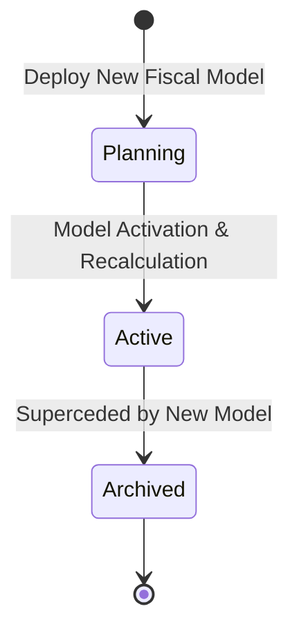

## Architectural Overview

The `Territory2Model` metadata type represents the root structural container and lifecycle controller for **Enterprise Territory Management (ETM / Territory2)** in Salesforce. Unlike legacy territory management, which supported only a single monolithic, continuously active hierarchy, Territory2 empowers sales operations and platform architects to build, simulate, and stage entire alternative sales organizational designs.

Architecturally, `Territory2Model` manages three discrete lifecycle states:
- **Planning:** The sandbox where sales architects construct new territory trees, create [Territory2Rule](/docs/metadata/territory2-rule-metadata-type/) criteria, and simulate account assignment metrics without disrupting active production account sharing.
- **Active:** The currently operational territory model driving runtime account sharing, opportunity visibility, and territory forecasting. Only **one** model can be active at any given moment.
- **Archived:** Historical models preserved for audit trails, reporting comparisons, and regulatory review.

Deploying `Territory2Model` metadata enables enterprise organizations to orchestrate annual territory realignments cleanly through automated CI/CD pipelines.



## Directory and File Conventions

In SFDX source projects, `Territory2Model` definitions reside at the root of their specific model folder inside `territory2Models`:

| Property | Value |
| :--- | :--- |
| **Metadata Type Name** | `Territory2Model` |
| **SFDX Folder** | `force-app/main/default/territory2Models/ModelName/` |
| **File Suffix** | `ModelName.territory2Model-meta.xml` |
| **Wildcard Support (`*`)** | Supported in `package.xml` |

## Key Metadata Fields

The `Territory2Model` metadata schema governs lifecycle status and descriptions:

| Field Name | Field Type | Required | Architectural Description |
| :--- | :--- | :--- | :--- |
| `name` | `string` | Yes | Human-readable label displayed in territory planning consoles. |
| `description` | `string` | No | Operational purpose detailing the fiscal year or strategic realignment scope. |
| `state` | `Territory2ModelState` | No | Lifecycle state (`Planning`, `Active`, `Archived`). |
| `customFields` | `CustomField[]` | No | Custom metadata attributes configured on the `Territory2Model` standard object. |

> [!NOTE]
> Attempting to deploy a model directly in the `Active` state when another model is already active will result in deployment failure. Transition models to `Active` after deployment validation.

## Declarative XML and Package Manifest Examples

Below is a declarative `Territory2Model` definition configuring a Planning model for the upcoming fiscal year:

```xml title="force-app/main/default/territory2Models/FY27_Global_Sales/FY27_Global_Sales.territory2Model-meta.xml"
<?xml version="1.0" encoding="UTF-8"?>
<Territory2Model xmlns="http://soap.sforce.com/2006/04/metadata">
    <name>FY27 Global Sales Model</name>
    <description>Strategic realignment of enterprise and commercial sales territories for fiscal year 2027.</description>
    <state>Planning</state>
</Territory2Model>
```

Add the model to `package.xml`:

```xml title="manifest/package.xml"
<?xml version="1.0" encoding="UTF-8"?>
<Package xmlns="http://soap.sforce.com/2006/04/metadata">
    <types>
        <members>FY27_Global_Sales</members>
        <name>Territory2Model</name>
    </types>
    <version>68.0</version>
</Package>
```

## Retrieval and Deployment

Manage territory models via the Salesforce CLI:

```bash
# Retrieve the entire territory model including child territories and rules
sf project retrieve start --metadata "Territory2Model:FY27_Global_Sales"

# Deploy territory model in Planning state to production
sf project deploy start --metadata "Territory2Model:FY27_Global_Sales" --target-org prod

# Query model states using Tooling API
sf data query --query "SELECT Id, DeveloperName, State FROM Territory2Model" --use-tooling-api
```

## Senior Architect Considerations

> [!TIP]
> Always deploy new models in the `Planning` state. This permits comprehensive end-to-end verification of territory hierarchies, rule assignments, and user allocations in production without triggering disruptive sharing recalculations.

1. **Activation Strategy:** Model activation triggers an org-wide asynchronous batch recalculation that updates millions of `AccountShare` records. Always execute activation via the UI or Tooling API during designated off-peak maintenance windows.
2. **Model Archival:** When promoting a new model to `Active`, the existing active model automatically transitions to `Archived`. Archived models cannot be re-activated directly; they must first be cloned back to `Planning`.
3. **CI/CD Best Practice:** Package all child [Territory2](/docs/metadata/territory2-metadata-type/) nodes and [Territory2Rule](/docs/metadata/territory2-rule-metadata-type/) components within the model directory to maintain atomic version control.
