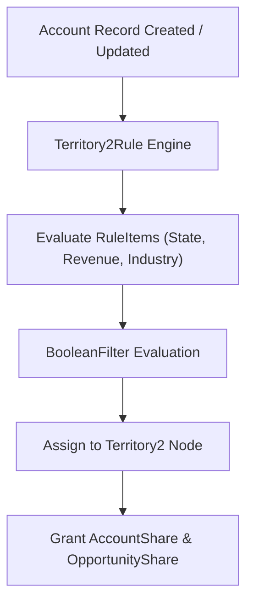

## Architectural Overview

The `Territory2Rule` metadata type represents declarative Account Assignment Rules within **Enterprise Territory Management (ETM / Territory2)**. In high-volume enterprise sales operations, assigning accounts manually to sales territories is operationally unfeasible and prone to human error. Organizations require automated routing rules that evaluate account demographics—such as billing state, postal code, annual revenue, industry vertical, and employee count—to align accounts dynamically with territory hierarchies.

Architecturally, `Territory2Rule` components belong to a parent [Territory2Model](/docs/metadata/territory2-model-metadata-type/) container. Each rule consists of evaluated criteria (`ruleItems`), complex Boolean logic expressions (`booleanFilter`), and territory bindings. When accounts are created, updated, or re-evaluated via batch jobs, the territory engine executes these rules to grant account and opportunity access to the appropriate sales representatives. Managing assignment rules as code ensures consistent territory segmentation across testing and production environments.



## Directory and File Conventions

In SFDX source projects, `Territory2Rule` components are organized inside the `rules` folder of their parent model:

| Property | Value |
| :--- | :--- |
| **Metadata Type Name** | `Territory2Rule` |
| **SFDX Folder** | `force-app/main/default/territory2Models/ModelName/rules/` |
| **File Suffix** | `.territory2Rule-meta.xml` (or `.territory2Rule`) |
| **Wildcard Support (`*`)** | Supported in `package.xml` |

## Key Metadata Fields

The `Territory2Rule` metadata schema defines filter criteria, operators, and logical combinations:

| Field Name | Field Type | Required | Architectural Description |
| :--- | :--- | :--- | :--- |
| `name` | `string` | Yes | Human-readable name of the assignment rule. |
| `active` | `boolean` | Yes | Controls whether the rule actively evaluates during account assignment executions. |
| `booleanFilter` | `string` | No | Advanced logic expression (e.g., `(1 AND 2) OR 3`) combining rule criteria. |
| `ruleItems` | `RuleItem[]` | Yes | Array of field criteria defining target field, operator, and comparison value. |
| `ruleItems.field` | `string` | Yes | API name of the evaluated `Account` field (e.g., `Account.BillingState`). |
| `ruleItems.operation`| `string` | Yes | Comparison operator (`equals`, `notEqual`, `greaterThan`, `contains`). |
| `ruleItems.value` | `string` | No | Literal threshold or string matched against the account field. |

> [!NOTE]
> `Territory2Rule` items evaluate against standard and custom fields on the `Account` object. Referenced custom fields must exist in target environments before deploying rule metadata.

## Declarative XML and Package Manifest Examples

Below is a declarative `Territory2Rule` assigning enterprise accounts in California with annual revenue exceeding $50M to the Northern California enterprise sales territory:

```xml title="force-app/main/default/territory2Models/FY27_Global_Sales/rules/NorCal_Enterprise_Accounts.territory2Rule-meta.xml"
<?xml version="1.0" encoding="UTF-8"?>
<Territory2Rule xmlns="http://soap.sforce.com/2006/04/metadata">
    <name>NorCal Enterprise Accounts</name>
    <active>true</active>
    <booleanFilter>1 AND 2</booleanFilter>
    <ruleItems>
        <field>Account.BillingState</field>
        <operation>equals</operation>
        <value>CA,California</value>
    </ruleItems>
    <ruleItems>
        <field>Account.AnnualRevenue</field>
        <operation>greaterOrEqual</operation>
        <value>50000000</value>
    </ruleItems>
</Territory2Rule>
```

Add the component to `package.xml`:

```xml title="manifest/package.xml"
<?xml version="1.0" encoding="UTF-8"?>
<Package xmlns="http://soap.sforce.com/2006/04/metadata">
    <types>
        <members>FY27_Global_Sales.NorCal_Enterprise_Accounts</members>
        <name>Territory2Rule</name>
    </types>
    <version>68.0</version>
</Package>
```

## Retrieval and Deployment

Use modern Salesforce CLI commands to manage assignment rules:

```bash
# Retrieve all rules for a territory model
sf project retrieve start --metadata "Territory2Rule:FY27_Global_Sales.*"

# Deploy rule to target sandbox
sf project deploy start --metadata "Territory2Rule:FY27_Global_Sales.NorCal_Enterprise_Accounts" --target-org uat

# Query assignment rules via Tooling API
sf data query --query "SELECT Id, DeveloperName, IsActive, Territory2ModelId FROM Territory2Rule" --use-tooling-api
```

## Senior Architect Considerations

> [!TIP]
> Use comma-separated values in `ruleItems.value` when using the `equals` operator to evaluate multiple states or postal codes in a single rule item rather than constructing multiple OR lines.

1. **Rule Limit Optimization:** Salesforce limits active territory rules per model. Consolidate overlapping rules into structured Boolean filter expressions to avoid exceeding platform governor limits.
2. **Batch Assignment Execution:** Deploying a rule in `active = true` state does not automatically reassign existing account records retroactively. Execute the `Run Territory Rules` apex batch job or trigger rule evaluation from Setup to process historical data.
3. **Field Level Security:** Assignment rules evaluate based on field values without considering field-level security of the running user. Ensure assignment criteria rely on authoritative system fields.
