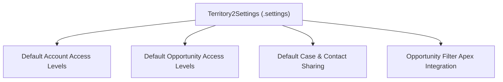

## Architectural Overview

The `Territory2Settings` metadata type represents organization-wide configuration settings for **Enterprise Territory Management (ETM / Territory2)**. In enterprise Sales Cloud implementations, managing sharing models across global sales organizations requires baseline policies defining how assigned territory members interact with Accounts, Contacts, Cases, and Opportunities.

Architecturally, `Territory2Settings` acts as the global policy anchor for the territory engine. It establishes default record access levels, controls whether opportunities automatically assign to territories when accounts are routed, and manages opportunity filter classes that govern territory assignment logic. Maintaining these settings in version control guarantees that sandbox refreshes, scratch orgs, and production environments share identical security baselines.



## Directory and File Conventions

In SFDX source projects, `Territory2Settings` is maintained inside the `settings` directory:

| Property | Value |
| :--- | :--- |
| **Metadata Type Name** | `Territory2Settings` (or member of `Settings`) |
| **SFDX Folder** | `force-app/main/default/settings/` |
| **File Name** | `Territory2.settings-meta.xml` (or `Territory2.settings`) |
| **Wildcard Support (`*`)** | Not supported under generic `Settings`; member must be explicitly listed |

## Key Metadata Fields

The `Territory2Settings` schema exposes baseline security and routing attributes:

| Field Name | Field Type | Default | Architectural Description |
| :--- | :--- | :--- | :--- |
| `defaultAccountAccessLevel` | `string` | `None` | Default access granted to accounts assigned to a territory (`None`, `Read`, `Edit`). |
| `defaultContactAccessLevel` | `string` | `None` | Default access granted to contacts related to assigned accounts. |
| `defaultOpportunityAccessLevel`| `string` | `None` | Default access granted to opportunities associated with assigned accounts. |
| `defaultCaseAccessLevel` | `string` | `None` | Default access level for cases attached to assigned territory accounts. |
| `opportunityFilterApexClassName`| `string` | No | Optional Apex class name implementing custom territory assignment filtering for opportunities. |
| `showParentTerritoryReports` | `boolean` | `false` | Enables reporting rollup metrics that aggregate child territory data up to parent territories. |

> [!NOTE]
> Access levels defined in `Territory2Settings` establish default values when creating new [Territory2](/docs/metadata/territory2-metadata-type/) components. Individual territories can override these defaults within allowable bounds.

## Declarative XML and Package Manifest Examples

Below is a declarative `Territory2Settings` definition configuring default Read/Write access on accounts and opportunities, along with parent rollup reporting:

```xml title="force-app/main/default/settings/Territory2.settings-meta.xml"
<?xml version="1.0" encoding="UTF-8"?>
<Territory2Settings xmlns="http://soap.sforce.com/2006/04/metadata">
    <defaultAccountAccessLevel>Edit</defaultAccountAccessLevel>
    <defaultContactAccessLevel>Edit</defaultContactAccessLevel>
    <defaultOpportunityAccessLevel>Edit</defaultOpportunityAccessLevel>
    <defaultCaseAccessLevel>Read</defaultCaseAccessLevel>
    <showParentTerritoryReports>true</showParentTerritoryReports>
</Territory2Settings>
```

Add the component to `package.xml`:

```xml title="manifest/package.xml"
<?xml version="1.0" encoding="UTF-8"?>
<Package xmlns="http://soap.sforce.com/2006/04/metadata">
    <types>
        <members>Territory2</members>
        <name>Settings</name>
    </types>
    <version>68.0</version>
</Package>
```

## Retrieval and Deployment

Use standard Salesforce CLI commands to manage territory settings:

```bash
# Retrieve Territory2 settings from the target org
sf project retrieve start --metadata "Settings:Territory2"

# Deploy settings to staging sandbox
sf project deploy start --metadata "Settings:Territory2" --target-org staging-sandbox

# Verify territory enablement and settings via CLI
sf org display --target-org staging-sandbox
```

## Senior Architect Considerations

> [!TIP]
> In scratch org definitions, include `"territory2": true` under `features` inside `project-scratch-def.json` so the Territory2 engine is activated before deploying `Territory2Settings`.

1. **Custom Opportunity Filter Apex:** If defining `opportunityFilterApexClassName`, ensure the referenced Apex class implements the `ITerritory2Filter` interface and is compiled in the org prior to deploying settings.
2. **Access Level Validation:** Setting `defaultAccountAccessLevel` to `None` is invalid if `defaultOpportunityAccessLevel` is set to `Edit`. The platform enforces that child record access cannot exceed parent account access.
3. **Implicit Sharing Impacts:** Broadening default access levels alters implicit sharing paths and triggers background sharing table updates. Evaluate the impact on performance before deploying changes to production.
