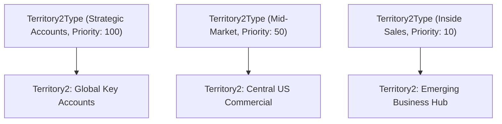

## Architectural Overview

The `Territory2Type` metadata type represents the classification schema that categorizes and ranks territory nodes within **Enterprise Territory Management (ETM / Territory2)**. In sophisticated global enterprises, sales structures comprise diverse operational tiers—such as Strategic Named Accounts, Commercial Mid-Market, High-Velocity Inside Sales, Government/Public Sector, and Channel Partner territories.

Architecturally, `Territory2Type` serves as a mandatory prerequisite for creating any [Territory2](/docs/metadata/territory2-metadata-type/) record. Beyond mere categorical labeling, each territory type possesses a numerical `priority` value. This priority indicates the relative weight and seniority of the territory classification across reporting views and helps sales leaders analyze revenue coverage across distinct organizational tiers. Deploying territory types as code guarantees structural consistency across development sandboxes and production environments.



## Directory and File Conventions

In SFDX source format, `Territory2Type` metadata files are maintained in the `territory2Types` directory:

| Property | Value |
| :--- | :--- |
| **Metadata Type Name** | `Territory2Type` |
| **SFDX Folder** | `force-app/main/default/territory2Types/` |
| **File Suffix** | `.territory2Type-meta.xml` (or `.territory2Type`) |
| **Wildcard Support (`*`)** | Supported in `package.xml` |

## Key Metadata Fields

The `Territory2Type` metadata schema provides classification attributes, labels, and prioritization numbers:

| Field Name | Field Type | Required | Architectural Description |
| :--- | :--- | :--- | :--- |
| `name` | `string` | Yes | Human-readable label displayed in territory planning and reporting tools. |
| `description` | `string` | No | Operational definition clarifying which territories qualify for this classification. |
| `priority` | `int` | Yes | Numerical weight indicating the relative hierarchy and priority of this territory type. |

> [!NOTE]
> `Territory2Type` was introduced in API version 32.0. Managing territories requires that the deploying user possess the **Manage Territories** permission.

## Declarative XML and Package Manifest Examples

Below is a declarative `Territory2Type` component defining a Strategic Accounts territory type with a high priority weighting:

```xml title="force-app/main/default/territory2Types/Strategic_Accounts.territory2Type-meta.xml"
<?xml version="1.0" encoding="UTF-8"?>
<Territory2Type xmlns="http://soap.sforce.com/2006/04/metadata">
    <name>Strategic Accounts</name>
    <description>Top tier global accounts with dedicated cross-functional account teams.</description>
    <priority>100</priority>
</Territory2Type>
```

Add the component to the package manifest:

```xml title="manifest/package.xml"
<?xml version="1.0" encoding="UTF-8"?>
<Package xmlns="http://soap.sforce.com/2006/04/metadata">
    <types>
        <members>Strategic_Accounts</members>
        <name>Territory2Type</name>
    </types>
    <version>68.0</version>
</Package>
```

## Retrieval and Deployment

Use modern Salesforce CLI commands to manage territory types:

```bash
# Retrieve all territory types
sf project retrieve start --metadata "Territory2Type:*"

# Deploy territory type to target sandbox
sf project deploy start --metadata "Territory2Type:Strategic_Accounts" --target-org uat

# Query territory types via Tooling API
sf data query --query "SELECT Id, DeveloperName, MasterLabel, Priority FROM Territory2Type" --use-tooling-api
```

## Senior Architect Considerations

> [!TIP]
> Always deploy `Territory2Type` metadata in the very first phase of an Enterprise Territory Management deployment pipeline. If child [Territory2](/docs/metadata/territory2-metadata-type/) components are deployed without pre-existing territory types, the entire deployment will abort.

1. **Priority Numbering Schemes:** Establish a standardized integer scale (e.g., 100 for Global Enterprise, 50 for Mid-Market, 10 for Velocity) to allow future intermediate tiers to be introduced without re-indexing existing priorities.
2. **Type Immutability:** Deleting a `Territory2Type` in an active environment is blocked by the platform if any active or planning `Territory2` records reference it.
3. **Packaging Strategy:** Include `Territory2Type` definitions in your core foundational sales metadata package, decoupled from specific fiscal year models.
