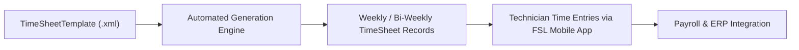

## Architectural Overview

The `TimeSheetTemplate` metadata type represents the declarative automation rules for generating worker time tracking records in **Salesforce Field Service (FSL)**. Managing mobile workforces—such as telecom technicians, equipment repair engineers, and home healthcare aides—requires precise tracking of on-site labor hours, travel durations, and overtime compliance according to statutory labor regulations.

Architecturally, `TimeSheetTemplate` acts as a recurring batch generator. Rather than requiring mobile resources or dispatchers to create time sheets manually, the template establishes:
1. **Generation Frequency:** The cadence at which time sheet records generate (`Daily`, `Weekly`, `EveryTwoWeeks`, `TwiceAMonth`, `Monthly`).
2. **Work Week Boundaries:** Definitive `workWeekStartDay` and `workWeekEndDay` designations to ensure payroll and overtime calculations align with corporate work week cycles.
3. **Target Audience:** User profile assignments (`timeSheetTemplateAssignments`) that dictate which field service technicians receive automated time sheets.

Managing time sheet templates in source control guarantees that corporate labor policies deploy consistently across sandbox, staging, and production environments.



## Directory and File Conventions

In SFDX source projects, `TimeSheetTemplate` components reside in the `timeSheetTemplates` directory:

| Property | Value |
| :--- | :--- |
| **Metadata Type Name** | `TimeSheetTemplate` |
| **SFDX Folder** | `force-app/main/default/timeSheetTemplates/` |
| **File Suffix** | `.timeSheetTemplate-meta.xml` (or `.timeSheetTemplate`) |
| **Wildcard Support (`*`)** | Not supported (explicit members required in `package.xml`) |

## Key Metadata Fields

The `TimeSheetTemplate` XML schema dictates time tracking periods and worker assignments:

| Field Name | Field Type | Required | Architectural Description |
| :--- | :--- | :--- | :--- |
| `fullName` | `string` | Yes | DeveloperName / API identifier of the time sheet template. |
| `masterLabel` | `string` | Yes | Human-readable title displayed in Field Service Setup. |
| `description` | `string` | No | Operational details specifying target labor unions, regions, or contractor groups. |
| `active` | `boolean` | Yes | Controls whether the template actively generates time sheets. |
| `frequency` | `TimeSheetFrequency` | Yes | Recurrence cadence (`Daily`, `Weekly`, `EveryTwoWeeks`, `TwiceAMonth`, `Monthly`). |
| `startDate` | `date` | Yes | Effective starting date from which recurring generation begins. |
| `workWeekStartDay` | `DaysOfWeek` | Yes | Starting boundary day of the work week (`Monday`, `Sunday`, etc.). |
| `workWeekEndDay` | `DaysOfWeek` | Yes | Ending boundary day of the work week. |
| `timeSheetTemplateAssignments` | `TimeSheetTemplateAssignment[]` | No | Child collection assigning specific user profiles to this template. |

> [!NOTE]
> `TimeSheetTemplate` was introduced in API version 46.0 and requires Field Service to be enabled along with the **Time Sheet Template** user permission.

## Declarative XML and Package Manifest Examples

Below is a declarative `TimeSheetTemplate` establishing a weekly work schedule running Monday through Friday for mobile service technicians:

```xml title="force-app/main/default/timeSheetTemplates/Weekly_Technician_Schedule.timeSheetTemplate-meta.xml"
<?xml version="1.0" encoding="UTF-8"?>
<TimeSheetTemplate xmlns="http://soap.sforce.com/2006/04/metadata">
    <fullName>Weekly_Technician_Schedule</fullName>
    <masterLabel>Weekly Technician Schedule</masterLabel>
    <description>Standard 40-hour weekly time sheet schedule for certified field technicians.</description>
    <active>true</active>
    <frequency>Weekly</frequency>
    <startDate>2026-01-01</startDate>
    <workWeekStartDay>Monday</workWeekStartDay>
    <workWeekEndDay>Friday</workWeekEndDay>
    <timeSheetTemplateAssignments>
        <profile>Custom_Field_Service_Technician</profile>
    </timeSheetTemplateAssignments>
</TimeSheetTemplate>
```

In `package.xml`, explicitly specify each template member:

```xml title="manifest/package.xml"
<?xml version="1.0" encoding="UTF-8"?>
<Package xmlns="http://soap.sforce.com/2006/04/metadata">
    <types>
        <members>Weekly_Technician_Schedule</members>
        <name>TimeSheetTemplate</name>
    </types>
    <version>68.0</version>
</Package>
```

## Retrieval and Deployment

Use Salesforce CLI commands to manage time sheet templates:

```bash
# Retrieve specific TimeSheetTemplate by name
sf project retrieve start --metadata "TimeSheetTemplate:Weekly_Technician_Schedule"

# Deploy template to target sandbox
sf project deploy start --metadata "TimeSheetTemplate:Weekly_Technician_Schedule" --target-org staging

# Query deployed templates via Tooling API
sf data query --query "SELECT Id, DeveloperName, MasterLabel, Frequency, Active FROM TimeSheetTemplate" --use-tooling-api
```

## Senior Architect Considerations

> [!TIP]
> Ensure the user profile referenced under `timeSheetTemplateAssignments` exists in the target environment or is included in the same deployment package.

1. **Explicit Member Manifests:** Wildcard (`*`) retrieval is not supported for `TimeSheetTemplate`. Always name members explicitly in manifests or use `sf project retrieve start --metadata TimeSheetTemplate:<Name>`.
2. **Scratch Org Setup:** Ensure Field Service features are enabled in `project-scratch-def.json` by adding `"fieldService": true` under `features`.
3. **Effective Date Management:** When updating `startDate` on active templates, verify that historical time sheet records are not duplicated by overlapping date generation windows.
