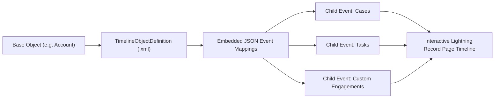

## Architectural Overview

The `TimelineObjectDefinition` metadata type represents the declarative visual configuration of **Salesforce Enhanced Timeline**. Across industries such as Health Cloud, Financial Services Cloud, Life Sciences Cloud, and Service Cloud, service agents, care managers, and relationship officers need a holistic, single-pane chronological visualization of all interactions tied to an anchor record—such as patient clinical encounters, prescription refills, bank transactions, customer support cases, and phone calls.

Architecturally, `TimelineObjectDefinition` models an anchor entity (`baseObject`) and encapsulates a structured JSON configuration within its `definition` tag. This JSON structure dictates:
1. **The Anchor:** The focal object (e.g., `Account` or `Contact`) and its age/time calculation baseline.
2. **Related Event Sources:** One-to-many child relationships (e.g., `Case`, `Task`, `Encounter__c`) that plot historical markers onto the timeline.
3. **Display Attributes:** Iconography, card titles, timestamps, and detail fields shown when users click an event node.

Codifying timeline definitions as metadata allows architects to promote rich, interactive UI components seamlessly through continuous deployment pipelines.



## Directory and File Conventions

In SFDX source format, `TimelineObjectDefinition` components reside in the `timelineObjectDefinitions` directory:

| Property | Value |
| :--- | :--- |
| **Metadata Type Name** | `TimelineObjectDefinition` |
| **SFDX Folder** | `force-app/main/default/timelineObjectDefinitions/` |
| **File Suffix** | `.timelineObjectDefinition-meta.xml` (or `.timelineObjectDefinition`) |
| **Wildcard Support (`*`)** | Supported in `package.xml` |

## Key Metadata Fields

The `TimelineObjectDefinition` XML schema defines base objects, active flags, and JSON payloads:

| Field Name | Field Type | Required | Architectural Description |
| :--- | :--- | :--- | :--- |
| `fullName` | `string` | Yes | DeveloperName / API identifier of the timeline configuration. |
| `masterLabel` | `string` | Yes | Display name of the timeline shown in Lightning App Builder palette. |
| `baseObject` | `string` | Yes | API name of the primary object anchoring the timeline (e.g., `Account`, `Contact`, `Patient__c`). |
| `definition` | `string` | Yes | JSON string containing anchor definitions, date fields, and related event objects. |
| `isActive` | `boolean` | No | Controls whether this timeline is active and selectable on Lightning record pages. |

> [!NOTE]
> `TimelineObjectDefinition` was introduced in API version 55.0. Target orgs must have the **Timeline** organization feature toggle enabled before deployments will succeed.

## Declarative XML and Package Manifest Examples

Below is a declarative `TimelineObjectDefinition` anchoring on `Account` and plotting related `Case` and `Task` events chronologically:

```xml title="force-app/main/default/timelineObjectDefinitions/Account_Customer_Timeline.timelineObjectDefinition-meta.xml"
<?xml version="1.0" encoding="UTF-8"?>
<TimelineObjectDefinition xmlns="http://soap.sforce.com/2006/04/metadata">
    <fullName>Account_Customer_Timeline</fullName>
    <baseObject>Account</baseObject>
    <isActive>true</isActive>
    <masterLabel>Account Customer Timeline</masterLabel>
    <definition>{
        "timeline": {
            "anchorObject": {
                "object": {
                    "entity": "Account",
                    "label": "Account",
                    "source": "",
                    "icon": "standard:account"
                }
            },
            "age": {
                "field": "CreatedDate",
                "label": "Account Created Date",
                "type": "DateTime"
            },
            "events": [
                {
                    "oneToMany": {
                        "eventObject": {
                            "name": "Case"
                        }
                    }
                },
                {
                    "oneToMany": {
                        "eventObject": {
                            "name": "Task"
                        }
                    }
                }
            ]
        }
    }</definition>
</TimelineObjectDefinition>
```

Add the component to `package.xml`:

```xml title="manifest/package.xml"
<?xml version="1.0" encoding="UTF-8"?>
<Package xmlns="http://soap.sforce.com/2006/04/metadata">
    <types>
        <members>Account_Customer_Timeline</members>
        <name>TimelineObjectDefinition</name>
    </types>
    <version>68.0</version>
</Package>
```

## Retrieval and Deployment

Use Salesforce CLI commands to manage timeline configurations:

```bash
# Retrieve all timeline object definitions
sf project retrieve start --metadata "TimelineObjectDefinition:*"

# Deploy timeline definition to target scratch org or sandbox
sf project deploy start --metadata "TimelineObjectDefinition:Account_Customer_Timeline" --target-org uat

# Query deployed timeline definitions via Tooling API
sf data query --query "SELECT Id, DeveloperName, MasterLabel, BaseObject, IsActive FROM TimelineObjectDefinition" --use-tooling-api
```

## Senior Architect Considerations

> [!TIP]
> After deploying `TimelineObjectDefinition`, embed the Timeline component into the target record page using [FlexiPage](/docs/metadata/flexipage-metadata-type/) metadata, referencing the timeline by its developer name.

1. **JSON Payload Validation:** The XML parser treats `definition` as an escaped text string. Validate the inner JSON structure thoroughly with a JSON linter before deploying to prevent runtime rendering bugs.
2. **Scratch Org Configuration:** Enable the timeline feature in your `project-scratch-def.json` by adding `"timeline": true` under `features`.
3. **Query Performance:** Timelines execute multi-object queries across related event tables. Ensure timestamp and relationship lookup fields (e.g., `AccountId` on `Case`) are indexed to maintain responsive page loads.
