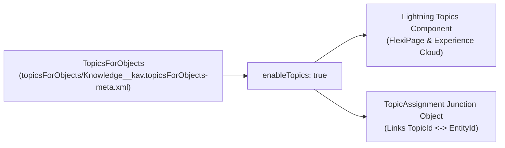

## Why the `TopicsForObjects` Metadata Type Matters

In Salesforce Lightning Experience and Experience Cloud portals, **Topics** allow users and automation to tag records (`Case`, `Knowledge__kav`, `Account`, or custom objects) with structured taxonomy tags without creating dozens of multi-select picklists. Before any user or Apex trigger can insert a `TopicAssignment` on an SObject—or before the standard **Topics** component will render on a [FlexiPage](/docs/metadata/flexipage-metadata-type/)—that object must have **`TopicsForObjects`** (`topicsForObjects/<Object>.topicsForObjects-meta.xml`) enabled.



---

## Key Metadata Fields on `TopicsForObjects`

| Field | Type | Required | Description |
|---|---|---|---|
| `entityApiName` | `string` | Yes | The API name of the standard or custom object (`Account`, `Case`, `Knowledge__kav`, `Deal_Registration__c`). |
| `enableTopics` | `boolean` | Yes | `true` to enable record topic tagging on the object; `false` to disable. |

---

## Real-World XML Example (`topicsForObjects/Knowledge__kav.topicsForObjects-meta.xml`)

```xml
<?xml version="1.0" encoding="UTF-8"?>
<TopicsForObjects xmlns="http://soap.sforce.com/2006/04/metadata">
    <enableTopics>true</enableTopics>
    <entityApiName>Knowledge__kav</entityApiName>
</TopicsForObjects>
```

---

## Querying `Topic` and `TopicAssignment` via SOQL

Once `TopicsForObjects` is enabled, topics and record-to-topic links are stored in the standard **`Topic`** and **`TopicAssignment`** objects. Note that in Experience Cloud, each site ([Network](/docs/metadata/network-metadata-type/)) maintains its own isolated topic namespace via `NetworkId`!

### 1. Query All Topics Assigned to a Specific Record (e.g., Case or Knowledge Article)

```sql
SELECT Id, TopicId, Topic.Name, EntityId, EntityType, NetworkId, CreatedDate
FROM TopicAssignment
WHERE EntityId = :recordId
ORDER BY Topic.Name ASC
```

### 2. Find All Cases Tagged with a Specific Topic in Internal Org (`NetworkId = null`)

```sql
SELECT Id, EntityId, EntityKeyPrefix, Topic.Name, CreatedBy.Name
FROM TopicAssignment
WHERE EntityType = 'Case'
  AND Topic.Name = 'Security Incident'
  AND NetworkId = null
ORDER BY CreatedDate DESC
```

---

## Senior Architect Best Practices

> [!WARNING]
> **Include `TopicsForObjects` in Your `package.xml` When Deploying FlexiPages:** One of the most common deployment omissions occurs when an admin enables Topics for a custom object in Setup (**Setup → Topics for Objects**), drops the **Topics** widget onto the Lightning Record Page (`FlexiPage`), and commits only the `FlexiPage`. Always include `TopicsForObjects` in your commit so the target Sandbox or Production org has topic tagging enabled on that object!
