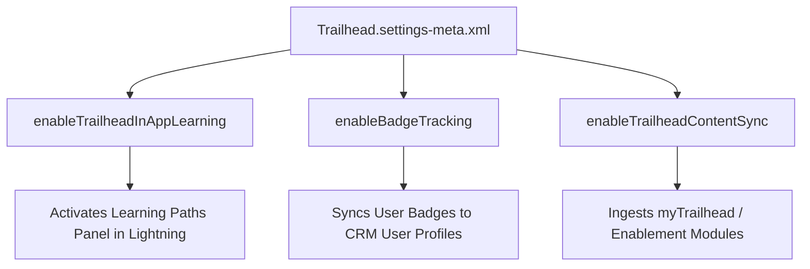

## Architectural Overview

The `TrailheadSettings` metadata type controls the administrative configuration of Trailhead and Sales Enablement (formerly myTrailhead) inside Salesforce Lightning Experience. As organizations embrace contextual onboarding and continuous learning, Salesforce exposes learning modules directly inside the CRM through the In-App Learning Paths panel and Guidance Center.

From an enterprise governance perspective, `TrailheadSettings` provides the programmatic switch to enable or restrict corporate learning feeds, track user badge progress against compliance requirements, and bind custom Trailhead subdomains to the CRM tenant. Automating these settings across sandbox and scratch org lifecycles ensures that end-user testing accurately reflects the guided training paths deployed to production.



## Directory and File Conventions

In Salesforce DX project structure, `TrailheadSettings` is managed as a singleton setting file located in the `settings/` directory.

| Property | Value |
| :--- | :--- |
| **Metadata Type Name** | `Settings` (member: `Trailhead`) / `TrailheadSettings` |
| **SFDX Folder** | `force-app/main/default/settings/` |
| **File Name** | `Trailhead.settings-meta.xml` |
| **Scratch Org Setting Key** | `trailheadSettings` |

## Key Metadata Fields

The `TrailheadSettings` type exposes the following configuration elements in XML representation:

| Field Name | Field Type | Required | Architectural Description |
| :--- | :--- | :--- | :--- |
| `enableTrailheadInAppLearning` | `boolean` | No | Activates the global Learning Paths side panel across all Lightning Experience pages. |
| `enableBadgeTracking` | `boolean` | No | Enables synchronization of completed badges and points to user identity records. |
| `enableTrailheadContentSync` | `boolean` | No | Authorizes automated synchronization of published custom trails and modules. |

> [!NOTE]
> Access to custom myTrailhead content also requires appropriate Sales Enablement license assignments and permission sets mapped to target user profiles.

## Declarative XML and Package Manifest Examples

Below is a standard declarative XML configuration for enterprise enablement environments:

```xml title="force-app/main/default/settings/Trailhead.settings-meta.xml"
<?xml version="1.0" encoding="UTF-8"?>
<TrailheadSettings xmlns="http://soap.sforce.com/2006/04/metadata">
    <enableBadgeTracking>true</enableBadgeTracking>
    <enableTrailheadContentSync>true</enableTrailheadContentSync>
    <enableTrailheadInAppLearning>true</enableTrailheadInAppLearning>
</TrailheadSettings>
```

### Scratch Org Configuration (`project-scratch-def.json`)

To enable learning panels automatically in ephemeral development environments, include the settings block:

```json title="config/project-scratch-def.json"
{
  "orgName": "Enablement Dev Org",
  "edition": "Developer",
  "settings": {
    "trailheadSettings": {
      "enableTrailheadInAppLearning": true,
      "enableBadgeTracking": true
    }
  }
}
```

### Manifest Definition (`package.xml`)

```xml title="manifest/package.xml"
<?xml version="1.0" encoding="UTF-8"?>
<Package xmlns="http://soap.sforce.com/2006/04/metadata">
    <types>
        <members>Trailhead</members>
        <name>Settings</name>
    </types>
    <version>68.0</version>
</Package>
```

## CLI Retrieval and Deployment Commands

Retrieve and deploy `TrailheadSettings` using standard Salesforce CLI commands:

```bash
# Retrieve Trailhead settings from the target org
sf project retrieve start --metadata Settings:Trailhead

# Deploy Trailhead settings to production or staging sandbox
sf project deploy start --metadata Settings:Trailhead --target-org prod-ci
```

## Architect Best Practices and Gotchas

- **Dependency Ordering in CI/CD:** Deploy `Trailhead.settings-meta.xml` before deploying Lightning App Pages or FlexiPages that embed the Learning Paths panel or custom In-App Guidance components.
- **License Entitlement Gates:** If `enableTrailheadContentSync` is set to `true` in an org lacking active Sales Enablement licenses, the metadata deployment may succeed with a warning or fail depending on API release flags.
- **Testing Contextual Learning in Scratch Orgs:** Ensure that scratch orgs mirror production settings so that functional testers experience the same contextual help panel layout as standard business users.

> [!TIP]
> Combine `TrailheadSettings` with `UserEngagementSettings` to deliver a cohesive, end-to-end user onboarding journey across enterprise deployments.
