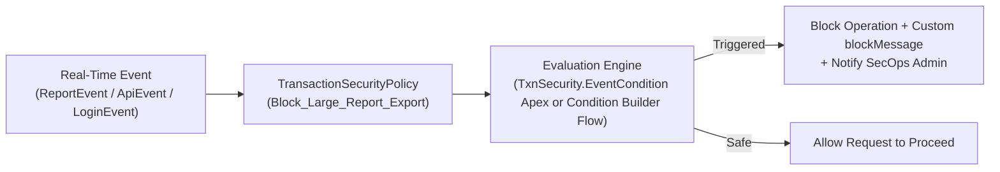

## Why the `TransactionSecurityPolicy` Metadata Type Prevents Data Exfiltration

Even when a user legitimately has Read access to 50,000 Customer Contacts to perform their daily job, they should not be allowed to export all 50,000 rows to a CSV file or run an unthrottled SOAP/REST `query()` from an unknown IP address.

Part of **Salesforce Shield (Real-Time Event Monitoring)**, **`TransactionSecurityPolicy`** (`transactionSecurityPolicies/<Name>.transactionSecurityPolicy-meta.xml`) intercepts synchronous platform events in real time (`ReportEvent`, `ApiEvent`, `ListViewEvent`, `LoginEvent`, `FileEventStore`) and takes immediate enforcement actions:

- **Block (`<block>true</block>`):** Aborts the report export, API query, or login before data leaves the org and displays a custom `<blockMessage>`.
- **Multi-Factor Authentication (`<twoFactorAuthentication>true</twoFactorAuthentication>`):** Prompts for step-up MFA on supported events.
- **Real-Time Notifications (`<notifications>`):** Sends email and in-app alerts to Security Operations.



---

## Key Metadata Fields on `TransactionSecurityPolicy`

| Field | Type | Required | Description |
|---|---|---|---|
| `eventName` | `TransactionSecurityEventName` | Yes | Event monitored (`ReportEvent`, `ApiEvent`, `ListViewEvent`, `LoginEvent`, `BulkApiResultEventStore`, `FileEventStore`, `ApiAnomalyEventStore`, `SessionHijackingEventStore`, etc.). |
| `type` | `TxnSecurityPolicyType` | Yes | `CustomApexPolicy` (uses `apexClass`) or `CustomConditionBuilderPolicy` (uses `flow`). |
| `apexClass` | `string` | Conditional | Apex class implementing `TxnSecurity.EventCondition` (required when `type` is `CustomApexPolicy`). |
| `flow` | `string` | Conditional | Developer name of the backing Condition Builder `Flow` (required when `type` is `CustomConditionBuilderPolicy`). |
| `active` | `boolean` | Yes | Enables (`true`) or disables (`false`) real-time monitoring. |
| `action.block` | `boolean` | Yes | Blocks the user's action when the policy triggers. |
| `action.twoFactorAuthentication` | `boolean` | Yes | Requires step-up MFA (supported on `LoginEvent` / `AccessResource`; upgraded to `Block` for `ReportEvent` and `ListViewEvent` in Lightning). |
| `blockMessage` | `string` | No | Custom error message (up to 1,000 chars) shown when `ReportEvent`, `ApiEvent`, `ListViewEvent`, or `BulkApiResultEventStore` is blocked. |

---

## Real-World XML & Apex Example: Blocking Mass Report Exports

### 1. Apex `TxnSecurity.EventCondition` Class (`classes/BlockMassReportExportCondition.cls`)

```java
global class BlockMassReportExportCondition implements TxnSecurity.EventCondition {
    public boolean evaluate(SObject event) {
        if (event instanceof ReportEvent) {
            ReportEvent reportEvt = (ReportEvent) event;
            return reportEvt.Operation == 'ReportExported'
                && reportEvt.RowsProcessed > 2000;
        }
        return false;
    }
}
```

### 2. Policy Metadata (`transactionSecurityPolicies/Block_Mass_Report_Exports.transactionSecurityPolicy-meta.xml`)

```xml
<?xml version="1.0" encoding="UTF-8"?>
<TransactionSecurityPolicy xmlns="http://soap.sforce.com/2006/04/metadata">
    <action>
        <block>true</block>
        <endSession>false</endSession>
        <freezeUser>false</freezeUser>
        <notifications>
            <inApp>true</inApp>
            <sendEmail>true</sendEmail>
            <user>secops.admin@acme.example.com</user>
        </notifications>
        <twoFactorAuthentication>false</twoFactorAuthentication>
    </action>
    <active>true</active>
    <apexClass>BlockMassReportExportCondition</apexClass>
    <blockMessage>Exporting reports with more than 2,000 rows is restricted by corporate security policy. Please contact InfoSec for an approved extract.</blockMessage>
    <description>Blocks any report export exceeding 2,000 rows and alerts Security Operations.</description>
    <developerName>Block_Mass_Report_Exports</developerName>
    <eventName>ReportEvent</eventName>
    <masterLabel>Block Mass Report Exports</masterLabel>
    <type>CustomApexPolicy</type>
</TransactionSecurityPolicy>
```

---

## Querying `TransactionSecurityPolicy` via SOQL

```sql
SELECT Id, DeveloperName, MasterLabel, EventName, Type, State,
       ApexPolicy.Name, BlockMessage, LastModifiedDate
FROM TransactionSecurityPolicy
ORDER BY EventName, DeveloperName
```

> [!WARNING]
> **Keep `evaluate()` Ultra-Fast (< 2 Seconds):** Synchronous `TransactionSecurityPolicy` Apex classes execute inline with every matching user login, API query, or report run. Avoid expensive SOQL queries inside `TxnSecurity.EventCondition.evaluate()`, or you will degrade org-wide response times and risk policy timeouts!
