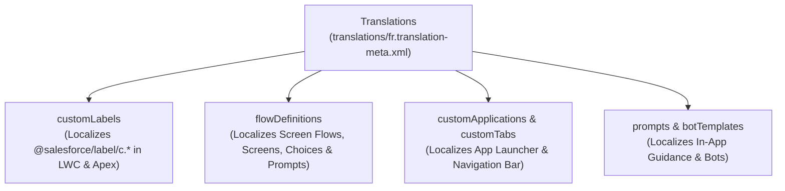

## Why the `Translations` Metadata Type Is Essential for Global Orgs

While [CustomObjectTranslation](/docs/metadata/custom-object-translation-metadata-type/) handles object-level fields and validation rules, **`Translations`** (`translations/<lang>.translation-meta.xml`) is the central translation hub for **org-wide, non-object metadata**. Whenever you localize a Lightning Web Component via `@salesforce/label/c.MyLabel` or localize a multi-language customer Screen Flow, those translations live inside `translations/<lang>.translation-meta.xml`.



---

## What Is Stored Inside `translations/<lang>.translation-meta.xml`?

| Child Element | What It Translates | Related Metadata Type |
|---|---|---|
| `customLabels` | Custom Labels referenced in LWC, Apex (`System.Label`), and Flows. | [CustomLabels](/docs/metadata/custom-labels-metadata-type/) |
| `flowDefinitions` | Screen Flow titles, screen component labels, help text, and choices. | [Flow](/docs/metadata/flow-metadata-type/) |
| `customApplications` | App Launcher names and descriptions. | [CustomApplication](/docs/metadata/custom-application-metadata-type/) |
| `customTabs` | Custom Tab labels in the Lightning navigation bar. | [CustomTab](/docs/metadata/custom-tab-metadata-type/) |
| `quickActions` | Global Quick Action labels (e.g., `NewCase`, `LogACall`). | [QuickAction](/docs/metadata/quick-action-metadata-type/) |
| `reportTypes` | Custom Report Type labels, descriptions, and section headers. | [ReportType](/docs/metadata/report-type-metadata-type/) |
| `prompts` | In-App Guidance walkthrough and floating prompt titles/bodies. | `Prompt` |

---

## Real-World XML Example (`translations/es.translation-meta.xml`)

```xml
<?xml version="1.0" encoding="UTF-8"?>
<Translations xmlns="http://soap.sforce.com/2006/04/metadata">
    <customApplications>
        <label>Consola de Operaciones Comerciales</label>
        <name>Commercial_Operations_Console</name>
    </customApplications>
    <customLabels>
        <label>Su solicitud ha sido enviada para aprobación.</label>
        <name>Approval_Submitted_Toast_Message</name>
    </customLabels>
    <customTabs>
        <label>Panel de Facturación</label>
        <name>Billing_Dashboard_Tab</name>
    </customTabs>
    <flowDefinitions>
        <flows>
            <fullName>Customer_Onboarding_Screen_Flow</fullName>
            <label>Registro de Nuevo Cliente</label>
            <screens>
                <fields>
                    <name>Company_Tax_ID_Input</name>
                    <fieldText>Número de Identificación Fiscal (NIF)</fieldText>
                </fields>
                <name>Customer_Details_Screen</name>
            </screens>
        </flows>
        <fullName>Customer_Onboarding_Screen_Flow</fullName>
    </flowDefinitions>
</Translations>
```

---

## Querying Translated Custom Labels via Tooling API (`ExternalStringLocalization`)

While the `Translations` metadata file bundles everything together in source control, Custom Label translations are stored at the database layer in the Tooling API object **`ExternalStringLocalization`**.

### Query All Spanish and French Translations for a Specific Custom Label

```sql
SELECT Id, ExternalStringId, ExternalString.Name, ExternalString.Value,
       Language, Value, LastModifiedDate
FROM ExternalStringLocalization
WHERE ExternalString.Name = 'Approval_Submitted_Toast_Message'
ORDER BY Language ASC
```

*(Run this query against the **Tooling API** endpoint `/services/data/v68.0/tooling/query/`.)*

---

## Senior Architect Best Practices & Gotchas

> [!WARNING]
> **Avoid Full-File Overwrites on `translations/<lang>.translation-meta.xml`:** When you retrieve `Translations` alongside only a subset of `CustomLabels` in `package.xml`, Salesforce only returns the `<customLabels>` translations matching the labels in your manifest. Keep your `translations/<lang>.translation-meta.xml` under modular git control so partial retrieves do not accidentally wipe out existing translations in your repository.

- **Flow Version Number Independence:** Starting in recent API versions, `<flowDefinitions>` inside `Translations` supports omitting the hardcoded version suffix (`_1`, `_2`) on `<fullName>` so translations carry forward cleanly when you activate a new version of a Screen Flow.
