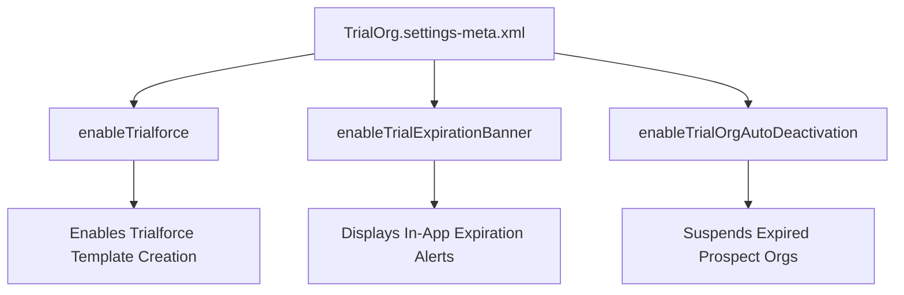

## Architectural Overview

The `TrialOrgSettings` metadata type controls trial lifecycle policies and Trialforce template generation parameters within Salesforce AppExchange partner environments. When independent software vendors (ISVs) distribute packaged enterprise solutions, Trialforce enables them to generate fully configured trial organizations pre-populated with custom schema, sample records, and workflow automations.

From an enterprise ISV architecture viewpoint, `TrialOrgSettings` is crucial for orchestrating demo environments and free trial experiences. It governs whether prospective customers see trial expiration banners, defines grace periods before org deactivation, and dictates how custom templates snapshot configurations. Automating these settings through Salesforce DX ensures consistent partner packaging pipelines.



## Directory and File Conventions

In Salesforce DX project structure, `TrialOrgSettings` is stored as a singleton settings file under `force-app/main/default/settings/`.

| Property | Value |
| :--- | :--- |
| **Metadata Type Name** | `Settings` (member: `TrialOrg`) / `TrialOrgSettings` |
| **SFDX Folder** | `force-app/main/default/settings/` |
| **File Name** | `TrialOrg.settings-meta.xml` |
| **Scratch Org Setting Key** | `trialOrgSettings` |

## Key Metadata Fields

The `TrialOrgSettings` XML definition contains the following lifecycle configuration elements:

| Field Name | Field Type | Required | Architectural Description |
| :--- | :--- | :--- | :--- |
| `enableTrialforce` | `boolean` | No | Activates Trialforce functionality, enabling the org to produce template snapshots for prospects. |
| `enableTrialExpirationBanner` | `boolean` | No | Shows or suppresses the standard Lightning Experience trial expiration and purchase reminder banner. |
| `enableTrialOrgAutoDeactivation` | `boolean` | No | Determines whether the org is automatically locked or decommissioned upon trial end. |

> [!NOTE]
> Trialforce functionality is restricted to ISV partner development orgs and Partner Business Orgs (PBOs) with active Trialforce licenses.

## Declarative XML and Package Manifest Examples

Below is an enterprise XML declaration for an ISV Trialforce source environment:

```xml title="force-app/main/default/settings/TrialOrg.settings-meta.xml"
<?xml version="1.0" encoding="UTF-8"?>
<TrialOrgSettings xmlns="http://soap.sforce.com/2006/04/metadata">
    <enableTrialExpirationBanner>true</enableTrialExpirationBanner>
    <enableTrialOrgAutoDeactivation>true</enableTrialOrgAutoDeactivation>
    <enableTrialforce>true</enableTrialforce>
</TrialOrgSettings>
```

### Scratch Org Definition (`project-scratch-def.json`)

When developing AppExchange demo setups in partner scratch orgs:

```json title="config/project-scratch-def.json"
{
  "orgName": "ISV Trialforce Source Org",
  "edition": "Partner Developer",
  "settings": {
    "trialOrgSettings": {
      "enableTrialforce": true,
      "enableTrialExpirationBanner": true
    }
  }
}
```

### Manifest Definition (`package.xml`)

```xml title="manifest/package.xml"
<?xml version="1.0" encoding="UTF-8"?>
<Package xmlns="http://soap.sforce.com/2006/04/metadata">
    <types>
        <members>TrialOrg</members>
        <name>Settings</name>
    </types>
    <version>68.0</version>
</Package>
```

## CLI Retrieval and Deployment Commands

Manage `TrialOrgSettings` using the Salesforce CLI:

```bash
# Retrieve TrialOrg settings from the partner source org
sf project retrieve start --metadata Settings:TrialOrg

# Deploy settings to a staging or packaging org
sf project deploy start --metadata Settings:TrialOrg --target-org packaging-org
```

## Architect Best Practices and Gotchas

- **Environment Restriction:** Attempting to deploy `TrialOrg.settings-meta.xml` into a standard customer Enterprise or Unlimited Edition org will produce deployment errors because Trialforce features are unentitled.
- **Snapshot Immutability:** When generating Trialforce templates from a source org, ensure `TrialOrgSettings` is deployed before initiating the snapshot; template instances inherit these settings at creation time.
- **Trialforce Email Branding:** Coordinate trial expiration banner settings with branded email templates configured in the Environment Hub to provide seamless customer onboarding.

> [!TIP]
> Keep `enableTrialExpirationBanner` set to `false` during recorded executive demonstrations to prevent distracting banner notifications during presentations.
