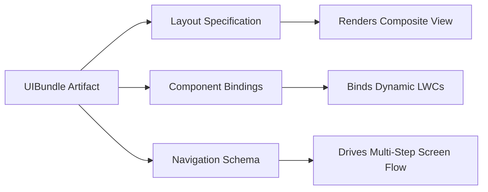

## Architectural Overview

The `UIBundle` metadata type provides an enterprise mechanism for packaging composite user interface definitions, modular screen templates, and runtime layout bindings within Salesforce Industry Clouds and specialized CRM applications. As enterprise frontends evolve beyond monolithic page layouts, modular UI architectures require declarative containers that package multiple screen configurations together with their navigation contracts.

From an architect's perspective, `UIBundle` decouples composite interface orchestration from individual Lightning Web Components (LWCs) or standard FlexiPages. By encapsulating layout metadata, localized labels, and component state rules into a unified version-controlled entity, development teams can deliver complex multi-step UI experiences through standard CI/CD pipelines without fragmented deployment steps.



## Directory and File Conventions

In Salesforce DX source format, `UIBundle` instances are organized inside the `uibundles` folder within the default package directory.

| Property | Value |
| :--- | :--- |
| **Metadata Type Name** | `UIBundle` |
| **SFDX Folder** | `force-app/main/default/uibundles/` |
| **File Suffix** | `.uibundle-meta.xml` |
| **Bundle Structure** | Directory container named after the bundle developer name |

## Key Metadata Fields

The XML representation of a `UIBundle` exposes the following structural attributes:

| Field Name | Field Type | Required | Architectural Description |
| :--- | :--- | :--- | :--- |
| `masterLabel` | `string` | Yes | Human-readable title displayed in administrative consoles and builders. |
| `description` | `string` | No | Architectural summary explaining business purpose and intended screen contexts. |
| `uiBundleType` | `string` | Yes | Categorizes the bundle archetype, such as Application, ScreenTemplate, or CompositeWidget. |
| `status` | `string` | Yes | Lifecycle status of the bundle, typically Draft, Active, or Deprecated. |
| `apiVersion` | `double` | Yes | Specifies the API runtime version ensuring backward compatibility. |

> [!NOTE]
> Ensure that all child components and static resources referenced within the bundle definition exist in the deployment payload to avoid unresolved reference errors.

## Declarative XML and Package Manifest Examples

The following example illustrates a declarative `UIBundle` configuration for an enterprise retail execution portal:

```xml title="force-app/main/default/uibundles/RetailStoreAuditBundle/RetailStoreAuditBundle.uibundle-meta.xml"
<?xml version="1.0" encoding="UTF-8"?>
<UIBundle xmlns="http://soap.sforce.com/2006/04/metadata">
    <apiVersion>68.0</apiVersion>
    <description>Composite UI bundle for retail store visit audits and inventory surveys.</description>
    <masterLabel>Retail Store Audit Bundle</masterLabel>
    <status>Active</status>
    <uiBundleType>ScreenTemplate</uiBundleType>
</UIBundle>
```

### Manifest Definition (`package.xml`)

To retrieve or deploy all UI bundles or a targeted bundle:

```xml title="manifest/package.xml"
<?xml version="1.0" encoding="UTF-8"?>
<Package xmlns="http://soap.sforce.com/2006/04/metadata">
    <types>
        <members>RetailStoreAuditBundle</members>
        <name>UIBundle</name>
    </types>
    <version>68.0</version>
</Package>
```

## CLI Retrieval and Deployment Commands

Manage `UIBundle` components using standard Salesforce CLI commands:

```bash
# Retrieve a specific UIBundle
sf project retrieve start --metadata UIBundle:RetailStoreAuditBundle

# Retrieve all UIBundles in the org
sf project retrieve start --metadata UIBundle

# Deploy the bundle to an integration scratch org
sf project deploy start --metadata UIBundle:RetailStoreAuditBundle --target-org int-scratch
```

## Architect Best Practices and Gotchas

- **Decomposition and Modularity:** Avoid building oversized monolithic UI bundles. Group related screens and reusable interactive sections into bounded bundles to maximize reusability across Lightning Apps.
- **Dependency Tracking:** When deploying a `UIBundle`, ensure that underlying Custom Fields, Custom Objects, and Lightning Web Components are either already present in the target environment or included in the same manifest.
- **Deprecation Governance:** Never delete active UI bundles directly in production. Transition the bundle `status` to `Deprecated` first, verify that no active runtime pages reference the bundle, and execute a planned removal in a subsequent release.

> [!TIP]
> Version-tag your `UIBundle` definitions alongside your second-generation package releases to ensure predictable upgrades across distributed subscriber orgs.
