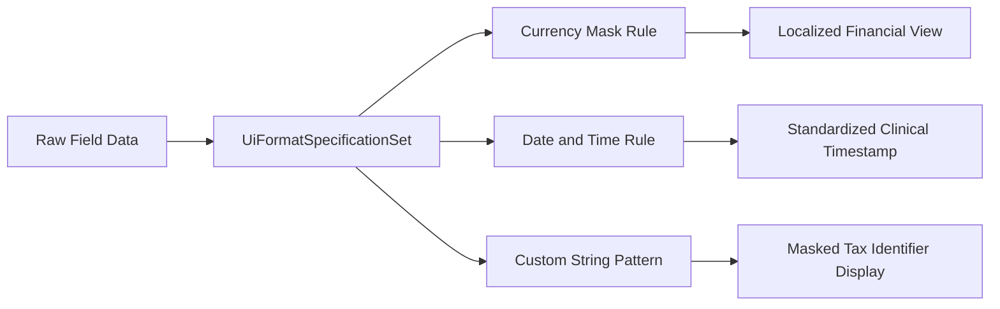

## Architectural Overview

The `UiFormatSpecificationSet` metadata type enables enterprise architects to define centralized data presentation rules, input masks, and localization display criteria for Salesforce client views. In complex implementations—such as Financial Services Cloud, Health Cloud, or OmniStudio-driven customer portals—presenting fiscal figures, policy numbers, or clinical measurements requires strict, compliant formatting rules.

Without centralized format definitions, developers often write duplicative JavaScript utility functions across dozens of Lightning Web Components, leading to inconsistent user experiences and difficult maintenance. `UiFormatSpecificationSet` establishes a single source of truth for UI formatting specifications, decoupling the raw data values stored in Salesforce custom fields from their visual presentation in user-facing components.



## Directory and File Conventions

In the Salesforce DX project structure, `UiFormatSpecificationSet` records are stored as XML files in the `uiFormatSpecificationSets/` directory.

| Property | Value |
| :--- | :--- |
| **Metadata Type Name** | `UiFormatSpecificationSet` |
| **SFDX Folder** | `force-app/main/default/uiFormatSpecificationSets/` |
| **File Suffix** | `.uiFormatSpecificationSet-meta.xml` |

## Key Metadata Fields

The XML schema for `UiFormatSpecificationSet` includes the following core attributes:

| Field Name | Field Type | Required | Architectural Description |
| :--- | :--- | :--- | :--- |
| `masterLabel` | `string` | Yes | Administrative label displayed in OmniStudio and Industries design canvases. |
| `developerName` | `string` | Yes | Unique API identifier utilized by components to reference the format ruleset. |
| `description` | `string` | No | Architectural documentation describing the format masks and target business domains. |
| `isActive` | `boolean` | Yes | Toggles whether the format specification set is available to runtime components. |
| `formatPattern` | `string` | No | Declarative regex or formatting pattern applied to transform the raw value. |

> [!NOTE]
> Format specification sets are evaluated at UI render time and do not alter the underlying data format stored in standard or custom object fields.

## Declarative XML and Package Manifest Examples

Below is a declarative XML definition establishing format patterns for financial wealth management summaries:

```xml title="force-app/main/default/uiFormatSpecificationSets/WealthSummaryFormats.uiFormatSpecificationSet-meta.xml"
<?xml version="1.0" encoding="UTF-8"?>
<UiFormatSpecificationSet xmlns="http://soap.sforce.com/2006/04/metadata">
    <description>Standardized currency and account masking rules for wealth client portals.</description>
    <developerName>WealthSummaryFormats</developerName>
    <formatPattern>#,##0.00</formatPattern>
    <isActive>true</isActive>
    <masterLabel>Wealth Summary Formats</masterLabel>
</UiFormatSpecificationSet>
```

### Manifest Definition (`package.xml`)

```xml title="manifest/package.xml"
<?xml version="1.0" encoding="UTF-8"?>
<Package xmlns="http://soap.sforce.com/2006/04/metadata">
    <types>
        <members>WealthSummaryFormats</members>
        <name>UiFormatSpecificationSet</name>
    </types>
    <version>68.0</version>
</Package>
```

## CLI Retrieval and Deployment Commands

Retrieve and deploy `UiFormatSpecificationSet` using standard Salesforce CLI commands:

```bash
# Retrieve all UI format specification sets
sf project retrieve start --metadata UiFormatSpecificationSet

# Retrieve a specific format specification set
sf project retrieve start --metadata UiFormatSpecificationSet:WealthSummaryFormats

# Deploy to target validation org
sf project deploy start --metadata UiFormatSpecificationSet:WealthSummaryFormats --target-org staging-sandbox
```

## Architect Best Practices and Gotchas

- **Cross-Locale Consistency:** Always test formatting specifications against multiple user locales (e.g., US English vs. German) to verify decimal and grouping separator behavior.
- **Upstream Dependencies:** Deploy `UiFormatSpecificationSet` components before deploying OmniStudio FlexCards or custom LWCs that bind to these format rules to prevent runtime template rendering failures.
- **Validation Fallbacks:** When defining custom regex masks, supply sensible fallback values to prevent empty or broken renders if an unexpected null or malformed data payload is received.

> [!TIP]
> Group related format patterns by business domain (e.g., Banking, Healthcare, Billing) into dedicated specification sets to simplify governance and release scoping.
