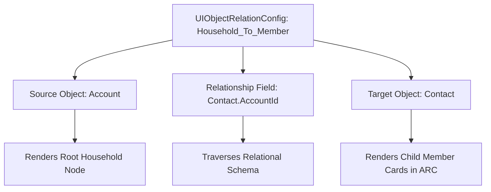

## Architectural Overview

The `UIObjectRelationConfig` metadata type defines structural graph hierarchies and object-to-object relationship visualizations for specialized Salesforce UI consoles, most prominently the Actionable Relationship Center (ARC) and Industry Relationship Graphs. In modern enterprise CRM architectures, business entities rarely exist in isolation—financial accounts relate to legal trusts, patients connect to households and caregivers, and B2B parent corporations connect to tiered subsidiaries.

Standard related lists fail to convey complex, multi-tiered networks. `UIObjectRelationConfig` provides the declarative blueprint that instructs ARC engines how to traverse relational data models, which lookup or junction fields to navigate, and which summary fields to render on each interactive graph node. Storing this configuration as version-controlled metadata enables developers to manage complex data visualization pipelines across release environments.



## Directory and File Conventions

In Salesforce DX projects, `UIObjectRelationConfig` metadata files are placed within the `uiObjectRelationConfigs/` folder.

| Property | Value |
| :--- | :--- |
| **Metadata Type Name** | `UIObjectRelationConfig` |
| **SFDX Folder** | `force-app/main/default/uiObjectRelationConfigs/` |
| **File Suffix** | `.uiObjectRelationConfig-meta.xml` |

## Key Metadata Fields

The `UIObjectRelationConfig` XML definition contains the following critical graph mapping parameters:

| Field Name | Field Type | Required | Architectural Description |
| :--- | :--- | :--- | :--- |
| `masterLabel` | `string` | Yes | Human-readable label identifying the relationship path in configuration builders. |
| `developerName` | `string` | Yes | Unique programmatic identifier utilized by ARC Lightning components. |
| `sourceObject` | `string` | Yes | API name of the originating entity (e.g., `Account` or custom entity). |
| `targetObject` | `string` | Yes | API name of the destination entity connected via the graph branch. |
| `relationshipField` | `string` | Yes | API name of the foreign key lookup or master-detail field linking the entities. |
| `displayFields` | `string` | No | Comma-separated or nested list of field API names to render within the node card. |
| `isActive` | `boolean` | Yes | Toggles availability of this relationship configuration within active consoles. |

> [!NOTE]
> All fields specified in `relationshipField` and `displayFields` must exist and be accessible to the deploying user profile in the target org.

## Declarative XML and Package Manifest Examples

Below is a declarative XML definition mapping legal entities to corporate subsidiaries:

```xml title="force-app/main/default/uiObjectRelationConfigs/Account_To_Subsidiary.uiObjectRelationConfig-meta.xml"
<?xml version="1.0" encoding="UTF-8"?>
<UIObjectRelationConfig xmlns="http://soap.sforce.com/2006/04/metadata">
    <developerName>Account_To_Subsidiary</developerName>
    <displayFields>Name,Industry,AnnualRevenue,Type</displayFields>
    <isActive>true</isActive>
    <masterLabel>Account to Corporate Subsidiary</masterLabel>
    <relationshipField>ParentId</relationshipField>
    <sourceObject>Account</sourceObject>
    <targetObject>Account</targetObject>
</UIObjectRelationConfig>
```

### Manifest Definition (`package.xml`)

```xml title="manifest/package.xml"
<?xml version="1.0" encoding="UTF-8"?>
<Package xmlns="http://soap.sforce.com/2006/04/metadata">
    <types>
        <members>Account_To_Subsidiary</members>
        <name>UIObjectRelationConfig</name>
    </types>
    <version>68.0</version>
</Package>
```

## CLI Retrieval and Deployment Commands

Manage `UIObjectRelationConfig` definitions via the Salesforce CLI:

```bash
# Retrieve all relation configs from the org
sf project retrieve start --metadata UIObjectRelationConfig

# Retrieve a specific relation configuration
sf project retrieve start --metadata UIObjectRelationConfig:Account_To_Subsidiary

# Deploy the configuration to an integration sandbox
sf project deploy start --metadata UIObjectRelationConfig:Account_To_Subsidiary --target-org staging-org
```

## Architect Best Practices and Gotchas

- **Schema Ordering in CI/CD:** Ensure underlying custom objects and custom fields referenced in `sourceObject`, `targetObject`, and `relationshipField` are deployed prior to or alongside `UIObjectRelationConfig`.
- **SOQL Performance and Query Depth:** ARC and relationship graphs traverse data dynamically at runtime. Restricting the number of child nodes and display fields ensures high performance and prevents hitting SOQL query row limits during deep graph expansions.
- **Field-Level Security (FLS) Impact:** If a user viewing an ARC graph lacks read access to fields declared in `displayFields`, the card renders with blank values or throws access warnings. Pair deployments with corresponding permission sets.

> [!TIP]
> Use descriptive developer names that clearly indicate source and target objects (e.g., `Household_To_FinancialAccount`) to maintain clarity as relationship hierarchies grow.
