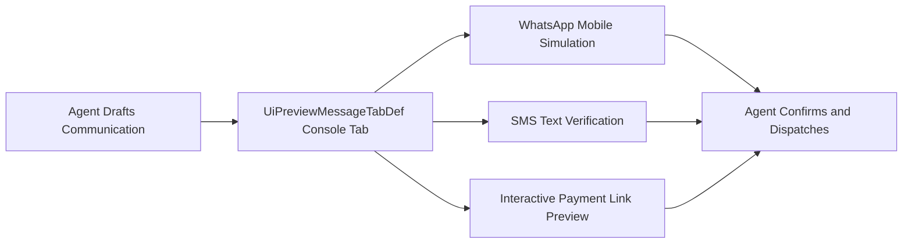

## Architectural Overview

The `UiPreviewMessageTabDef` metadata type defines tabbed message preview interfaces utilized by contact center agents and service representatives within Salesforce Service Cloud and Digital Engagement consoles. Modern customer service interactions span a diverse spectrum of asynchronous channels—including SMS, WhatsApp, social direct messaging, and in-app chat.

Before dispatching sensitive transactional communications or structured interactive templates (such as authentication requests or payment links), service agents must preview exactly how content will render on recipient mobile devices. `UiPreviewMessageTabDef` provides the declarative schema that binds communication channels, preview layout tabs, and validation renderers into a unified console surface.



## Directory and File Conventions

In the Salesforce DX project repository, `UiPreviewMessageTabDef` metadata files reside within the `uiPreviewMessageTabDefs/` directory.

| Property | Value |
| :--- | :--- |
| **Metadata Type Name** | `UiPreviewMessageTabDef` |
| **SFDX Folder** | `force-app/main/default/uiPreviewMessageTabDefs/` |
| **File Suffix** | `.uiPreviewMessageTabDef-meta.xml` |

## Key Metadata Fields

The XML schema for `UiPreviewMessageTabDef` incorporates the following key properties:

| Field Name | Field Type | Required | Architectural Description |
| :--- | :--- | :--- | :--- |
| `masterLabel` | `string` | Yes | Human-readable label displayed in console configuration views. |
| `developerName` | `string` | Yes | Unique API name referenced by Lightning console integration frameworks. |
| `tabLabel` | `string` | Yes | User-facing title rendered on the preview tab in the service agent console. |
| `channelType` | `string` | Yes | Communication channel identifier (e.g., `SMS`, `WhatsApp`, `Email`, `Chat`). |
| `targetComponent` | `string` | No | Programmatic name of the Lightning Web Component responsible for rendering previews. |
| `isActive` | `boolean` | Yes | Designates whether the preview tab definition is active for production agents. |

> [!NOTE]
> Ensure the target Lightning Web Component specified in `targetComponent` is deployed alongside this metadata definition to avoid invalid reference errors during deployment.

## Declarative XML and Package Manifest Examples

Below is an enterprise XML definition for a multi-channel customer service preview tab:

```xml title="force-app/main/default/uiPreviewMessageTabDefs/WhatsAppCarePreview.uiPreviewMessageTabDef-meta.xml"
<?xml version="1.0" encoding="UTF-8"?>
<UiPreviewMessageTabDef xmlns="http://soap.sforce.com/2006/04/metadata">
    <channelType>WhatsApp</channelType>
    <developerName>WhatsAppCarePreview</developerName>
    <isActive>true</isActive>
    <masterLabel>WhatsApp Customer Care Preview</masterLabel>
    <tabLabel>WhatsApp Preview</tabLabel>
    <targetComponent>c:whatsAppMessageRenderer</targetComponent>
</UiPreviewMessageTabDef>
```

### Manifest Definition (`package.xml`)

```xml title="manifest/package.xml"
<?xml version="1.0" encoding="UTF-8"?>
<Package xmlns="http://soap.sforce.com/2006/04/metadata">
    <types>
        <members>WhatsAppCarePreview</members>
        <name>UiPreviewMessageTabDef</name>
    </types>
    <version>68.0</version>
</Package>
```

## CLI Retrieval and Deployment Commands

Manage `UiPreviewMessageTabDef` records using the Salesforce CLI:

```bash
# Retrieve all message preview tab definitions
sf project retrieve start --metadata UiPreviewMessageTabDef

# Retrieve a specific tab definition
sf project retrieve start --metadata UiPreviewMessageTabDef:WhatsAppCarePreview

# Deploy to a target scratch org or sandbox
sf project deploy start --metadata UiPreviewMessageTabDef:WhatsAppCarePreview --target-org service-dev
```

## Architect Best Practices and Gotchas

- **Feature Entitlements:** Always ensure destination environments have Digital Engagement or Messaging entitlements provisioned before initiating deployment to prevent unentitled feature errors.
- **Component Lifecycle Synchronization:** Package the rendering component specified in `targetComponent` within the same deployment changeset or unlocked package to prevent broken preview panels.
- **Multi-Channel Consistency:** When standardizing contact center agent workflows, create corresponding preview tab definitions for every supported messaging channel to maintain a uniform agent experience.

> [!TIP]
> Use preview tabs in conjunction with macro actions so that agents can review automated responses prior to final dispatch.
