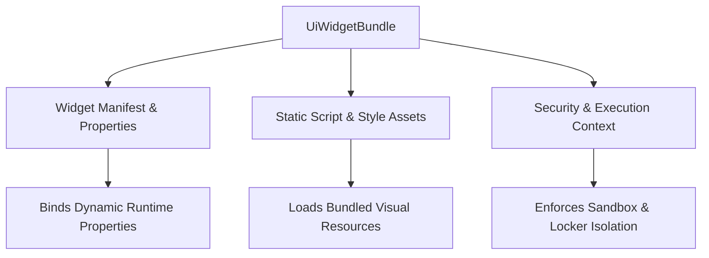

## Architectural Overview

The `UiWidgetBundle` metadata type enables organizations to bundle, distribute, and govern composite user interface widgets and micro-frontend modules within Salesforce Lightning Experience and specialized client applications. As enterprise frontends incorporate third-party charting libraries, real-time telemetry panels, and specialized interactive tooling, architects require a declarative mechanism to package these composite assets without cluttering individual component repositories.

`UiWidgetBundle` provides an encapsulated boundary that packages script assets, configuration properties, layout bindings, and security metadata into a cohesive deployment unit. By treating composite widgets as versioned metadata artifacts, development teams can reliably promote specialized UI capabilities from development sandboxes to production environments through standard automated release pipelines.



## Directory and File Conventions

In the Salesforce DX project repository, `UiWidgetBundle` instances are organized inside the `uiWidgetBundles/` directory.

| Property | Value |
| :--- | :--- |
| **Metadata Type Name** | `UiWidgetBundle` |
| **SFDX Folder** | `force-app/main/default/uiWidgetBundles/` |
| **File Suffix** | `.uiWidgetBundle-meta.xml` |

## Key Metadata Fields

The XML schema for `UiWidgetBundle` includes the following structural attributes:

| Field Name | Field Type | Required | Architectural Description |
| :--- | :--- | :--- | :--- |
| `masterLabel` | `string` | Yes | Human-readable name displayed in administrative widget managers. |
| `developerName` | `string` | Yes | Programmatic API name used by application containers to instantiate the widget. |
| `description` | `string` | No | Architectural description detailing widget purpose and integration scope. |
| `widgetType` | `string` | Yes | Defines the architectural classification, such as Analytics, Telemetry, or Utility. |
| `scriptResource` | `string` | No | Identifier for static resources or external script bundles utilized at runtime. |
| `isActive` | `boolean` | Yes | Indicates whether the widget bundle is active and accessible to end-user sessions. |

> [!NOTE]
> Ensure any static resources or custom permissions referenced within the widget bundle are included in the same deployment manifest.

## Declarative XML and Package Manifest Examples

The following declarative XML sample defines a telemetry monitoring widget deployed to operations consoles:

```xml title="force-app/main/default/uiWidgetBundles/TelemetryMonitorWidget.uiWidgetBundle-meta.xml"
<?xml version="1.0" encoding="UTF-8"?>
<UiWidgetBundle xmlns="http://soap.sforce.com/2006/04/metadata">
    <description>Composite telemetry widget for real-time infrastructure and API health monitoring.</description>
    <developerName>TelemetryMonitorWidget</developerName>
    <isActive>true</isActive>
    <masterLabel>Telemetry Monitor Widget</masterLabel>
    <scriptResource>TelemetryAssets</scriptResource>
    <widgetType>Telemetry</widgetType>
</UiWidgetBundle>
```

### Manifest Definition (`package.xml`)

```xml title="manifest/package.xml"
<?xml version="1.0" encoding="UTF-8"?>
<Package xmlns="http://soap.sforce.com/2006/04/metadata">
    <types>
        <members>TelemetryMonitorWidget</members>
        <name>UiWidgetBundle</name>
    </types>
    <version>68.0</version>
</Package>
```

## CLI Retrieval and Deployment Commands

Manage `UiWidgetBundle` metadata using standard Salesforce CLI commands:

```bash
# Retrieve all widget bundles
sf project retrieve start --metadata UiWidgetBundle

# Retrieve a specific widget bundle definition
sf project retrieve start --metadata UiWidgetBundle:TelemetryMonitorWidget

# Deploy widget bundle to a staging sandbox
sf project deploy start --metadata UiWidgetBundle:TelemetryMonitorWidget --target-org staging-sandbox
```

## Architect Best Practices and Gotchas

- **Security Isolation:** Verify that all third-party libraries bundled inside `UiWidgetBundle` comply with Lightning Web Security (LWS) guidelines to avoid runtime CSP blocks.
- **Resource Bundling:** Avoid creating excessively large script bundles; compress JavaScript assets and load heavy dependencies asynchronously to optimize Core Web Vitals (CWV) and page load speed.
- **Release Decoupling:** Treat widgets as modular micro-frontends with explicit version boundaries so individual widgets can be updated without triggering full application regression cycles.

> [!TIP]
> Coordinate widget bundle updates with automated visual regression tests in your CI/CD pipeline to catch styling regressions across different screen sizes.
