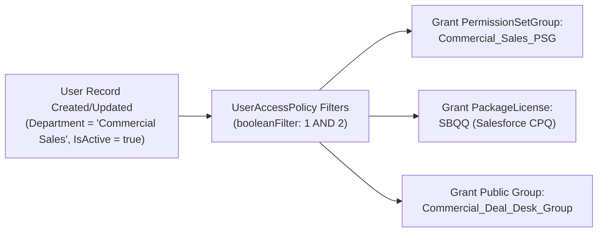

## Why the `UserAccessPolicy` Metadata Type Replaces User Provisioning Triggers

Historically, automating user onboarding in Salesforce required complex after-insert/after-update Apex triggers or asynchronous Platform Event Flows on the `User` object to assign `PermissionSetAssignment`, `PermissionSetLicenseAssign`, `GroupMember`, and `UserPackageLicense` records.

Introduced in API v57.0, **`UserAccessPolicy`** (`useraccesspolicies/<Name>.useraccesspolicy-meta.xml`) provides a native, declarative rules engine that evaluates user criteria (`userAccessPolicyFilters`) on `Create`, `Update`, or `CreateAndUpdate` and automatically executes `Grant` or `Revoke` actions (`userAccessPolicyActions`).



---

## Key Metadata Fields on `UserAccessPolicy`

| Field | Type | Required | Description |
|---|---|---|---|
| `masterLabel` | `string` | Yes | Display name of the User Access Policy in Setup. |
| `status` | `UserAccessPolicyStatus` | Yes | `Design`, `Active`, `Testing`, `Migrate`, `Updating`, `Completed`, or `Failed`. *(Deploying `Active` sets it to `Design` in the target org until activated in Setup.)* |
| `triggerType` | `UserAccessPolicyTriggerType` | No | `Create`, `Update`, or `CreateAndUpdate`. |
| `order` | `int` | Conditional | Priority order (`0`–`10000`, required when `status` is `Active`). **Only the matching policy with the lowest `order` value executes!** |
| `booleanFilter` | `string` | Yes | Filter logic combining `userAccessPolicyFilters` by `sortOrder` (e.g., `1 AND 2`). |
| `userAccessPolicyFilters` | `UserAccessPolicyFilter[]` | No | Criteria evaluating `User` fields (`columnName`, `operation`, `value`) or existing assignments (`Profile`, `UserRole`, `PermissionSet`, `Group`). |
| `userAccessPolicyActions` | `UserAccessPolicyAction[]` | No | List of `Grant` or `Revoke` actions targeting `PermissionSetGroup`, `PermissionSet`, `PermissionSetLicense`, `PackageLicense`, `Group`, or `Queue`. |

---

## Real-World XML Example (`useraccesspolicies/Commercial_AE_Onboarding.useraccesspolicy-meta.xml`)

```xml
<?xml version="1.0" encoding="UTF-8"?>
<UserAccessPolicy xmlns="http://soap.sforce.com/2006/04/metadata">
    <booleanFilter>1 AND 2 AND 3</booleanFilter>
    <description>Automatically provisions Commercial Account Executives with Sales PSG, CPQ Package License, and Deal Desk Group.</description>
    <masterLabel>Commercial AE Onboarding</masterLabel>
    <order>10</order>
    <status>Design</status>
    <triggerType>CreateAndUpdate</triggerType>
    <userAccessPolicyActions>
        <action>Grant</action>
        <target>Commercial_AE_PSG</target>
        <type>PermissionSetGroup</type>
    </userAccessPolicyActions>
    <userAccessPolicyActions>
        <action>Grant</action>
        <target>Commercial_Sales_Group</target>
        <type>Group</type>
    </userAccessPolicyActions>
    <userAccessPolicyFilters>
        <columnName>IsActive</columnName>
        <operation>equals</operation>
        <sortOrder>1</sortOrder>
        <target>User</target>
        <type>User</type>
        <value>true</value>
    </userAccessPolicyFilters>
    <userAccessPolicyFilters>
        <columnName>Department</columnName>
        <operation>equalsIgnoreCase</operation>
        <sortOrder>2</sortOrder>
        <target>User</target>
        <type>User</type>
        <value>Commercial Sales</value>
    </userAccessPolicyFilters>
    <userAccessPolicyFilters>
        <operation>in</operation>
        <sortOrder>3</sortOrder>
        <target>AE_AMER,AE_EMEA,AE_APAC</target>
        <type>UserRole</type>
    </userAccessPolicyFilters>
</UserAccessPolicy>
```

---

## Senior Architect Best Practices & Gotchas

> [!WARNING]
> **The "Lowest `order` Wins" Rule:** Unlike Record-Triggered Flows (where all matching flows run), when a `User` creation or update matches multiple active `UserAccessPolicy` definitions, **only the single active policy with the lowest `order` integer runs**. Design your `UserAccessPolicy` rules around mutually exclusive personas (such as Job Role / Department) and assign `order` numbers in increments of `10` (`10`, `20`, `30`).

- **Post-Deployment Activation Step:** Because Salesforce resets `<status>Active</status>` to `Design` upon Metadata API deployment to prevent accidental mass user permission changes, always document activating the `UserAccessPolicy` in your release runbook.

