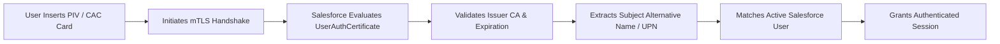

## Architectural Overview

The `UserAuthCertificate` metadata type manages public X.509 client certificates utilized for Certificate-Based Authentication (CBA) within Salesforce environments. In highly regulated sectors—such as federal government agencies, aerospace and defense contractors, financial institutions, and healthcare systems—standard username/password flows with time-based OTPs are insufficient to satisfy strict zero-trust identity mandates.

Certificate-based authentication leverages hardware cryptographic tokens, such as Common Access Cards (CAC) and Personal Identity Verification (PIV) smart cards. When a user navigates to the dedicated CBA login endpoint, mutual TLS (mTLS) verifies the client certificate against the trusted public certificates registered in `UserAuthCertificate`. Programmatically deploying these certificates guarantees that security policies remain synchronized across production, disaster recovery, and staging orgs.



## Directory and File Conventions

In Salesforce DX project structures, `UserAuthCertificate` definitions are stored inside the `userAuthCertificates/` directory.

| Property | Value |
| :--- | :--- |
| **Metadata Type Name** | `UserAuthCertificate` |
| **SFDX Folder** | `force-app/main/default/userAuthCertificates/` |
| **File Suffix** | `.userAuthCertificate-meta.xml` |

## Key Metadata Fields

The XML representation of `UserAuthCertificate` contains the following cryptographic and identity fields:

| Field Name | Field Type | Required | Architectural Description |
| :--- | :--- | :--- | :--- |
| `masterLabel` | `string` | Yes | Administrative title identifying the certificate authority or department. |
| `developerName` | `string` | Yes | Unique API name referenced across security configurations. |
| `certificateType` | `string` | Yes | Classification of the certificate, typically `UserAuthentication`. |
| `issuer` | `string` | Yes | Distinguished Name (DN) of the issuing Certificate Authority. |
| `keySize` | `integer` | No | Cryptographic key length in bits (e.g., 2048 or 4096). |
| `isActive` | `boolean` | Yes | Designates whether the certificate is active for authenticating user sessions. |

> [!NOTE]
> Deploying certificate configurations requires that certificate-based authentication is first enabled within Identity and My Domain administrative settings.

## Declarative XML and Package Manifest Examples

Below is a declarative XML definition representing an enterprise root certificate authority for federal smart card logins:

```xml title="force-app/main/default/userAuthCertificates/DoD_PIV_Root_CA.userAuthCertificate-meta.xml"
<?xml version="1.0" encoding="UTF-8"?>
<UserAuthCertificate xmlns="http://soap.sforce.com/2006/04/metadata">
    <certificateType>UserAuthentication</certificateType>
    <developerName>DoD_PIV_Root_CA</developerName>
    <isActive>true</isActive>
    <issuer>CN=DoD Root CA 3, OU=PKI, OU=DoD, O=U.S. Government, C=US</issuer>
    <keySize>2048</keySize>
    <masterLabel>DoD PIV Root CA</masterLabel>
</UserAuthCertificate>
```

### Manifest Definition (`package.xml`)

```xml title="manifest/package.xml"
<?xml version="1.0" encoding="UTF-8"?>
<Package xmlns="http://soap.sforce.com/2006/04/metadata">
    <types>
        <members>DoD_PIV_Root_CA</members>
        <name>UserAuthCertificate</name>
    </types>
    <version>68.0</version>
</Package>
```

## CLI Retrieval and Deployment Commands

Manage authentication certificates via the Salesforce CLI:

```bash
# Retrieve all user auth certificates
sf project retrieve start --metadata UserAuthCertificate

# Retrieve a specific authentication certificate
sf project retrieve start --metadata UserAuthCertificate:DoD_PIV_Root_CA

# Deploy certificate configuration to a production environment
sf project deploy start --metadata UserAuthCertificate:DoD_PIV_Root_CA --target-org prod-security
```

## Architect Best Practices and Gotchas

- **Certificate Lifecycle Monitoring:** Establish proactive monitoring for CA expiration dates; if an issuing CA certificate expires, all dependent smart card logins fail immediately.
- **Certificate Revocation Checking (CRL/OCSP):** Ensure network firewalls and proxy configurations allow Salesforce to reach Online Certificate Status Protocol (OCSP) endpoints or Certificate Revocation Lists (CRLs).
- **Fallback Access Protocols:** Maintain a break-glass administrator account authenticated via traditional FIDO2/WebAuthn security keys to prevent lockout if client certificate validation encounters infrastructure outages.

> [!WARNING]
> Inactivating or deleting an active `UserAuthCertificate` terminates all active user authentication flows relying on that issuing certificate chain.
