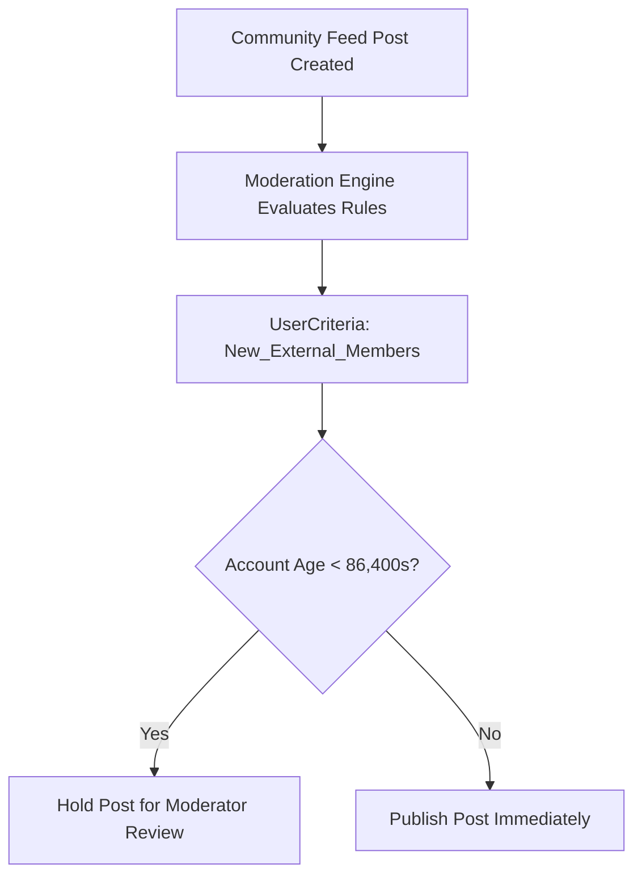

## Architectural Overview

The `UserCriteria` metadata type defines declarative user filtering logic utilized across Salesforce Experience Cloud for content moderation, community protection, and dynamic audience personalization. High-traffic public portals and partner communities face significant threats from spam bots, malicious links, and unauthorized data disclosure.

Rather than authoring complex Apex triggers to inspect every community comment or feed item, architects deploy `UserCriteria` rules that classify members based on user profile, member type (Internal, Customer, Partner, Guest), and membership age in seconds. These criteria are attached directly to community moderation rules to automatically flag, hold for review, or block suspicious content before it becomes visible to other users.



## Directory and File Conventions

In Salesforce DX projects, `UserCriteria` files are saved within the `userCriteria/` directory.

| Property | Value |
| :--- | :--- |
| **Metadata Type Name** | `UserCriteria` |
| **SFDX Folder** | `force-app/main/default/userCriteria/` |
| **File Suffix** | `.userCriteria-meta.xml` |

## Key Metadata Fields

The `UserCriteria` XML definition contains the following parameters:

| Field Name | Field Type | Required | Architectural Description |
| :--- | :--- | :--- | :--- |
| `masterLabel` | `string` | Yes | Human-readable label displayed in Experience Workspaces moderation settings. |
| `description` | `string` | No | Architectural description outlining intended moderation or targeting scope. |
| `creationAgeInSeconds` | `integer` | No | Threshold age in seconds since member creation to identify newly onboarded users. |
| `userTypes` | `string[]` | No | Target member classifications, such as `Standard`, `Customer`, `Partner`, or `Guest`. |
| `profiles` | `string[]` | No | Array of Profile API names matching the criteria conditions. |

> [!NOTE]
> When defining profile names inside `UserCriteria`, ensure corresponding profiles exist in the deployment payload or target org.

## Declarative XML and Package Manifest Examples

Below is a declarative XML definition designed to flag posts from external users whose accounts were created within the past 48 hours:

```xml title="force-app/main/default/userCriteria/New_External_Members.userCriteria-meta.xml"
<?xml version="1.0" encoding="UTF-8"?>
<UserCriteria xmlns="http://soap.sforce.com/2006/04/metadata">
    <creationAgeInSeconds>172800</creationAgeInSeconds>
    <description>Identifies customer and partner community members registered within the past 48 hours.</description>
    <masterLabel>New External Members</masterLabel>
    <userTypes>Customer</userTypes>
    <userTypes>Partner</userTypes>
</UserCriteria>
```

### Manifest Definition (`package.xml`)

```xml title="manifest/package.xml"
<?xml version="1.0" encoding="UTF-8"?>
<Package xmlns="http://soap.sforce.com/2006/04/metadata">
    <types>
        <members>New_External_Members</members>
        <name>UserCriteria</name>
    </types>
    <version>68.0</version>
</Package>
```

## CLI Retrieval and Deployment Commands

Retrieve and deploy `UserCriteria` using standard Salesforce CLI commands:

```bash
# Retrieve all user criteria definitions
sf project retrieve start --metadata UserCriteria

# Retrieve a specific user criteria rule
sf project retrieve start --metadata UserCriteria:New_External_Members

# Deploy to a target community sandbox
sf project deploy start --metadata UserCriteria:New_External_Members --target-org experience-dev
```

## Architect Best Practices and Gotchas

- **Bot and Spam Mitigation:** Combine `creationAgeInSeconds` filters with keyword-based Content Rules to intercept spam campaigns initiated by automated bot registrations.
- **Dependency on Experience Workspaces:** `UserCriteria` cannot be created or deployed unless Digital Experiences (Communities) is enabled in the target org settings.
- **Granular Profiling:** Avoid attaching internal employee profiles to aggressive moderation criteria, as this can trigger unintended moderation holds on support agents participating in customer forums.

> [!TIP]
> Deploy `UserCriteria` definitions alongside your Network (Community) and moderation rule metadata to achieve consistent portal governance across release branches.
