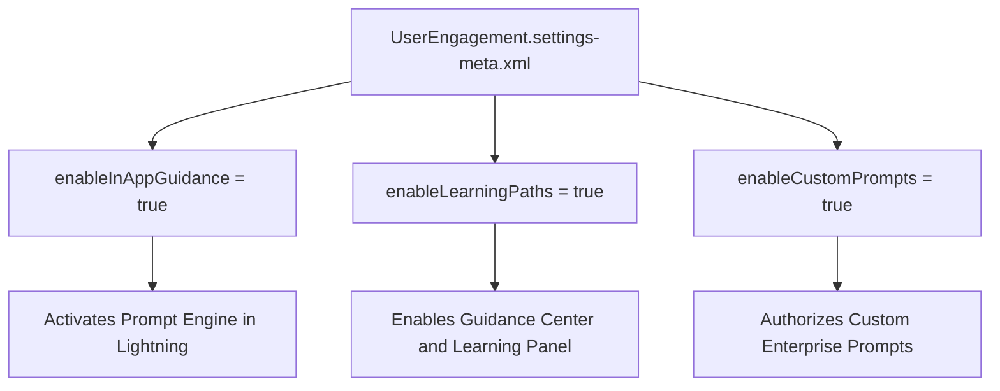

## Architectural Overview

The `UserEngagementSettings` metadata type manages organizational parameters for Salesforce In-App Guidance, user onboarding walkthroughs, prompt orchestration intervals, and the Guidance Center. As digital transformations accelerate, driving user adoption and maintaining change management standards directly within CRM workflows is paramount.

Salesforce In-App Guidance allows architects and administrators to deliver floating prompts, targeted docked prompts, and multi-step walkthroughs to educate users about new custom fields, revised business processes, and compliance requirements. `UserEngagementSettings` provides the global administrative levers that dictate whether prompts appear, establish delay timers between consecutive messages, and configure user learning sidebars.



## Directory and File Conventions

In Salesforce DX project structures, `UserEngagementSettings` is managed as a singleton settings file under the `settings/` directory.

| Property | Value |
| :--- | :--- |
| **Metadata Type Name** | `Settings` (member: `UserEngagement`) / `UserEngagementSettings` |
| **SFDX Folder** | `force-app/main/default/settings/` |
| **File Name** | `UserEngagement.settings-meta.xml` |
| **Scratch Org Setting Key** | `userEngagementSettings` |

## Key Metadata Fields

The `UserEngagementSettings` XML schema includes the following administrative flags:

| Field Name | Field Type | Required | Architectural Description |
| :--- | :--- | :--- | :--- |
| `enableInAppGuidance` | `boolean` | No | Master switch enabling or disabling all in-app guidance prompts and walkthroughs. |
| `enableLearningPaths` | `boolean` | No | Toggles the availability of the Learning Paths panel and custom module assignments. |
| `enableCustomPrompts` | `boolean` | No | Authorizes the creation and display of organization-specific prompts. |
| `enableGuidanceCenter` | `boolean` | No | Enables the native Salesforce Guidance Center panel for business users. |

> [!NOTE]
> Walkthroughs containing more than three consecutive steps require a myTrailhead or Sales Enablement add-on license for authoring and display.

## Declarative XML and Package Manifest Examples

Below is an enterprise XML declaration configured for controlled user adoption:

```xml title="force-app/main/default/settings/UserEngagement.settings-meta.xml"
<?xml version="1.0" encoding="UTF-8"?>
<UserEngagementSettings xmlns="http://soap.sforce.com/2006/04/metadata">
    <enableCustomPrompts>true</enableCustomPrompts>
    <enableGuidanceCenter>true</enableGuidanceCenter>
    <enableInAppGuidance>true</enableInAppGuidance>
    <enableLearningPaths>true</enableLearningPaths>
</UserEngagementSettings>
```

### Scratch Org Configuration (`project-scratch-def.json`)

To replicate production adoption settings during local development and automated testing:

```json title="config/project-scratch-def.json"
{
  "orgName": "Adoption QA Org",
  "edition": "Enterprise",
  "settings": {
    "userEngagementSettings": {
      "enableInAppGuidance": true,
      "enableLearningPaths": true,
      "enableCustomPrompts": true
    }
  }
}
```

### Manifest Definition (`package.xml`)

```xml title="manifest/package.xml"
<?xml version="1.0" encoding="UTF-8"?>
<Package xmlns="http://soap.sforce.com/2006/04/metadata">
    <types>
        <members>UserEngagement</members>
        <name>Settings</name>
    </types>
    <version>68.0</version>
</Package>
```

## CLI Retrieval and Deployment Commands

Manage `UserEngagementSettings` with the Salesforce CLI:

```bash
# Retrieve settings from the target org
sf project retrieve start --metadata Settings:UserEngagement

# Deploy settings to an integration environment
sf project deploy start --metadata Settings:UserEngagement --target-org qa-sandbox
```

## Architect Best Practices and Gotchas

- **Prompt Fatigue Mitigation:** While prompts enhance training, excessive popups lead to prompt fatigue and reflex dismissals. Configure global prompt delay intervals to space out announcements.
- **CI/CD Ordering:** Deploy `UserEngagement.settings-meta.xml` before deploying individual `Prompt` metadata records to ensure the underlying guidance runtime is active.
- **Sandbox Suppression:** Consider disabling `enableInAppGuidance` in developer scratch orgs where automated UI test suites (e.g., Playwright or Cypress) run to prevent guidance modals from intercepting click events.

> [!TIP]
> Pair `UserEngagementSettings` with custom permission sets to target advanced walkthroughs specifically to new hires or pilot user groups.
