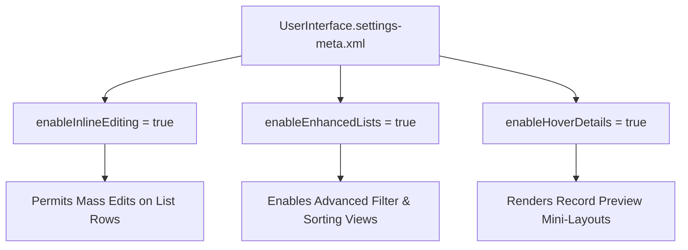

## Architectural Overview

The `UserInterfaceSettings` metadata type represents foundational configuration parameters that govern global desktop ergonomics, data editing mechanics, and list view interactions across Salesforce. User productivity hinges on seamless interaction models—such as the ability to perform inline mass edits directly from list views, preview record highlights via hover overlays, and collapse sidebars for expanded workspace real estate.

From an enterprise governance perspective, `UserInterfaceSettings` enforces organizational standards across all scratch orgs, sandboxes, and production environments. For instance, ensuring `enableInlineEditing` and `enableEnhancedLists` are enabled globally allows sales and support teams to update pipeline stages and case statuses with minimal friction. Automating these settings in version-controlled CI/CD workflows eliminates discrepancies between developer sandboxes and live business environments.



## Directory and File Conventions

In Salesforce DX project structures, `UserInterfaceSettings` is maintained as a singleton setting file located in the `settings/` folder.

| Property | Value |
| :--- | :--- |
| **Metadata Type Name** | `Settings` (member: `UserInterface`) / `UserInterfaceSettings` |
| **SFDX Folder** | `force-app/main/default/settings/` |
| **File Name** | `UserInterface.settings-meta.xml` |
| **Scratch Org Setting Key** | `userInterfaceSettings` |

## Key Metadata Fields

The `UserInterfaceSettings` XML schema defines the following core UI flags:

| Field Name | Field Type | Required | Architectural Description |
| :--- | :--- | :--- | :--- |
| `enableInlineEditing` | `boolean` | No | Allows users to edit field values directly within list views and record detail tables. |
| `enableEnhancedLists` | `boolean` | No | Activates enhanced list views featuring multi-column sorting and mass actions. |
| `enableHoverDetails` | `boolean` | No | Displays record preview overlays when users hover over lookup links. |
| `enableCollapsibleSidebar` | `boolean` | No | Enables collapsible navigation panels to maximize horizontal workspace. |
| `enableCustomObjectTruncate` | `boolean` | No | Allows system administrators to truncate custom objects to delete all records rapidly. |

> [!NOTE]
> `enableCustomObjectTruncate` should be strictly disabled in production environments to avoid accidental permanent data destruction.

## Declarative XML and Package Manifest Examples

Below is an enterprise XML declaration tailored for high-volume operational environments:

```xml title="force-app/main/default/settings/UserInterface.settings-meta.xml"
<?xml version="1.0" encoding="UTF-8"?>
<UserInterfaceSettings xmlns="http://soap.sforce.com/2006/04/metadata">
    <enableCollapsibleSidebar>true</enableCollapsibleSidebar>
    <enableCustomObjectTruncate>false</enableCustomObjectTruncate>
    <enableEnhancedLists>true</enableEnhancedLists>
    <enableHoverDetails>true</enableHoverDetails>
    <enableInlineEditing>true</enableInlineEditing>
</UserInterfaceSettings>
```

### Scratch Org Configuration (`project-scratch-def.json`)

```json title="config/project-scratch-def.json"
{
  "orgName": "Core UI Scratch Org",
  "edition": "Enterprise",
  "settings": {
    "userInterfaceSettings": {
      "enableInlineEditing": true,
      "enableEnhancedLists": true,
      "enableHoverDetails": true,
      "enableCustomObjectTruncate": true
    }
  }
}
```

### Manifest Definition (`package.xml`)

```xml title="manifest/package.xml"
<?xml version="1.0" encoding="UTF-8"?>
<Package xmlns="http://soap.sforce.com/2006/04/metadata">
    <types>
        <members>UserInterface</members>
        <name>Settings</name>
    </types>
    <version>68.0</version>
</Package>
```

## CLI Retrieval and Deployment Commands

Manage `UserInterfaceSettings` using standard Salesforce CLI commands:

```bash
# Retrieve UserInterface settings from the org
sf project retrieve start --metadata Settings:UserInterface

# Deploy settings to staging or production
sf project deploy start --metadata Settings:UserInterface --target-org staging-org
```

## Architect Best Practices and Gotchas

- **Truncate Guardrails:** Keep `enableCustomObjectTruncate` set to `true` in developer sandboxes for rapid test data resets, but enforce `false` in production deployment pipelines to safeguard historical business data.
- **Record Type Gotcha for Inline Editing:** For inline editing to work on list views, the list view filter must be filtered by a single specific Record Type; otherwise, Salesforce disables the edit pencil icons across all rows.
- **Testing Performance:** Disabling `enableHoverDetails` in test environments can shave seconds off automated UI test execution by eliminating unnecessary network calls for hover preview cards.

> [!TIP]
> Ensure both `enableEnhancedLists` and `enableInlineEditing` are set to `true` to ensure sales reps can execute rapid multi-record updates during daily pipeline reviews.
