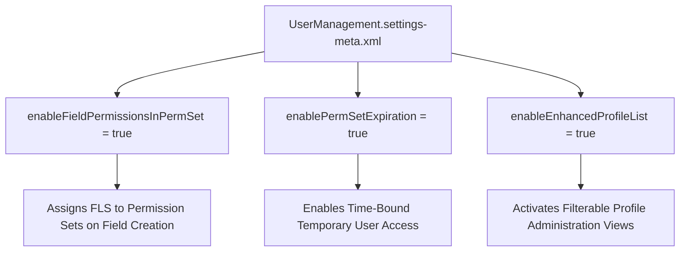

## Architectural Overview

The `UserManagementSettings` metadata type represents one of the most critical security configuration artifacts in the modern Salesforce ecosystem. As Salesforce systematically transitions access control away from legacy Profiles toward modular Permission Sets and Permission Set Groups, `UserManagementSettings` serves as the primary administrative engine for this architectural paradigm shift.

Key capabilities governed by this metadata type include **Permission Set Expiration** (enabling temporary elevated access for audit compliance) and **Field-Level Security on Permission Sets** (redirecting field creation wizards away from Profiles). Enabling these settings org-wide guarantees that all team members and automated CI/CD pipelines adhere to zero-trust principles and maintain clean, auditable security architectures.



## Directory and File Conventions

In Salesforce DX project structures, `UserManagementSettings` is stored as a singleton settings file in the `settings/` directory.

| Property | Value |
| :--- | :--- |
| **Metadata Type Name** | `Settings` (member: `UserManagement`) / `UserManagementSettings` |
| **SFDX Folder** | `force-app/main/default/settings/` |
| **File Name** | `UserManagement.settings-meta.xml` |
| **Scratch Org Setting Key** | `userManagementSettings` |

## Key Metadata Fields

The `UserManagementSettings` XML schema defines the following enterprise identity flags:

| Field Name | Field Type | Required | Architectural Description |
| :--- | :--- | :--- | :--- |
| `enableFieldPermissionsInPermSet` | `boolean` | No | Allows administrators to assign Field-Level Security to Permission Sets during field creation. |
| `enablePermSetExpiration` | `boolean` | No | Enables assigning expiration dates to Permission Set and Permission Set Group assignments. |
| `enableEnhancedProfileList` | `boolean` | No | Enables pagination, sorting, and inline editing on Profile management list views. |
| `enableUserSelfDeactivate` | `boolean` | No | Allows external Experience Cloud users to self-deactivate their portal membership. |
| `enableScimProvisioning` | `boolean` | No | Enables System for Cross-domain Identity Management (SCIM) user synchronization endpoints. |

> [!NOTE]
> Enabling `enableFieldPermissionsInPermSet` aligns your organization with Salesforce's official roadmap to deprecate profile-based permissions.

## Declarative XML and Package Manifest Examples

Below is an enterprise XML declaration enforcing modern identity governance:

```xml title="force-app/main/default/settings/UserManagement.settings-meta.xml"
<?xml version="1.0" encoding="UTF-8"?>
<UserManagementSettings xmlns="http://soap.sforce.com/2006/04/metadata">
    <enableEnhancedProfileList>true</enableEnhancedProfileList>
    <enableFieldPermissionsInPermSet>true</enableFieldPermissionsInPermSet>
    <enablePermSetExpiration>true</enablePermSetExpiration>
    <enableScimProvisioning>true</enableScimProvisioning>
    <enableUserSelfDeactivate>false</enableUserSelfDeactivate>
</UserManagementSettings>
```

### Scratch Org Configuration (`project-scratch-def.json`)

```json title="config/project-scratch-def.json"
{
  "orgName": "Identity Governance Dev",
  "edition": "Enterprise",
  "settings": {
    "userManagementSettings": {
      "enableFieldPermissionsInPermSet": true,
      "enablePermSetExpiration": true,
      "enableEnhancedProfileList": true
    }
  }
}
```

### Manifest Definition (`package.xml`)

```xml title="manifest/package.xml"
<?xml version="1.0" encoding="UTF-8"?>
<Package xmlns="http://soap.sforce.com/2006/04/metadata">
    <types>
        <members>UserManagement</members>
        <name>Settings</name>
    </types>
    <version>68.0</version>
</Package>
```

## CLI Retrieval and Deployment Commands

Manage `UserManagementSettings` using the Salesforce CLI:

```bash
# Retrieve UserManagement settings
sf project retrieve start --metadata Settings:UserManagement

# Deploy settings to target production or sandbox
sf project deploy start --metadata Settings:UserManagement --target-org prod-security
```

## Architect Best Practices and Gotchas

- **Time-Bound Privileges:** Utilize `enablePermSetExpiration` in conjunction with just-in-time access reviews to automatically expire temporary administrative privileges (e.g., Release Manager, Escalation Responder).
- **CI/CD Source Integrity:** Enforce `enableFieldPermissionsInPermSet` in all developer scratch orgs so new custom fields commit clean Permission Set diffs rather than massive Profile metadata diffs.
- **Self-Deactivation Caveats:** For B2B customer communities, evaluate regulatory requirements before enabling `enableUserSelfDeactivate` to ensure compliance with data retention policies.

> [!TIP]
> Setting `enableFieldPermissionsInPermSet` to `true` is a prerequisite for achieving clean Git branches and avoiding merge conflicts in multi-developer teams.
