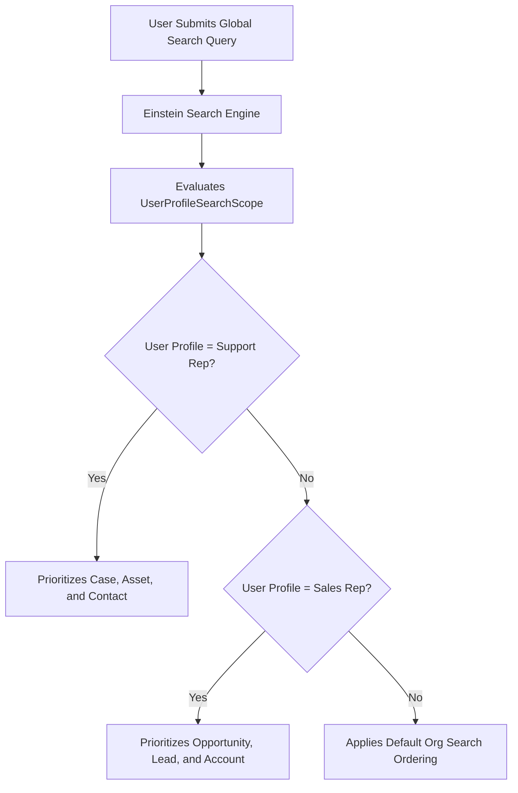

## Architectural Overview

The `UserProfileSearchScope` metadata type configures customized search scoping and object prioritization rules tailored to distinct user personas and profiles across Salesforce Lightning Experience. In large-scale enterprises with hundreds of custom and standard objects, default global search behaviors often produce cluttered result sets with irrelevant record types.

A customer support representative primarily searches for `Case`, `Contact`, and `Asset` records, whereas an account executive searches for `Lead`, `Opportunity`, and `Account`. `UserProfileSearchScope` enables architects to establish declarative search ordering, ensuring that global search and modal lookup dialogs rank business-critical entities at the top of results. Version-controlling these configurations guarantees that search optimizations are systematically applied across release tiers.



## Directory and File Conventions

In the Salesforce DX project repository, `UserProfileSearchScope` files reside within the `userProfileSearchScopes/` directory.

| Property | Value |
| :--- | :--- |
| **Metadata Type Name** | `UserProfileSearchScope` |
| **SFDX Folder** | `force-app/main/default/userProfileSearchScopes/` |
| **File Suffix** | `.userProfileSearchScope-meta.xml` |

## Key Metadata Fields

The XML schema for `UserProfileSearchScope` includes the following configuration attributes:

| Field Name | Field Type | Required | Architectural Description |
| :--- | :--- | :--- | :--- |
| `profile` | `string` | Yes | API name of the target Profile to which the search scope applies. |
| `entity` | `string` | Yes | API name of the standard or custom object included in the search scope. |
| `sortOrder` | `integer` | Yes | Numeric rank dictating display precedence in search result navigation. |
| `isEnabled` | `boolean` | Yes | Toggles whether the entity is actively prioritized in search results. |

> [!NOTE]
> Ensure the target profile and entity specified in the metadata file exist in the destination environment before deploying.

## Declarative XML and Package Manifest Examples

The following declarative XML definition configures search ordering for customer service profiles:

```xml title="force-app/main/default/userProfileSearchScopes/Support_Case_Scope.userProfileSearchScope-meta.xml"
<?xml version="1.0" encoding="UTF-8"?>
<UserProfileSearchScope xmlns="http://soap.sforce.com/2006/04/metadata">
    <entity>Case</entity>
    <isEnabled>true</isEnabled>
    <profile>Custom: Support Profile</profile>
    <sortOrder>1</sortOrder>
</UserProfileSearchScope>
```

### Manifest Definition (`package.xml`)

```xml title="manifest/package.xml"
<?xml version="1.0" encoding="UTF-8"?>
<Package xmlns="http://soap.sforce.com/2006/04/metadata">
    <types>
        <members>Support_Case_Scope</members>
        <name>UserProfileSearchScope</name>
    </types>
    <version>68.0</version>
</Package>
```

## CLI Retrieval and Deployment Commands

Retrieve and deploy `UserProfileSearchScope` with the Salesforce CLI:

```bash
# Retrieve all profile search scope definitions
sf project retrieve start --metadata UserProfileSearchScope

# Retrieve a specific search scope configuration
sf project retrieve start --metadata UserProfileSearchScope:Support_Case_Scope

# Deploy search scopes to an integration sandbox
sf project deploy start --metadata UserProfileSearchScope:Support_Case_Scope --target-org staging-sandbox
```

## Architect Best Practices and Gotchas

- **Search Indexing Sync:** Updating search scope metadata directs UI presentation; ensure custom fields have appropriate search indexing enabled in the underlying Object Manager.
- **Cross-Profile Alignment:** Periodically audit search scopes against user feedback to ensure changing business priorities are reflected in global search ranking.
- **Deployment Dependencies:** Deploy underlying Custom Objects before deploying corresponding `UserProfileSearchScope` metadata to avoid unresolved entity errors during packaging.

> [!TIP]
> Keep the number of prioritized entities per profile between 3 and 5 to provide clear, focused search results without cognitive overload.
