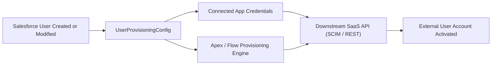

## Architectural Overview

The `UserProvisioningConfig` metadata type manages automated user lifecycle synchronization between Salesforce and external cloud platforms. When Salesforce operates as an enterprise Identity Provider (IdP) or central authentication hub, administrators require automated workflows to provision, update attributes for, and deprovision downstream accounts when employees change roles or depart the organization.

`UserProvisioningConfig` bridges Connected Apps with execution engines such as Salesforce Flows or Apex plugins implementing the `UserProvisioningPlugin` interface. It defines error handling, batch reconciliation schedules, and attribute mapping logic. Managing this configuration as version-controlled metadata ensures that identity governance policies remain consistent across enterprise sandbox environments and production releases.



## Directory and File Conventions

In Salesforce DX projects, `UserProvisioningConfig` files are located within the `userProvisioningConfigs/` folder.

| Property | Value |
| :--- | :--- |
| **Metadata Type Name** | `UserProvisioningConfig` |
| **SFDX Folder** | `force-app/main/default/userProvisioningConfigs/` |
| **File Suffix** | `.userProvisioningConfig-meta.xml` |

## Key Metadata Fields

The XML schema for `UserProvisioningConfig` encompasses the following parameters:

| Field Name | Field Type | Required | Architectural Description |
| :--- | :--- | :--- | :--- |
| `masterLabel` | `string` | Yes | Human-readable title displayed in the Salesforce User Provisioning wizard. |
| `developerName` | `string` | Yes | Unique programmatic identifier utilized by identity frameworks. |
| `connectedApp` | `string` | Yes | Developer name of the Connected App providing authentication to the target SaaS system. |
| `apexClass` | `string` | No | Name of the Apex class implementing custom provisioning logic. |
| `flow` | `string` | No | Name of the Salesforce Flow driving the user synchronization logic. |
| `isActive` | `boolean` | Yes | Toggles whether automated provisioning events are triggered on user updates. |

> [!NOTE]
> Connected Apps referenced in `connectedApp` must have OAuth scopes and provisioning capabilities enabled before deployment.

## Declarative XML and Package Manifest Examples

The following declarative XML sample defines an automated provisioning configuration for ServiceNow accounts:

```xml title="force-app/main/default/userProvisioningConfigs/ServiceNow_User_Sync.userProvisioningConfig-meta.xml"
<?xml version="1.0" encoding="UTF-8"?>
<UserProvisioningConfig xmlns="http://soap.sforce.com/2006/04/metadata">
    <apexClass>ServiceNowProvisioningHandler</apexClass>
    <connectedApp>ServiceNow_Integration_App</connectedApp>
    <developerName>ServiceNow_User_Sync</developerName>
    <isActive>true</isActive>
    <masterLabel>ServiceNow User Sync</masterLabel>
</UserProvisioningConfig>
```

### Manifest Definition (`package.xml`)

```xml title="manifest/package.xml"
<?xml version="1.0" encoding="UTF-8"?>
<Package xmlns="http://soap.sforce.com/2006/04/metadata">
    <types>
        <members>ServiceNow_User_Sync</members>
        <name>UserProvisioningConfig</name>
    </types>
    <version>68.0</version>
</Package>
```

## CLI Retrieval and Deployment Commands

Manage `UserProvisioningConfig` records using the Salesforce CLI:

```bash
# Retrieve all user provisioning configurations
sf project retrieve start --metadata UserProvisioningConfig

# Retrieve a specific provisioning config
sf project retrieve start --metadata UserProvisioningConfig:ServiceNow_User_Sync

# Deploy configuration to an identity staging org
sf project deploy start --metadata UserProvisioningConfig:ServiceNow_User_Sync --target-org idp-sandbox
```

## Architect Best Practices and Gotchas

- **Dependency Sequencing:** Ensure that the referenced `ConnectedApp` and `ApexClass` or `Flow` are deployed before or alongside `UserProvisioningConfig` to avoid broken metadata references.
- **Deprovisioning Safeguards:** Implement reconciliation audits to guarantee that deactivating a Salesforce user immediately triggers deactivation in target SaaS systems, preventing orphaned active accounts.
- **Rate Limiting and Retries:** When configuring high-volume provisioning flows, account for downstream API rate limits by queuing requests asynchronously using batch apex or platform events.

> [!TIP]
> Test user provisioning in dedicated developer scratch orgs using mock endpoints or test tenants before activating production synchronization.
