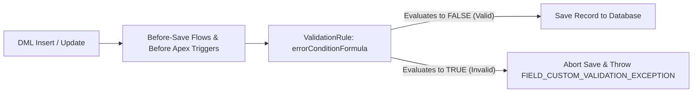

## Overview

The `ValidationRule` metadata type (`objects/<ObjectName>/validationRules/<RuleName>.validationRule-meta.xml`) enforces declarative data quality standards before a record is saved to the database. A validation rule evaluates a boolean formula expression (`errorConditionFormula`) against the record being created or updated; when the formula returns **`true`**, Salesforce aborts the DML save and returns the configured `errorMessage` (both in the Lightning UI and as a `FIELD_CUSTOM_VALIDATION_EXCEPTION` in Apex and REST/Bulk APIs).

In Salesforce DX source format, validation rules are decomposed out of the parent [CustomObject](/docs/metadata/custom-object-metadata-type/) file into individual `.validationRule-meta.xml` files inside the object's `validationRules/` subfolder. This allows developers to toggle, version, and deploy individual validation rules without touching custom fields or object sharing settings.



As shown in the execution flow above, `ValidationRule` formulas evaluate **after** Before-Save Flows and Before Apex Triggers have populated default field values, meaning any fields defaulted in a `before insert` trigger are visible to the validation rule.

## Prerequisites

- **Permissions:** "Customize Application" permission to deploy validation rules; "View Setup and Configuration" to query via Tooling API.
- **Referenced Fields:** All fields, `$CustomMetadata` records, `$Permission` flags, or `$Setup` hierarchy custom settings referenced in `errorConditionFormula` must exist in the target org.
- **API Version:** Verified against API version `68.0` (Winter '27).

## ValidationRule XML Elements

| XML Element | Type | Required | Description & Architectural Notes |
| :--- | :--- | :--- | :--- |
| `fullName` | `string` | ✅ Yes | Rule API name (`Require_Billing_Tax_Id`). In `package.xml`, qualify with the object name (`Account.Require_Billing_Tax_Id`). |
| `active` | `boolean` | ✅ Yes | Set to `true` to enforce at runtime, or `false` to disable without deleting. |
| `errorConditionFormula` | `string` | ✅ Yes | Formula that returns `true` when data is **invalid**. Escape XML characters (`&amp;`, `&lt;`, `&gt;`, `&apos;`). |
| `errorMessage` | `string` | ✅ Yes | User-facing message (≤255 characters) returned when the rule triggers. |
| `errorDisplayField` | `string` | No | Field API name (`Tax_Id__c`) where the inline error attaches. Defaults to top of page if omitted. |
| `description` | `string` | No | Documents the business owner and requirement behind the rule. |

> [!TIP]
> Never hardcode `Profile.Name` or `User.Id` in `errorConditionFormula` to bypass validation rules (`$Profile.Name <> 'System Administrator'`). Instead, check a Custom Permission (`NOT($Permission.Bypass_Validation_Rules)`) so you can grant temporary bypass access via a session-based [PermissionSet](/docs/metadata/permission-set-metadata-type/).

## Querying ValidationRule via Tooling API

The `ValidationRule` object is exposed through the **Tooling API** (`sf data query --use-tooling-api`), allowing you to audit active and inactive rules across your entire org.

### 1. List All Active Validation Rules on an Object (Tooling API)
Run this query with `--use-tooling-api` to inspect all validation rules on `Account`, `Opportunity`, or any custom object:

```soql
SELECT Id, ValidationName, Active, EntityDefinition.QualifiedApiName,
       ErrorDisplayField, ErrorMessage, Description, LastModifiedDate
FROM ValidationRule
WHERE EntityDefinition.QualifiedApiName = 'Account'
ORDER BY Active DESC, ValidationName ASC
```

### 2. Find Inactive Validation Rules Left Behind in Production (Tooling API)
Inactive validation rules still count toward the per-object total validation rule limit (up to 500 total rules). Audit inactive rules with:

```soql
SELECT ValidationName, EntityDefinition.QualifiedApiName,
       LastModifiedBy.Name, LastModifiedDate
FROM ValidationRule
WHERE Active = false
ORDER BY LastModifiedDate ASC
```

## Example

The following `Require_Tax_Id_On_Closed_Won.validationRule-meta.xml` prevents closing an `Invoice__c` record as `Paid` unless `ERP_External_Id__c` is populated and `Total_Amount__c` is positive, while allowing ETL integrations with the `Bypass_Invoice_Validations` custom permission to bypass the rule.

```xml title="force-app/main/default/objects/Invoice__c/validationRules/Require_ERP_Id_When_Paid.validationRule-meta.xml"
<?xml version="1.0" encoding="UTF-8"?>
<ValidationRule xmlns="http://soap.sforce.com/2006/04/metadata">
    <fullName>Require_ERP_Id_When_Paid</fullName>
    <active>true</active>
    <description>Prevents marking an Invoice as Paid without an ERP External ID and a positive amount, unless the user holds the Bypass_Invoice_Validations custom permission.</description>
    <errorConditionFormula>AND(
    NOT($Permission.Bypass_Invoice_Validations),
    ISPICKVAL(Status__c, &apos;Paid&apos;),
    OR(
        ISBLANK(ERP_External_Id__c),
        Total_Amount__c &lt;= 0
    )
)</errorConditionFormula>
    <errorDisplayField>ERP_External_Id__c</errorDisplayField>
    <errorMessage>An ERP External ID and a Total Amount greater than zero are required before marking an Invoice as Paid.</errorMessage>
</ValidationRule>
```

### Retrieving and Deploying ValidationRules via `package.xml` and CLI

Because `ValidationRule` does not support `<members>*</members>`, specify each rule with its object prefix:

```xml title="manifest/package.xml"
<?xml version="1.0" encoding="UTF-8"?>
<Package xmlns="http://soap.sforce.com/2006/04/metadata">
    <types>
        <members>Invoice__c.Require_ERP_Id_When_Paid</members>
        <members>Account.Require_Billing_Country</members>
        <name>ValidationRule</name>
    </types>
    <version>68.0</version>
</Package>
```

Deploy a single validation rule directly from its source path:

```bash
sf project deploy start \
  --metadata ValidationRule:Invoice__c.Require_ERP_Id_When_Paid \
  --target-org Production
```

## Limits and Gotchas

- **Active Validation Rules per Object:** Enterprise Edition allows up to **100 active validation rules** per object; Unlimited and Performance Editions allow up to **500 active validation rules** per object.
- **Formula Size Limit:** Maximum of 3,900 characters and **15,000 bytes** when compiled (including referenced formula fields).
- **Compound Fields Not Supported:** You cannot reference compound fields (`BillingAddress`, `Name` on Contact/Lead) directly in `errorConditionFormula`; reference their individual constituent fields (`BillingStreet`, `BillingCountry`, `FirstName`, `LastName`) instead.
- **`VLOOKUP` Function Restrictions:** The `VLOOKUP` formula function is only supported in `ValidationRule` formulas (not in custom formula fields) and can only match against the `Name` field of a custom object.

## Related Official Documentation

- [ValidationRule Metadata API Reference](https://developer.salesforce.com/docs/atlas.en-us.api_meta.meta/api_meta/meta_validationformulas.htm): XML tags and formula escaping rules.
- [ValidationRule Tooling API Object](https://developer.salesforce.com/docs/atlas.en-us.api_tooling.meta/api_tooling/tooling_api_objects_validationrule.htm): Querying validation rules and metadata via Tooling API.

