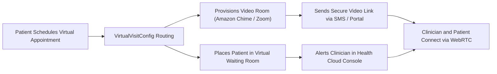

## Architectural Overview

The `VirtualVisitConfig` metadata type manages telehealth and virtual care session configurations within Salesforce Health Cloud. In modern healthcare ecosystems, remote clinical consultations, patient triage, and virtual follow-ups require seamless coordination between electronic health record (EHR) systems, scheduling engines, and real-time audio/video streaming infrastructure.

`VirtualVisitConfig` acts as the declarative bridge connecting Salesforce Service Appointments with video communication providers (such as Amazon Chime SDK or Zoom for Healthcare). It governs waiting room experiences, participant entry notifications, recording consents, and clinician console layouts. Managing this configuration as version-controlled metadata ensures consistent telehealth workflows across staging environments and clinical production orgs.



## Directory and File Conventions

In Salesforce DX project structures, `VirtualVisitConfig` definitions reside inside the `virtualVisitConfigs/` directory.

| Property | Value |
| :--- | :--- |
| **Metadata Type Name** | `VirtualVisitConfig` |
| **SFDX Folder** | `force-app/main/default/virtualVisitConfigs/` |
| **File Suffix** | `.virtualVisitConfig-meta.xml` |

## Key Metadata Fields

The XML schema for `VirtualVisitConfig` includes the following core attributes:

| Field Name | Field Type | Required | Architectural Description |
| :--- | :--- | :--- | :--- |
| `masterLabel` | `string` | Yes | Human-readable title displayed in Health Cloud setup consoles. |
| `developerName` | `string` | Yes | Unique programmatic API name referenced by virtual care flows. |
| `videoProvider` | `string` | Yes | Telehealth video vendor (e.g., `AmazonChime`, `Zoom`, `Webex`, `Custom`). |
| `appointmentType` | `string` | No | Target service appointment category associated with this virtual visit flow. |
| `waitingRoomConfig` | `string` | No | Configuration reference specifying patient waiting room instructions and branding. |
| `isActive` | `boolean` | Yes | Indicates whether this virtual care configuration is active for scheduling. |

> [!NOTE]
> Prior to deploying `VirtualVisitConfig`, ensure Health Cloud and Telehealth feature licenses are active in the target org.

## Declarative XML and Package Manifest Examples

Below is a declarative XML definition configuring Amazon Chime-powered telehealth visits:

```xml title="force-app/main/default/virtualVisitConfigs/PrimaryCare_VirtualVisit.virtualVisitConfig-meta.xml"
<?xml version="1.0" encoding="UTF-8"?>
<VirtualVisitConfig xmlns="http://soap.sforce.com/2006/04/metadata">
    <appointmentType>ClinicalTelehealth</appointmentType>
    <developerName>PrimaryCare_VirtualVisit</developerName>
    <isActive>true</isActive>
    <masterLabel>Primary Care Virtual Visit</masterLabel>
    <videoProvider>AmazonChime</videoProvider>
    <waitingRoomConfig>StandardWaitingRoom</waitingRoomConfig>
</VirtualVisitConfig>
```

### Manifest Definition (`package.xml`)

```xml title="manifest/package.xml"
<?xml version="1.0" encoding="UTF-8"?>
<Package xmlns="http://soap.sforce.com/2006/04/metadata">
    <types>
        <members>PrimaryCare_VirtualVisit</members>
        <name>VirtualVisitConfig</name>
    </types>
    <version>68.0</version>
</Package>
```

## CLI Retrieval and Deployment Commands

Retrieve and deploy `VirtualVisitConfig` using standard Salesforce CLI commands:

```bash
# Retrieve all virtual visit configurations
sf project retrieve start --metadata VirtualVisitConfig

# Retrieve a specific configuration
sf project retrieve start --metadata VirtualVisitConfig:PrimaryCare_VirtualVisit

# Deploy to a clinical validation sandbox
sf project deploy start --metadata VirtualVisitConfig:PrimaryCare_VirtualVisit --target-org clinical-dev
```

## Architect Best Practices and Gotchas

- **HIPAA and Data Privacy:** Telehealth video sessions must comply with HIPAA, GDPR, and regional patient privacy laws. Ensure provider accounts (e.g., AWS or Zoom) have executed Business Associate Agreements (BAAs).
- **Network Bandwidth Resilience:** Configure fallback options (such as direct telephone bridging) within scheduling flows to support patients residing in rural areas with limited broadband.
- **Console Integration:** Pair `VirtualVisitConfig` deployments with customized FlexiPages for the Health Cloud Patient Console, embedding the virtual care component alongside clinical charts and medication histories.

> [!TIP]
> Leverage Salesforce Flows to automate post-visit survey distribution and clinical note drafting immediately following session termination.
