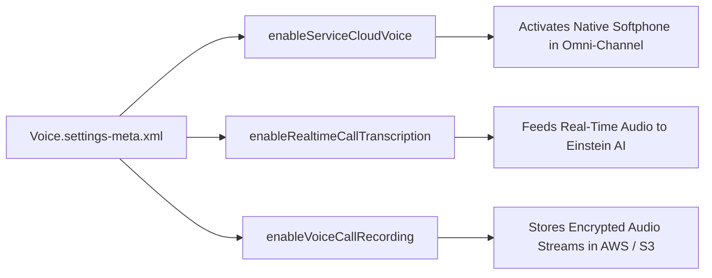

## Architectural Overview

The `VoiceSettings` metadata type manages organization-level telephony configurations for Salesforce Service Cloud Voice. Traditionally, computer telephony integration (CTI) relied on fragile browser popups and disjointed third-party softphones. Service Cloud Voice unifies phone channels natively inside the Salesforce console, integrating directly with telephony providers like Amazon Connect or Bring Your Own Telephony (BYOT) partners.

From an enterprise contact center architecture perspective, `VoiceSettings` serves as the programmatic foundation that activates audio streaming, enables real-time speech-to-text transcription for Einstein Conversation Insights, and governs compliance recording controls. Automating these settings across CI/CD environments ensures that omni-channel routing and telephony behaviors remain uniform across all developer and staging environments.



## Directory and File Conventions

In Salesforce DX project structures, `VoiceSettings` is stored as a singleton settings file in the `settings/` directory.

| Property | Value |
| :--- | :--- |
| **Metadata Type Name** | `Settings` (member: `Voice`) / `VoiceSettings` |
| **SFDX Folder** | `force-app/main/default/settings/` |
| **File Name** | `Voice.settings-meta.xml` |
| **Scratch Org Setting Key** | `voiceSettings` |

## Key Metadata Fields

The `VoiceSettings` XML schema defines the following core telephony parameters:

| Field Name | Field Type | Required | Architectural Description |
| :--- | :--- | :--- | :--- |
| `enableServiceCloudVoice` | `boolean` | No | Master switch enabling Service Cloud Voice telephony capabilities org-wide. |
| `enableRealtimeCallTranscription` | `boolean` | No | Enables real-time audio transcription streaming into the VoiceCall record. |
| `enableVoiceCallRecording` | `boolean` | No | Authorizes automated recording and storage of inbound and outbound customer calls. |
| `enableVoiceConferencing` | `boolean` | No | Allows contact center agents to initiate multi-party telephony conferences and transfers. |

> [!NOTE]
> Service Cloud Voice requires active Contact Center and Service Cloud Voice add-on licenses in the target Salesforce organization.

## Declarative XML and Package Manifest Examples

Below is an enterprise XML declaration configured for real-time contact center intelligence:

```xml title="force-app/main/default/settings/Voice.settings-meta.xml"
<?xml version="1.0" encoding="UTF-8"?>
<VoiceSettings xmlns="http://soap.sforce.com/2006/04/metadata">
    <enableRealtimeCallTranscription>true</enableRealtimeCallTranscription>
    <enableServiceCloudVoice>true</enableServiceCloudVoice>
    <enableVoiceCallRecording>true</enableVoiceCallRecording>
    <enableVoiceConferencing>true</enableVoiceConferencing>
</VoiceSettings>
```

### Scratch Org Configuration (`project-scratch-def.json`)

To enable telephony features in partner or developer scratch orgs:

```json title="config/project-scratch-def.json"
{
  "orgName": "Voice Contact Center Dev",
  "edition": "Enterprise",
  "features": ["ServiceCloudVoice"],
  "settings": {
    "voiceSettings": {
      "enableServiceCloudVoice": true,
      "enableRealtimeCallTranscription": true,
      "enableVoiceCallRecording": true
    }
  }
}
```

### Manifest Definition (`package.xml`)

```xml title="manifest/package.xml"
<?xml version="1.0" encoding="UTF-8"?>
<Package xmlns="http://soap.sforce.com/2006/04/metadata">
    <types>
        <members>Voice</members>
        <name>Settings</name>
    </types>
    <version>68.0</version>
</Package>
```

## CLI Retrieval and Deployment Commands

Manage `VoiceSettings` using standard Salesforce CLI commands:

```bash
# Retrieve Voice settings from the target org
sf project retrieve start --metadata Settings:Voice

# Deploy Voice settings to a staging or production org
sf project deploy start --metadata Settings:Voice --target-org prod-voice
```

## Architect Best Practices and Gotchas

- **Contact Center Certificate Dependencies:** Deploying `VoiceSettings` enables the platform; however, contact centers must be paired with Amazon Connect instances and AWS Identity and Access Management (IAM) role trusts.
- **Data Residency and Recording Privacy:** Telephony call recordings frequently contain sensitive customer audio. Verify that audio storage buckets comply with regional data sovereignty standards (e.g., GDPR, CCPA).
- **Omni-Channel Flow Orchestration:** Pair `VoiceSettings` with Omni-Channel Flows to dynamically route inbound phone calls based on customer tier and agent skill matrices.

> [!TIP]
> Enable real-time transcription to unlock Einstein Next Best Action recommendations and automated call summarization for frontline service agents.
