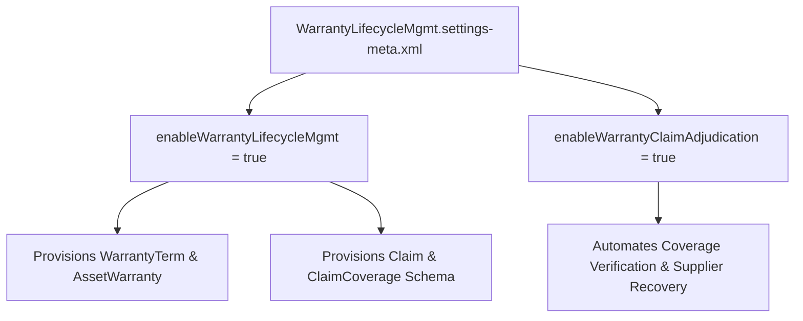

## Architectural Overview

The `WarrantyLifecycleMgmtSettings` metadata type controls organizational settings for Warranty Lifecycle Management within Salesforce Manufacturing Cloud and Automotive Cloud. Complex manufacturing operations—spanning heavy machinery, automotive components, and industrial equipment—require rigorous warranty tracking to protect profit margins, maintain customer trust, and enforce supplier cost recovery.

Enabling `WarrantyLifecycleMgmtSettings` provisions the core data schema required to track warranty terms, manage asset coverage timelines, process service claims, and adjudicate reimbursement requests. Automated deployment of these settings via Salesforce DX ensures that multi-tiered sandboxes and scratch orgs replicate production warranty rules without manual setup intervention.



## Directory and File Conventions

In Salesforce DX project structures, `WarrantyLifecycleMgmtSettings` is managed as a singleton setting file located in the `settings/` folder.

| Property | Value |
| :--- | :--- |
| **Metadata Type Name** | `Settings` (member: `WarrantyLifecycleMgmt`) / `WarrantyLifecycleMgmtSettings` |
| **SFDX Folder** | `force-app/main/default/settings/` |
| **File Name** | `WarrantyLifecycleMgmt.settings-meta.xml` |
| **Scratch Org Setting Key** | `warrantyLifecycleMgmtSettings` |

## Key Metadata Fields

The `WarrantyLifecycleMgmtSettings` XML schema includes the following administrative flags:

| Field Name | Field Type | Required | Architectural Description |
| :--- | :--- | :--- | :--- |
| `enableWarrantyLifecycleMgmt` | `boolean` | No | Master switch enabling Warranty Lifecycle Management and provisioning warranty objects. |
| `enableWarrantyClaimAdjudication` | `boolean` | No | Activates automated claim adjudication and coverage validation workflows. |
| `enableAssetWarrantyAutoAssignment` | `boolean` | No | Automatically assigns standard warranty terms upon new asset creation. |
| `enableSupplierRecoveryTracking` | `boolean` | No | Enables tracking warranty claim recovery and reimbursement from component suppliers. |

> [!NOTE]
> Deploying `WarrantyLifecycleMgmtSettings` requires an active Manufacturing Cloud or Automotive Cloud license in the target org.

## Declarative XML and Package Manifest Examples

Below is an enterprise XML declaration configured for automated industrial claim processing:

```xml title="force-app/main/default/settings/WarrantyLifecycleMgmt.settings-meta.xml"
<?xml version="1.0" encoding="UTF-8"?>
<WarrantyLifecycleMgmtSettings xmlns="http://soap.sforce.com/2006/04/metadata">
    <enableAssetWarrantyAutoAssignment>true</enableAssetWarrantyAutoAssignment>
    <enableSupplierRecoveryTracking>true</enableSupplierRecoveryTracking>
    <enableWarrantyClaimAdjudication>true</enableWarrantyClaimAdjudication>
    <enableWarrantyLifecycleMgmt>true</enableWarrantyLifecycleMgmt>
</WarrantyLifecycleMgmtSettings>
```

### Scratch Org Configuration (`project-scratch-def.json`)

```json title="config/project-scratch-def.json"
{
  "orgName": "Manufacturing Warranty Dev",
  "edition": "Enterprise",
  "features": ["ManufacturingUser"],
  "settings": {
    "warrantyLifecycleMgmtSettings": {
      "enableWarrantyLifecycleMgmt": true,
      "enableWarrantyClaimAdjudication": true,
      "enableSupplierRecoveryTracking": true
    }
  }
}
```

### Manifest Definition (`package.xml`)

```xml title="manifest/package.xml"
<?xml version="1.0" encoding="UTF-8"?>
<Package xmlns="http://soap.sforce.com/2006/04/metadata">
    <types>
        <members>WarrantyLifecycleMgmt</members>
        <name>Settings</name>
    </types>
    <version>68.0</version>
</Package>
```

## CLI Retrieval and Deployment Commands

Manage `WarrantyLifecycleMgmtSettings` using standard Salesforce CLI commands:

```bash
# Retrieve settings from the target org
sf project retrieve start --metadata Settings:WarrantyLifecycleMgmt

# Deploy settings to an integration environment
sf project deploy start --metadata Settings:WarrantyLifecycleMgmt --target-org mfg-sandbox
```

## Architect Best Practices and Gotchas

- **Schema Dependencies in CI/CD:** Deploy `WarrantyLifecycleMgmt.settings-meta.xml` before deploying Custom Fields, Flows, or FlexiPages that reference `Claim`, `AssetWarranty`, or `WarrantyTerm`.
- **Claim Status Transitions:** Define robust validation rules or Flow orchestrations governing transitions through claim states (Draft, Submitted, Under Review, Approved, Rejected) to prevent unauthorized payouts.
- **Supplier Recovery Architecture:** Coordinate warranty recovery tracking with ERP integrations to ensure credit memos or vendor reimbursements synchronize back to financial ledgers.

> [!TIP]
> Combine warranty claim flows with Business Rules Engine (BRE) expression sets to automate complex multi-variable adjudication calculations.
