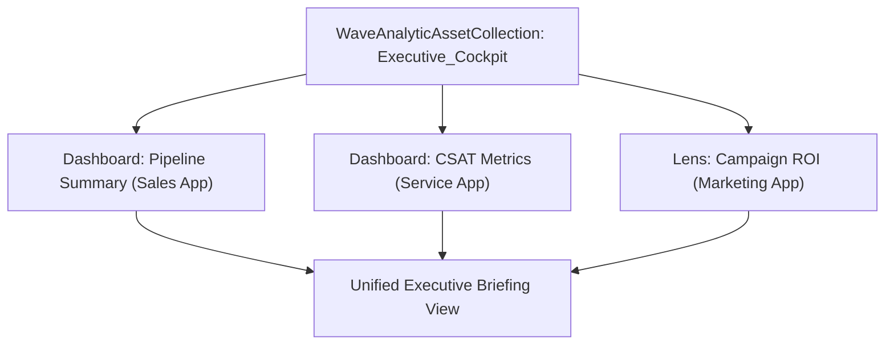

## Architectural Overview

The `WaveAnalyticAssetCollection` metadata type manages Collections within Salesforce CRM Analytics (formerly Tableau CRM / Einstein Analytics). In complex enterprises, analytics assets are naturally dispersed across multiple departmental Wave applications—such as Sales Performance, Service Operations, and Marketing Attribution. Executives and cross-functional leaders require a unified pane of glass without navigating across disparate analytics folders.

`WaveAnalyticAssetCollection` allows architects and analytics developers to curate related dashboards, lenses, and datasets into logical collections without duplicating underlying assets or altering existing application security boundaries. By storing these curated collections as version-controlled metadata, teams can automate their deployment through CI/CD pipelines alongside core CRM dashboards.



## Directory and File Conventions

In Salesforce DX project structures, `WaveAnalyticAssetCollection` definitions reside within the `waveAnalyticAssetCollections/` directory.

| Property | Value |
| :--- | :--- |
| **Metadata Type Name** | `WaveAnalyticAssetCollection` |
| **SFDX Folder** | `force-app/main/default/waveAnalyticAssetCollections/` |
| **File Suffix** | `.waveAnalyticAssetCollection-meta.xml` |

## Key Metadata Fields

The XML schema for `WaveAnalyticAssetCollection` defines the following properties:

| Field Name | Field Type | Required | Architectural Description |
| :--- | :--- | :--- | :--- |
| `masterLabel` | `string` | Yes | Human-readable title displayed in the CRM Analytics Studio Collections tab. |
| `developerName` | `string` | Yes | Programmatic API name referenced across analytics configurations. |
| `description` | `string` | No | Architectural description outlining intended audience and included assets. |
| `accessType` | `string` | Yes | Governs visibility, typically Private, Shared, or Public. |
| `assetList` | `string[]` | No | Array of developer names for included Wave Dashboards, Lenses, and Datasets. |

> [!NOTE]
> All dashboards and lenses referenced within `assetList` must exist in the target org or be included in the same deployment package.

## Declarative XML and Package Manifest Examples

Below is a declarative XML definition assembling an executive operations collection:

```xml title="force-app/main/default/waveAnalyticAssetCollections/Executive_Operations_Collection.waveAnalyticAssetCollection-meta.xml"
<?xml version="1.0" encoding="UTF-8"?>
<WaveAnalyticAssetCollection xmlns="http://soap.sforce.com/2006/04/metadata">
    <accessType>Shared</accessType>
    <description>Curated operational metrics spanning global revenue and customer escalations.</description>
    <developerName>Executive_Operations_Collection</developerName>
    <masterLabel>Executive Operations Collection</masterLabel>
</WaveAnalyticAssetCollection>
```

### Manifest Definition (`package.xml`)

```xml title="manifest/package.xml"
<?xml version="1.0" encoding="UTF-8"?>
<Package xmlns="http://soap.sforce.com/2006/04/metadata">
    <types>
        <members>Executive_Operations_Collection</members>
        <name>WaveAnalyticAssetCollection</name>
    </types>
    <version>68.0</version>
</Package>
```

## CLI Retrieval and Deployment Commands

Retrieve and deploy `WaveAnalyticAssetCollection` using standard Salesforce CLI commands:

```bash
# Retrieve all asset collections
sf project retrieve start --metadata WaveAnalyticAssetCollection

# Retrieve a specific collection definition
sf project retrieve start --metadata WaveAnalyticAssetCollection:Executive_Operations_Collection

# Deploy collection to a staging sandbox
sf project deploy start --metadata WaveAnalyticAssetCollection:Executive_Operations_Collection --target-org analytics-dev
```

## Architect Best Practices and Gotchas

- **Dependency Sequencing in CI/CD:** Deploy all underlying `WaveApplication`, `WaveDashboard`, and `WaveLens` components before or alongside `WaveAnalyticAssetCollection` to prevent broken reference errors.
- **Granular Sharing Strategies:** Set collection `accessType` according to target role hierarchies so confidential revenue metrics are restricted to executive stakeholders.
- **Governance Across Release Branches:** Maintain collection definitions in source control to ensure curated home screens remain consistent when refreshing developer sandboxes from production.

> [!TIP]
> Pin critical collections to the CRM Analytics home screen to drive executive adoption and eliminate manual dashboard searching.
